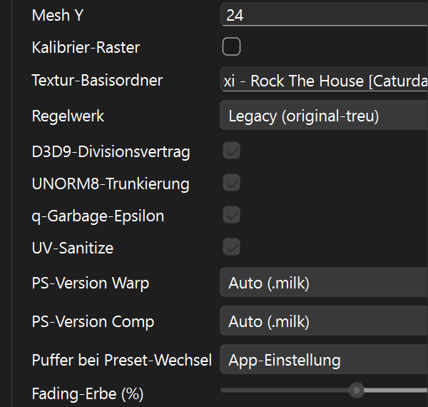
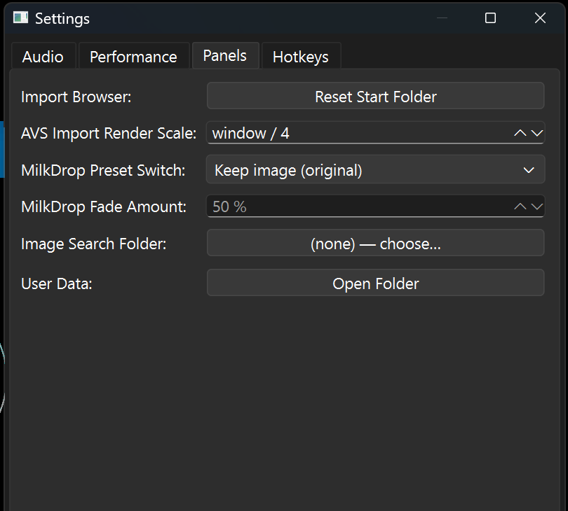
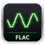

# LumiViz — Benutzerhandbuch

> **Version:** 1.144.0
> **Datum:** 2026-10-13
> **Typ:** Benutzerhandbuch
> **Status:** Aktiv
> **Zielgruppe:** Anwender
> **Sprache:** Deutsch

LumiViz ist ein Audio-Player mit Echtzeit-Visualisierung: Musik abspielen,
zuschauen, und jede Stufe der Visualisierung live verstellen. Dieses Handbuch
beschreibt die Bedienung der App als Ganzes; die Detail-Bedienung des
Konfigurations-Panels steht im
[ConfigPanel-Guide §2](ui/ConfigPanel_Guide.md#2-bedienung).

---

## Inhaltsverzeichnis

1. [Der erste Blick](#1-der-erste-blick)
2. [Musik abspielen (Player)](#2-musik-abspielen-player)
3. [Playlist verwalten](#3-playlist-verwalten)
4. [Visualizer auswählen](#4-visualizer-auswählen)
5. [Visualizer konfigurieren](#5-visualizer-konfigurieren)
6. [Vollbild](#6-vollbild)
7. [Fenster-Layout (Docking)](#7-fenster-layout-docking)
8. [Einstellungen & Frame-Modus](#8-einstellungen--frame-modus)
9. [Tastenkürzel](#9-tastenkürzel)
10. [Automatisch gemerkt / Bekanntes](#10-automatisch-gemerkt--bekanntes)
11. [Effektketten, Milkdrop & Host-Gruppen](#11-effektketten-milkdrop--host-gruppen)
12. [Shadertoy](#12-shadertoy)
13. [Video & Kamera als Quelle](#13-video--kamera-als-quelle)
14. [Stilfilter (Pixel Filter)](#14-stilfilter-pixel-filter)
15. [Composer](#15-composer)
16. [Loop](#16-loop)
17. [Dateitypen und ihre Icons](#17-dateitypen-und-ihre-icons)
18. [Mit einer Datei starten — und immer nur ein LumiViz](#18-mit-einer-datei-starten--und-immer-nur-ein-lumiviz)

---

## 1. Der erste Blick

```
┌───────────────────────────────────────────────┬──────────────┐
│ Menü: File · Edit · View · Settings · Help    │              │
├───────────────────────────────────────────────┤  Seitentabs  │
│                                               │  (Auto-Hide) │
│         Visualizer (zentrale Ansicht)         │  Visualizer  │
│                                               │  Config      │
│                                               │  Playlist    │
├───────────────────────────────────────────────┤  Visualizers │
│ Player (Dock unten)                           │              │
├───────────────────────────────────────────────┴──────────────┤
│ Statusleiste: Meldungen · FPS-Anzeige (rechts)                │
└───────────────────────────────────────────────────────────────┘
```

Die Panels sind **andockbare Fenster** (siehe §7): am Rand als schmale
Seitentabs geparkt, per Klick ausklappbar, frei verschieb- und abdockbar.
Die FPS-Anzeige rechts unten zeigt die Bildrate des Haupt-Visualizers.

## 2. Musik abspielen (Player)

Das **Player-Panel** steuert die Wiedergabe:

| Element | Funktion |
|---|---|
| ⏮ / ⏭ | Voriger / nächster Track der Playlist |
| ▶ / ⏸ | Wiedergabe starten / pausieren |
| ⏹ | Stopp (zurück an den Trackanfang) |
| Loop-Taste | **Aktuellen Track** wiederholen (leuchtet bei aktiv) |
| Resume-Taste (⏩) | **Resume playback**: nach dem Neustart dort weiterspielen (leuchtet bei aktiv) |
| Fortschrittsbalken | Anfassen und ziehen = Spulen (Seek) |
| 🔇 + Lautstärkeregler | Stummschalten / Lautstärke |
| **Mute** | Den Ton für eine Durchsage absenken und zurückholen — nach einem Mute-Profil (siehe unten) |

Musik kommt über die Playlist (§3) in die App — Titel dort doppelklicken
startet die Wiedergabe.

**Mute für Durchsagen:** Der Knopf **Mute** rechts neben dem Lautstärkeregler
senkt den Ton weich ab; noch einmal gedrückt, kommt er weich zurück. Solange
abgesenkt ist, leuchtet der Knopf. Es gibt ihn zweimal — hier und im Panel
Composer (§15) —, beide zeigen denselben Zustand, und er wirkt auf alles, was
zu hören ist: auf die Playlist ebenso wie auf eine laufende Komposition. Der
Lautsprecher-Knopf (🔇) daneben bleibt das einfache, sofortige Stummschalten.

Wie der Ton weggeht und wiederkommt, bestimmt das **Mute-Profil**:

- **Level while muted** — worauf abgesenkt wird, 0 bis 100 %. 0 % ist stumm;
  20 % lässt die Musik leise unter der Stimme weiterlaufen.
- **Fade out** und **Fade in** — je die Dauer und die Kurvenform (dieselben
  Formen wie die Blenden im Composer). 0 s = sofort.
- **Visuals follow** — aus (Vorgabe): das Bild reagiert weiter auf die volle
  Musik. An: es beruhigt sich mit dem Ton.

**Rechtsklick auf den Knopf** wählt das Profil; mitgeliefert sind
*Announcement* (auf 20 %), *Soft mute* (weich auf 0 %) und *Hard mute*
(sofort). *Edit mute profiles...* öffnet den Dialog: Profil wählen, Werte
einstellen, mit **Save As...** als eigenes Profil speichern (es ist danach
gewählt), eigene mit **Delete** löschen. Ohne gewähltes Profil gilt die
Vorgabe: in 0,4 s auf 0 %, in 0,8 s zurück. Ein gewechseltes Profil gilt ab
dem nächsten Drücken. Wird mitten im Absenken wieder gedrückt, geht es ohne
Sprung zurück.

Der Mute wird nicht gespeichert: nach einem Neustart ist der Ton voll da. Für
eine Absenkung an einer **festen Stelle** einer Komposition ist die Zeile
AUDIO des Composers da (§15).

**Resume playback** (auch unter **Settings → Audio**): Beendest du LumiViz,
**während ein Titel läuft**, spielt der nächste Start denselben Titel an
derselben Stelle weiter. Warst du beim Beenden auf Pause oder Stopp, bleibt es
still. Steht der Titel noch in der Playlist, läuft er von dort (und danach
normal weiter zum nächsten); fehlt die Datei inzwischen, passiert nichts.
Festgehalten wird der Stand beim geordneten Beenden — nach einem Absturz gilt
der vom letzten Beenden davor.

**Ziehen zum Abspielen** (seit Session 84): Zieh eine Audiodatei (aus dem
Audio Browser oder dem Explorer) oder einen **Playlist-Eintrag** auf das
Player-Panel **oder auf das Bild der Visualisierung**. Ein Playlist-Eintrag
wird direkt angesprungen; eine Datei, die schon in der Playlist steht, ebenso
— sonst wird sie angehängt und gespielt. Der Eintrag bleibt dabei in der
Playlist (es wird nie verschoben).

## 3. Playlist verwalten

Das **Playlist-Panel** führt die Titelliste:

- **Add files** — Audiodateien hinzufügen (Mehrfachauswahl möglich).
- **Doppelklick** auf einen Titel — abspielen.
- **Remove selected / Clear** — Auswahl entfernen bzw. Liste leeren.
- **Save / Load** — Playlist als Datei sichern/laden
  (**M3U/M3U8**, PLS, JSON).
- **Shuffle-Modus** — nächster Titel wird zufällig gewählt (mischt die Liste
  nicht um).
- **Loop-Playlist** — nach dem letzten Titel geht es vorn weiter.
- **Ziehen** (seit Session 84): Titel in der Liste verschieben (auch
  mehrere), Audiodateien aus dem **Audio Browser** oder dem Explorer an eine
  bestimmte Stelle fallen lassen, Titel hinaus auf Player oder Visualisierung
  ziehen (§2). *Behoben:* Verschieben änderte früher nur die Anzeige — danach
  spielte ein Doppelklick den falschen Titel.

### Tag View

**View → Panels → Tag View** zeigt, was LumiViz aus dem laufenden Titel liest:
**Title**, **Artist**, **Album**, **Year**, **Genre**, **Track**, dazu **File**
und **Format** (Dauer) — und darüber das **Cover** in größerer Vorschau
(eingebettet, sonst das Ordnerbild). Ein fehlender Tag steht als „—" da. Die
Werte lassen sich markieren und kopieren. Es sind dieselben, die der
Text-Knoten in seine Vorlagen einsetzt (`{title}`, `{artist}` …) — das Panel
zeigt also auch, warum eine Vorlage leer bleibt. Ändern lassen sich die Tags
hier nicht.

Darunter steht der **Songtext** des laufenden Titels, so wie ihn der
Lyrics-Knoten führt: die Zeile **Lyrics** nennt Quelle, *synced* oder *not
synced* und die Zeilenzahl, das Feld darunter den Text ohne Zeitmarken (nur
lesen, markieren und kopieren). Ein online geholter oder über
**Alternatives…** gewählter Text erscheint von selbst, sobald er da ist. Ohne
Text steht dort *No lyrics for this track*.

### Audio Browser

**View → Panels → Audio Browser** zeigt einen Ordner mit Musik, wie der
Effect Browser die Presets: Unterordner zum Hineingehen, darunter alle Dateien,
die die Audio-Engine abspielen kann (samt den Formaten der geladenen
BASS-Plugins). Als Icon steht das **Albumcover**: zuerst das in der Datei
eingebettete (MP3/ID3, FLAC, M4A — bei mehreren Bildern das Frontcover),
sonst ein Cover-Bild im Ordner (`cover`, `folder`, `front`, `albumart…` als
`.jpg`/`.png`), sonst ein Icon der Formatfamilie (MP3, WAV/AIFF, FLAC u. ä.,
OGG/Opus, M4A/AAC, sonstige). Die Cover erscheinen nach und nach — ein großer
Ordner bleibt dabei bedienbar. Ogg/Opus-Cover werden noch nicht gelesen.

- **Doppelklick** — an die Playlist hängen und abspielen (steht der Titel
  schon drin: dorthin springen).
- **Ziehen** — in die Playlist (an die Stelle), auf Player oder
  Visualisierung (abspielen). Mehrfachauswahl geht.
- **Loops** (`.lvloop`, §16) stehen hinter den Songs, mit einem Kreispfeil als
  Icon. Ein **Doppelklick** lädt den Loop ins Panel **Loop** und holt es nach
  vorn — in die Playlist kommt er nicht, er ist kein Song. **Ziehen** lässt er
  sich in einen Audio-Kanal des Composers (§15); Playlist, Player und
  Visualisierung nehmen ihn nicht an.
- Der zuletzt geöffnete Ordner wird gemerkt; beim ersten Mal öffnet der
  Musik-Ordner von Windows.
- **Der laufende Titel** ist markiert, wenn der Browser seinen Ordner zeigt.
  Der Browser wechselt nie von selbst den Ordner; der Knopf **◎** neben der
  Ordnerwahl springt in den Ordner des laufenden Titels und markiert ihn (ein
  Suchtext, der ihn verdeckt, wird dabei gelöscht) — wie im Effect Browser.

**Session-Playlist:** Beim Beenden wird die aktuelle Playlist automatisch
gespeichert und beim nächsten Start wiederhergestellt (inklusive Position in
der Liste, ohne Autostart). Es gibt nichts zu tun — einfach schließen.

## 4. Visualizer auswählen

Im **Visualizers-Panel** stehen die verfügbaren Visualisierungen
(Pulsing, Equalizer, Waveform, Oscilloscope, Superscope), gruppiert nach
Kategorie und mit Kurzbeschreibung. Auswahl markieren → **Apply** — die
zentrale Ansicht wechselt sofort.

**Mehrere Visualizer gleichzeitig:** *View → New Visualizer* (Ctrl+N) öffnet
ein weiteres Visualizer-Fenster als Tab bzw. Dock — jedes rendert unabhängig
mit eigener Bildrate; frei anordnen wie in §7 beschrieben.

## 5. Visualizer konfigurieren

Das **Visualizer-Config-Panel** zeigt alle Parameter des aktiven Visualizers,
gegliedert nach den Pipeline-Stufen (1 Audio/Analyse → 6 Post). Die
vollständige Bedienungsanleitung — Parametergruppen, Presets speichern/laden,
Farbverlaufs-Editor, Stufen-Vorschauen (Auge-Symbol im Gruppenkopf) — steht im
**[ConfigPanel-Guide §2](ui/ConfigPanel_Guide.md#2-bedienung)**.

Das Wichtigste in Kürze:

- Jede Änderung wirkt **sofort** im Bild.
- **Undo/Redo:** *Edit → Undo/Redo* (Ctrl+Z / Ctrl+Y) — Slider-Züge werden
  zu einem Schritt zusammengefasst.
- **Presets:** oben im Panel je Visualizer speichern/laden; „Default" setzt
  auf die Werkseinstellung zurück.
- **Live-Vorschauen** je Stufe über das Auge-Symbol einblenden (standardmäßig
  aus, kosten nichts solange ausgeblendet).

## 6. Vollbild

- **Rein:** Doppelklick auf die Visualizer-Fläche — oder *View → Fullscreen*
  (F11). Es erscheint NUR das Bild, randlos ohne Menü/Tabs/Panels.
- **Raus:** **Esc** oder erneuter Doppelklick.
- Bei mehreren Visualizern geht genau der **doppelt geklickte** in den
  Vollbildmodus (F11/Menü nehmen den Haupt-Visualizer).

## 7. Fenster-Layout (Docking)

Alle Panels und Visualizer-Fenster sind frei andockbar:

- **Verschieben:** Titelleiste ziehen — beim Ziehen erscheinen
  Andock-Zonen; loslassen dockt an, außerhalb entsteht ein
  **schwebendes Fenster**.
- **Tabs:** Zwei Docks übereinander ziehen stapelt sie als Tabs.
- **Auto-Hide:** Pin-Symbol in der Dock-Titelleiste parkt das Panel als
  Seitentab am Rand; Klick auf den Tab klappt es temporär aus.
- **Panels ein-/ausblenden:** *View → Panels*.
- **Perspektiven:** *View → Perspectives* — benannte Layouts speichern und
  umschalten; *Reset Layout* stellt das Standard-Layout wieder her,
  *Save Layout as Default* macht das aktuelle Layout zum Standard.
- Das Layout wird beim Beenden **automatisch gespeichert** und beim
  nächsten Start wiederhergestellt.

## 8. Einstellungen & Frame-Modus

**Settings-Panel** (Seitentab) mit sechs Reitern:

- **Audio:** Ausgabegerät wählen; Puffergröße (kleiner = weniger Latenz,
  größer = stabiler) und Samplerate.
- **Performance:** Frame-Modus und Ziel-FPS · **Graphics Card** — welche
  Grafikkarte LumiViz rendert (Automatic (Windows decides) / High Performance / Power Saving).
  Der Wert landet in der Windows-Grafikeinstellung und greift erst beim
  Prozessstart, deshalb **startet die App bei einer Änderung sofort neu**.
  Darunter zeigt *Active GPU* die tatsächlich benutzte Karte.
- **Panels:** **Effect Browser: Reset Start Folder** (Startordner zurücksetzen) — er springt danach in
  den **Programmordner**, wo der mitgelieferte Ordner `presets/` liegt (daneben liegt der Ordner
  `asset/` mit dem, was das Programm selbst liest: mitgelieferte Voreinstellungen, Shader-Vorlagen,
  Blenden, das Kit und die Instrumente des Loops, die Beispiel-Loops unter `asset/loop/` und die
  Datei-Icons — beide Ordner gehören zur App, eigene Dateien legt man dort nicht ab) · Render-Scale-Divisor
  für AVS-Importe · **Image and Texture Search Folders** (Suchordner für Bilder und Texturen) — eine
  Liste von Ordnern mit **Add...**, **Remove** und **▲ ▼**. Sie werden durchsucht, wenn die Bilder
  eines AVS-Presets (Picture, Texer, Texer II, AVI) oder die Texturen und Sprites eines
  MilkDrop-Presets nicht beim Preset und nicht in den Ordnern darüber liegen — von oben nach unten,
  bei MilkDrop in jedem Ordner auch unter `textures` und `sprites`. So findet ein Preset aus einer
  kleinen Auswahl die Bilder einer großen Sammlung an anderem Ort (meldet der Import „Texer II:
  image not found", fehlt hier der Ordner der Sammlung). Was beim Preset liegt, gilt immer zuerst.
  Eine Änderung wirkt beim nächsten Laden eines Presets. Ein Ordner, den es gerade nicht gibt, steht
  grau mit „(not found)" da. Der erste Ordner ist auch der Startordner der Bildauswahl in der
  Effektkette · **User Data: Open Folder** (Benutzerdaten-Ordner) — dort liegen
  deine eigenen Knoten-Voreinstellungen (`nodepresets/<typ>/`); der Ordner wird
  beim ersten Öffnen angelegt · daneben **Export...** und **Import...**: deine eigenen Daten
  in **eine Datei** (`.lvdata`) schreiben und wieder einlesen — zum Sichern oder für einen
  anderen Rechner. *Export your data* zeigt die Bereiche mit der Zahl deiner Dateien
  (Visualizer presets, Gradients, Module presets, Shader templates, Karaoke presets and
  trails, Composer fades, shapes, mutes, Shadertoy imports, Instruments, Samples); abgesetzt
  darunter und anfangs aus stehen *Settings* (Tastenkürzel, Favoriten, Optionen — nie die
  Fensterlage, gemerkte Ordner oder der Shadertoy-Schlüssel) und *Downloaded lyrics* (die
  geladenen Songtexte mit deinen Versätzen). *Import data* zeigt nur, was in der Datei
  steckt, und wie viele Namen es bei dir schon gibt; darunter wählst du, was dann geschieht:
  **Keep mine** (Vorgabe), **Replace mine**, **Keep both** (die importierte Datei bekommt
  eine Zahl an den Namen) oder **Let me decide for each file** — eine Liste mit beiden
  Dateien je Name, Datum und Größe, in der du anhakst, was bleibt. Eine importierte Datei,
  die deiner Byte für Byte gleicht, zählt nicht. Importierte *Settings* ersetzen deine und
  gelten nach einem Neustart. Nicht im Export: Loops, Kompositionen und Ketten, die du
  selbst irgendwo gespeichert hast, und die Testaufnahmen der Kamera. Die Datei ist ein
  Zip — umbenannt in `.zip` lässt sie sich mit jedem Werkzeug ansehen · **Chosen Sample
  Files** — was mit einer Tondatei geschieht, die du im Instrument-Creator über File...
  wählst: *Ask each time* (Vorgabe), *Copy to My samples* oder *Use it where it is*
  (§16, Instrument-Creator) · **MilkDrop Preset Switch** + **MilkDrop Fade
  Amount** — der App-Standard dafür, was beim MilkDrop-Preset-Wechsel mit dem
  geerbten Bild passiert (Details und die Regeln je Node: §11,
  „Preset-Wechsel: das geerbte Bild").
- **Editor:** wie **Beautify** im großen Code-Editor formatiert —
  *Beautify Indent Width* (Einzug), *Spaces around Operators* (nur EEL) und
  *Max. Blank Lines* (so viele Leerzeilen hintereinander bleiben stehen).
- **Camera:** Kamera-Clips aufnehmen und verwalten (Gerät, Dauer,
  *● Record Camera Clip*, Liste der *Camera clips*) — Details in §13.
- **Hotkeys:** Tastenbelegung je Aktion (siehe §9).

Der **Frame-Modus** (auch über *Settings → Frame Mode* im Menü) bestimmt die
Bildrate der Visualizer:

| Modus | Verhalten |
|---|---|
| **Limited (60 FPS)** | feste Zielrate, Standard — sparsam und gleichmäßig |
| **Unlimited** | so schnell wie möglich (Benchmark/Test) |
| **VSync** | synchron zur Bildwiederholrate des Monitors (z. B. 240 Hz) |

Die Oberfläche bleibt in allen Modi flüssig — das Rendering läuft von der
Bedienung entkoppelt.

## 9. Tastenkürzel

| Kürzel | Aktion |
|---|---|
| Ctrl+N | Neues Visualizer-Fenster |
| F11 | *Fullscreen* ein/aus (Haupt-Visualizer) |
| Esc | Vollbild verlassen |
| Ctrl+Z / Ctrl+Y | Parameter-Änderung rückgängig / wiederherstellen |
| Ctrl+O | *Open Audio…* (derzeit ohne Funktion, siehe §10) |
| Ctrl+Shift+N | *File → New Effect Chain* — leere Kette als Ausgangspunkt für ein neues Preset |
| Ctrl+S | *File → Save Effect Chain* — speichert in die laufende eigene Datei, ohne nachzufragen (sonst wie Save As, s. u.) |
| Ctrl+Shift+S | *File → Save Effect Chain As…* — fragt immer nach Ort und Namen |
| F1 | *About LumiViz* |
| Alt+F4 | Beenden |
| Ctrl+K | *Karaoke On / Off* — Songtext über jedem Preset ein- und ausschalten (umbelegbar; auch **View → Karaoke** und der Haken im Karaoke-Panel). Ruht, solange der Cursor in einem Textfeld oder im Skript-Editor steht — auch nach dem Umbelegen |

### Speichern und ungespeicherte Änderungen

**Save** schreibt ohne Dialog, wenn die Kette aus einer eigenen `.lvfx` oder
`.lvfx2` geladen oder dorthin gespeichert wurde. In allen anderen Fällen
öffnet auch Save den Dialog von **Save As…**: bei einer neuen Kette, bei
einem importierten `.avs` oder `.milk`, bei einem mitgelieferten Preset aus
dem Programmordner, und wenn sich die Endung ändern muss (eine Kette mit
Host-Gruppe ist `.lvfx2`, eine ohne `.lvfx`). Nach dem Speichern gilt die
gespeicherte Datei als laufendes Preset.

Hat die Kette **ungespeicherte Änderungen**, fragt LumiViz nach, bevor sie
ersetzt wird — bei *New Effect Chain*, beim Laden und Importieren über das
Menü, beim Doppelklick im Effect Browser, beim Blättern mit Bild ab/Bild auf,
beim Wechsel auf einen anderen Visualizer (Panel *Visualizers*) und beim
Beenden: **Save** (speichern, dann weiter), **Discard** (weiter ohne
Speichern), **Cancel** (zurück). Als Änderung zählt nur, was auch gespeichert
würde — ein Feld hin und zurück gestellt ist keine, ein frisch geladenes oder
importiertes Preset auch nicht. Im **Vollbild** verlässt LumiViz dafür erst
das Vollbild und fragt dann. Knoten-Voreinstellungen fragen nie nach: sie zu
laden und zu verändern ist eine Änderung an der Kette wie jede andere.

### Die Preset-Zeile

Die Panels **Effect Chain** und **Karaoke** tragen oben dieselbe Zeile:

- **Dropdown:** ganz oben das laufende Preset — mit einem `*` dahinter,
  solange es ungespeicherte Änderungen hat —, darunter deine **Favoriten**
  und die **zehn zuletzt benutzten**. Es zeigt nicht alle Dateien eines
  Ordners; dafür ist der Effect Browser da. Eine Auswahl **lädt sofort**
  (mit der Rückfrage oben, falls etwas ungespeichert ist). Das Mausrad über
  dem Dropdown wechselt nichts. Ein Eintrag, dessen Datei es nicht mehr gibt,
  steht grau da und fällt beim Anklicken aus der Liste.
- **+ New empty effect chain** (nur im Effect-Chain-Panel) steht immer direkt
  unter dem laufenden Preset: eine leere Kette für ein neues Preset — dasselbe
  wie **File → New Effect Chain** (Ctrl+Shift+N), mit derselben Rückfrage.
- **★** macht das laufende Preset zum Favoriten bzw. nimmt es wieder heraus.
- **Load…**, **Save**, **Save As…** tun dasselbe wie die Einträge im Menü
  File. **Load…** im Effect-Chain-Panel bietet dabei jedes Preset an —
  `.lvfx`, `.lvfx2`, `.avs` und `.milk` in einem Dialog; eine `.avs` oder
  `.milk` geht von dort an den passenden Import. Im Effect-Chain-Panel landet in „zuletzt" alles, was als Visual
  geladen oder gespeichert wurde (`.avs`, `.milk`, `.lvfx`, `.lvfx2`) — egal
  ob über Menü, Effect Browser oder die Zeile selbst. Das Karaoke-Panel führt
  eigene Listen für `.lvkar`.

**Favoriten im Effect Browser.** Dieselben Favoriten zeigt und setzt auch der
Effect Browser:

- Ein Favorit trägt in der Dateiliste ein **★** vor dem Namen.
- **Rechtsklick** auf ein Preset → **Add to favorites** bzw. **Remove from
  favorites** — ohne es zu laden. So lässt sich eine Sammlung durchsehen und
  nebenbei merken, was gefällt.
- In der Filter-Auswahl steht neben AVS, MilkDrop, LumiViz und All der Eintrag
  **★ Favorites**: er zeigt **alle Favoriten aus allen Ordnern** als eine
  Liste, nach Name geordnet (der Ordner steht im Tooltip), Karaoke-Presets
  eingeschlossen. Pfadzeile, „Up" und die Ordnerwahl ruhen in dieser Ansicht;
  ein anderer Filter bringt den Ordner von vorher zurück. Ein Favorit, dessen
  Datei es nicht mehr gibt, steht grau da und fällt beim Öffnen aus der Liste.

### Presets durchblättern

| Kürzel | Aktion |
|---|---|
| Bild ab | *Next Preset* im **aktiven Ordner des Effect Browsers** |
| Bild auf | *Previous Preset* |

`Bild ab` geht in der Liste nach unten, also **vorwärts**.

Geblättert wird über die Presets des Ordners, der im Effect Browser offen ist —
Unterordner werden übersprungen, am Ende des Ordners hält es an. Steht der
Effect Browser auf **★ Favorites**, blättern die Tasten stattdessen durch die
Favoriten (Karaoke-Presets werden übersprungen). Das Panel muss
dafür **nicht** sichtbar oder fokussiert sein. Während in einem Textfeld oder
Skript-Editor getippt wird, blättern die Tasten nicht, sondern verhalten sich
normal.

**Was läuft, und wo der Browser steht.** Der Effect Browser bleibt in dem
Ordner, in den du ihn gestellt hast — auch über den Neustart, und auch wenn
das laufende Preset von woanders kommt (Preset-Zeile, **File → Load**). Zeigt
er den Ordner des laufenden Presets, ist es in der Liste markiert. Der Knopf
**◎** neben der Ordnerwahl springt in den Ordner des laufenden Presets und
markiert es; verdeckt ein Typfilter, die Suche oder die Ansicht **★ Favorites**
es, löst der Knopf das. Geblättert wird immer in der Liste, die der Browser
zeigt.

**Beim Start** lädt LumiViz das Preset, das zuletzt lief — gleich, über
welchen Weg es geladen oder gespeichert wurde. Lief zuletzt eine neue Kette
ohne Namen, ist es das davor benannte; gibt es die Datei nicht mehr, das
mitgelieferte Start-Preset.

### Musikwiedergabe

In der Hotkey-Liste stehen diese Aktionen unter der Kategorie *Playback*, Vollbild
und Screenshot unter *View*.

| Kürzel | Aktion |
|---|---|
| Leertaste | *Play / Pause* |
| Ctrl+→ / Ctrl+← | *Next Song* / *Previous Song* |
| Ctrl+↑ / Ctrl+↓ | *Volume Up* / *Volume Down* (5 % je Anschlag) |

Diese Tasten wirken wie die Knöpfe des Player-Panels und funktionieren auch, wenn
das Panel nicht sichtbar ist.

### Screenshot of the Visual

`Druck` legt ein Bild **des Visuals** (ohne Panels) ab — in einem Ordner je
Programmlauf, benannt nach dem Startzeitpunkt:

```
…\asset\calibration\screenshot\2026-07-27_11-47-57\
    Alien Alloy_avs.png     das Bild
    Alien Alloy_avs.txt     der vollständige Pfad des Presets
```

Dieselbe Aufnahme mehrfach ergibt `_2`, `_3` — es wird nie überschrieben. Der
Zielordner lässt sich über den Einstellungsschlüssel `screenshot/baseDir`
verlegen; ohne Eintrag sucht die App den Projekt-Ordner `asset/calibration`.

> Öffnet `Druck` bei Dir das Windows-Snipping-Tool, ist das eine
> Windows-Einstellung. Dann in *Settings → Hotkeys* eine andere Taste
> vergeben.

**Im Vollbild** erscheint bei einem Fehler **kein** Meldungsfenster mehr:
stattdessen wird automatisch ein Screenshot aufgenommen und die Meldung an
`fehler.log` im selben Ordner angehängt. Im Fenster kommt weiterhin der Dialog.

### Eigene Belegung

*Settings → Hotkeys*: jede Aktion hat ein Aufnahmefeld, ein
*Default*-Knopf je Zeile und *All to defaults* für die ganze Liste. Eine
Taste, die schon vergeben ist, wird **abgelehnt** statt still umgehängt — erst
die andere Zuweisung freimachen. Die Transporttasten (Leertaste, Ctrl+Pfeile)
sind für die Musikwiedergabe reserviert und lassen sich nicht an Preset-Aktionen
vergeben.

## 10. Automatisch gemerkt / Bekanntes

**Automatisch gespeichert** (keine Aktion nötig):

- Fenster-Layout (Panels, Docks, Perspektiven)
- Session-Playlist inkl. aktueller Position
- Eingeblendete Stufen-Vorschauen je Visualizer

**Bekannte Einschränkungen:**

- *File → Open Audio…* (Ctrl+O) ist noch ohne Funktion — Dateien über die
  Playlist (**Add files**) hinzufügen.
- Im Preset-Dropdown des Config-Panels kann „Default" bei einzelnen
  Visualizern von der Start-Optik abweichen (bekannt beim Pulsing-Farbverlauf).

---

## 11. Effektketten, Milkdrop & Host-Gruppen

Der Visualizer **„Multi Effect"** rendert eine frei editierbare Effektkette.
Bearbeitet wird sie im Panel **View → Panels → Effect Chain**; Presets lädt
der **Effect Browser** (Panel rechts, bis Session 82 „Import Browser") per
Doppelklick — `.avs`, `.milk`, `.lvfx` und `.lvfx2`. Geladene `.avs`/`.milk`
werden beim Speichern zur `.lvfx`. Ein Preset aus dem Browser in den Baum
**gezogen** wird dort ein Presetverweis (s. Host-Gruppen).

### Ketten-Editor

- **Baum** = die Kette; das **Auge** (Spalte 2) blendet einen Effekt aus/ein.
- **Toolbar:** Typ im Dropdown wählen, **+** fügt in die selektierte
  Liste/Gruppe ein (sonst ans Ende), **−** entfernt, **⧉** klont,
  **↑/↓** sortiert; Drag & Drop verschiebt (auf eine Gruppe fallen lassen =
  hinein).
- Unter dem Baum: der **Eigenschafts-Editor** des selektierten Eintrags.
- **File → New Effect Chain** (`Ctrl+Shift+N`) beginnt mit einer leeren Kette —
  der Ausgangspunkt für ein eigenes Preset. Es wird vorher gefragt.

### Voreinstellungen je Knoten

Ganz oben im Eigenschafts-Editor steht die Zeile **Preset**. Sie gilt für
**jeden** Knotentyp — auch für Effect List, Movement oder eine Host-Gruppe.

- **Auswählen** lädt einen benannten Parametersatz. Mitgeliefertes steht ohne
  Zusatz in der Liste, Selbstgespeichertes mit `*`. Der Name **bleibt stehen**,
  solange du nichts änderst; ohne geladene Voreinstellung steht dort
  **(none)**.
- Sobald du danach etwas änderst (Regler, Formel, Farbe), zeigt die Zeile
  **(unsaved) – Name**: der Stand stammt von dieser Voreinstellung, ist aber
  nicht mehr derselbe. Name und Beschreibung des Knotens zählen nicht — sie
  gehören nicht zur Voreinstellung.
- **Save as…** fragt nach einem Namen und zeigt **jedes Feld des Knotens mit
  einem Häkchen**. Was du abwählst, kommt nicht in die Datei — und bleibt beim
  Laden unangetastet. So speicherst du „nur die Formeln, nicht die Farbe".
- **🗑** löscht eine eigene Voreinstellung — die gewählte oder, bei
  „(unsaved)", die, von der der Stand stammt. Mitgelieferte lassen sich nicht
  löschen.
- **Milkdrop-Elemente** haben seit Session 83 eine eigene Zeile: Markiere im
  Baum eine einzelne **Custom Wave**, **Custom Shape** oder ein **Sprite** —
  oben im Editor steht dann *Preset* für genau dieses Element. Mitgeliefert
  sind z. B. *Oscilloscope Line*, *Spectrum Circle* (Waves) und *Pulse With
  Bass*, *Slow Fade* (Shapes). Nummer und An/Aus des Elements bleiben beim
  Laden, wie sie sind.
- Auch die Milkdrop-Sektionen **Code** und **Parameters** tragen eine eigene
  Zeile. *Code*: kleine per_frame-/per_pixel-Bausteine (*Slow Rotation*,
  *Beat Zoom*, *Ripple (per pixel)* …) — ein Baustein setzt nur die Felder,
  die er braucht. *Parameters*: Stellungen der Basiswerte, der Gruppe *Styling* und
  der „bisher"-Schalter, z. B. **Original** (*Styling* aus, alle drei
  „bisher"-Schalter auf Original), **Old LumiViz Look (pre-S80)** (weicher Sog
  nach oben links samt *Soften* und die drei „bisher"-Stellungen — der
  Look bis Session 80 in einem Zug), *Soft Pull Up-Left*, *Radial Swirl*,
  *Mirror Echo*, *Modern Rules (IEEE)*.
- **Namen** der mitgelieferten Presets und Vorlagen sind englisch — wie die
  übrige Oberfläche.
- Die früheren **Template**-Listen bei **SuperScope 3D** und **3D Camera**
  sind jetzt ebenfalls Voreinstellungen dieser Zeile (gleiche Namen, z. B.
  *Spiral Galaxy*, *Orbit*) — und damit um eigene erweiterbar.
- Die **SuperScope-Figuren** (Spiral, Butterfly, Hypocycloid …) sind seit
  Session 53 solche Voreinstellungen — das frühere Dropdown „Figure" ist
  entfallen. Da sie nur die Formeln enthalten, behältst du beim Laden deine
  Farbtafel und Linienbreite.
- Seit Session 60/61 liefert die App einen **Grundkatalog von 125
  Voreinstellungen für 39 Knotentypen** mit: Bewegungs-Klassiker (u. a. die
  acht originalen AVS-Movement-Formeln wie *Big Swirl Out* und *6-way
  Kaleida*), Faltungskerne (*Blur*, *Sharpen*, *Edges*, *Emboss*),
  Farbverläufe (*Fire*, *Ocean*, *Neon*), Wasser-, Gitter-, Zoom-, Spiegel- und
  Beat-Vorlagen, die **Fraktal-Familie** (Mandelbrot-Ausschnitte, Mandelbulb,
  Plasma, Attraktoren, Reaktions-Diffusion), **Bloom** (inkl. der
  Lights-Referenzwerte) sowie sechs aus der Preset-Sammlung **geerntete
  Dynamic-Movement-Warps** (Quelle je Vorlage im Katalog genannt). Alles
  Teil-Presets: sie setzen nur die Felder, die den Charakter ausmachen. Der
  vollständige Katalog mit Erklärung je Vorlage steht in
  `asset/nodepresets/README.md`.

Eigene Voreinstellungen liegen im Benutzerdaten-Ordner (*Settings →
Panels → User Data: Open Folder*), mitgelieferte unter
`asset/nodepresets/`. Wer eine eigene weitergeben will, kopiert die Datei
dorthin.

### Werte per Formel steuern

Fast jeder Knoten hat unten drei EEL-Felder: **Init** (einmal), **Frame** (jedes
Bild) und **Beat** (bei jedem Beat). Darin lassen sich die Regler desselben
Knotens berechnen — etwa bei Rotating Stars:

```
Frame:  points = 5 + bass*8
```

Die schreibbaren Namen sind die Feldbezeichnungen in Kleinschreibung; dazu gibt
es `b` (Beat), `w`/`h` (Bildmaße) und den Audio-Satz (`bass`, `mid`, `treb`,
`vol` …). Eigene Variablen darfst du frei benennen — sie gelten innerhalb
**eines** Knotens über alle Slots hinweg. Zwischen Knoten wandern nur
`reg00..reg99`, `q1..q64` und `gmegabuf`.

Ein leeres Feld kostet nichts: ohne Formel läuft kein Skript.

Seit Session 85 lässt sich **jedes Zahl-, Schalter- und Auswahlfeld** eines
Knotens so steuern — auch bei Fraktalen, 3D-Knoten, Glow Orbs, Texer II &
Co. (dort etwa `type`, `smooth`, `blend`). Die ⓘ-Seite listet alle Namen.
Bewegst du einen Regler, während ein Skript läuft, **gilt ab da der Regler**
und das Skript rechnet von diesem Wert weiter — sein Zustand (Zähler, Phasen)
bleibt erhalten; früher begann das Skript bei jeder Reglerbewegung von vorn.

Seit Session 86 gilt das auch für **SuperScope** und **Effect List**:

- **SuperScope** — in Init, Frame und Beat sind `linewidth`, `dotsize`,
  `rendermode`, `lineblend`, `audiochannel`, `spectrumsource`,
  `colorcycleframes` und `pointcount` schreibbar. Die AVS-Namen behalten
  Vorrang: `n` bestimmt die Punktzahl (ein Schreiben auf `pointcount` wird an
  `n` weitergereicht), `linesize` und `drawmode` schlagen `linewidth` und
  `rendermode`. `colorcycleframes` wirkt ab dem nächsten Bild.
- **Effect List** — im Listen-Code (mit **Use list code**) sind `blendin`,
  `blendout`, `bufferin`, `bufferout`, `bufferininvert`, `bufferoutinvert`,
  `cleareveryframe`, `onbeatrender`, `onbeatframes` sowie `inadjustalpha` und
  `outadjustalpha` (0..255) schreibbar. `alphain`/`alphaout` (0..1) bleiben wie
  in AVS und gewinnen, wenn das Skript beide Schreibweisen benutzt.
- **Dynamic Movement** — in Init, Frame und Beat sind `wrap`, `nomove`,
  `subpixel`, `rectcoords` und `buffern` schreibbar. **Nicht** `blend` (viele
  AVS-Presets benutzen den Namen als eigene Variable) und nicht die
  Gittergröße `xres`/`yres`.
- **Host-Gruppe** — im Parameter-Skript der Gruppe zusätzlich zu
  `outadjustalpha` jetzt `blendout`, `curvein`, `curveout` und
  `crossfadeseconds` (wirkt ab dem nächsten Bild).
- **Host Switcher** — `intervalseconds`, `order` und `nextonsongchange`;
  **Switch after (s)** lässt sich auch mit dem **~**-Knopf modulieren.

- **Text** und **AVI** — haben jetzt eigene Felder **Init**, **Frame** und
  **Beat** (und Song). Text: `normspeed`, `onbeatspeed`, `onbeat`, `blend`,
  `randomword`, `insertblank` wirken sofort; Schrift, Farbe (`color_r/_g/_b`),
  Lage (`xshift`, `yshift`, `halign`, `valign`) und Kontur lassen den Text neu
  zeichnen und folgen dem Skript deshalb nur aus Init, Song und Beat. AVI:
  `blend`, `adapt`, `persist`, `speedms`.

Ohne Formelfelder und deshalb nicht per Skript steuerbar bleiben Movement
(nur die Bewegungsformel), Render Scale und Debug Bars.

**Text: Schrift wählen.** Das Feld **Font** ist eine Auswahlliste aller
installierten Schriften; ein Name lässt sich weiterhin eintippen (importierte
Presets nennen Schriften, die nicht installiert sein müssen — dann nimmt das
System die nächstliegende). Leer = Standardschrift. Das Häkchen **Bold** setzt
**Weight** auf 700 (aus: 400); gezeichnet wird fett ab Weight 600.

**Text: Titel und Interpret anzeigen.** Im Textfeld stehen Platzhalter für die
Tags des laufenden Titels — der Knopf **Insert tag** fügt sie an der
Schreibmarke ein:

| Platzhalter | Inhalt |
|---|---|
| `{title}` | Titel (ohne Tag: der Dateiname) |
| `{artist}` `{album}` `{year}` `{genre}` `{track}` | Interpret, Album, Jahr, Genre, Tracknummer |
| `{file}` | Dateiname ohne Pfad und Endung |

Eckige Klammern machen einen Teil **wahlfrei**: er verschwindet, wenn ein Tag
darin leer ist. `[{artist} – ]{title}[ ({year})]` ergibt „New Order – Blue
Monday (1983)", ohne Jahr „New Order – Blue Monday", ohne Interpret „Blue
Monday". Das `;` trennt weiterhin die Wörter: `{title};{artist};{album}` zeigt
die drei nacheinander. Gelesen werden ID3v2/ID3v1 (MP3), Vorbis-Kommentare
(Ogg, FLAC), APE und MP4. Ist kein Titel geladen, zeichnet eine reine
Tag-Vorlage nichts. Die Voreinstellung **Now Playing** bringt eine fertige
Zeile unten im Bild mit.

**Lyrics: Songtext zum laufenden Titel.** Der Knoten **Lyrics** (Effekt-Palette
→ Images) zeigt den Text des laufenden Titels. Den Text sucht LumiViz beim
Titelwechsel, in dieser Reihenfolge — synchron vor unsynchron, nah am Song vor
fern:

1. eingebetteter **synchroner** Text (ID3 `SYLT`, oder ein eingebetteter Text
   mit Zeitmarken)
2. `<Song>.lrc` neben dem Song
3. `<Interpret> - <Titel>.lrc` im Benutzerordner
   (`%APPDATA%\LumiViz Project\LumiViz\lyrics`)
4. eingebetteter unsynchroner Text (ID3 `USLT`, Vorbis `LYRICS`)
5. `<Song>.txt` neben dem Song
6. `<Interpret> - <Titel>.txt` im Benutzerordner

Synchron ist ein Text, sobald er Zeitmarken trägt (`[01:23.45]`) — die Endung
entscheidet nicht. Oben im Editor steht laufend als kleine Tabelle, was
gefunden wurde:

| Zeile | Inhalt |
|---|---|
| **Status** | *Lyrics loaded*, *No lyrics found …* oder, solange ein Online-Abruf läuft, *…downloading…* |
| **Source** | woher der Text stammt (eingebettet, Datei neben dem Song, Benutzerordner, LRCLIB) |
| **Timing** | *synced* oder *not synced* |
| **Lines** | Zeilenzahl |
| **Origin** | Herkunftsvermerk eines aus dem Netz geholten Texts |
| **File** | Name der gelesenen Datei (voller Pfad im Tooltip); **Open folder** öffnet ihren Ordner — bei eingebettetem Text gibt es keinen |

| Feld | Bedeutung |
|---|---|
| **Preview lines** | So viele kommende Zeilen stehen unter der laufenden (0–4), in **Color upcoming**. |
| **Preview size (%)** | Schriftgröße der Vorschau-Zeilen in Prozent der laufenden Zeile (10–400); ihre Zeilenhöhe geht mit. |
| **Preview weight (0 = as line)** | Gewicht der Vorschau-Zeilen: 0 = wie die laufende Zeile, sonst 400 normal oder 700 fett. |
| **Preview X shift / Y shift (%)** | Versatz der Vorschau-Zeilen gegen ihren gewohnten Platz, in Prozent von Breite und Höhe (negativ = nach links bzw. oben). Die laufende Zeile bleibt stehen. |
| **Line spacing (%)** | Zeilenabstand in Prozent der Schrifthöhe (50–400); 115 ist der Abstand bis Version 1.54. |
| **Word scale (%)** | Größe des Worts, das gerade gesungen wird, in Prozent der Zeile (50–400); 100 = aus. Wirkt nur bei Songtext **mit Wort-Zeiten** (`<mm:ss.xx>` im Text) — ohne sie gibt es kein laufendes Wort. |
| **Own word color** / **Word color** | Das laufende Wort in eigener Farbe statt in der Farbe der Stimme. Schon Gesungenes behält die Stimmfarbe, noch nicht Gesungenes **Color upcoming**. |
| **Word layout** | Wie das größere Wort in der Zeile sitzt: **Reflow** — die Nachbarn rücken zur Seite; **Overlay** — die Zeile bleibt stehen, das Wort wächst um seine Mitte und liegt über den Nachbarn (ruhiger, mit Lyrics Trail die bessere Wahl). |
| **Word flow (ms)** | Zeit, in der die Wortgröße gleitet (0–2000): das neue Wort wächst, während das vorige schrumpft — die Zeile gleitet, statt zu springen. 0 = harter Wechsel. |
| **Word spacing (%)** | Abstand zwischen den Worten in Prozent des Leerzeichens der Schrift (50–400, 100 = wie die Schrift ihn setzt). Gilt für jede Zeile, die laufende wie die Vorschau, mit und ohne Wort-Zeiten. Ein weiterer Abstand gibt dem vergrößerten Wort Luft zu seinen Nachbarn — vor allem mit **Word layout** Overlay, wo es sonst über ihnen liegt. Die Zeile wird damit breiter; passt die längste Zeile des Songs nicht mehr, wird die Schrift für den ganzen Song kleiner. Im Skript: `wordspacing` |
| **Color (voice 1)**, **Color voice 2**, **Color both voices** | Farbe der laufenden Zeile; bei Duetten je Stimme. Stimm-Marken am Zeilenanfang: `v1:`, `v2:`, `v1+v2:` (auch `M:`, `F:`, `D:`); eine Marke gilt bis zur nächsten. |
| **Blend** | Wie sich der Text mit dem Bild mischt: **Replace**, **Additive**, **50/50**, **Subtract**, **Invert** (weißer Text kehrt die Farbe darunter um), **XOR**, **Multiply**, **Maximum**, **Minimum** — dieselben Arten wie bei der Karaoke-Ebene (unten). Ab **Subtract** mischt nur die Füllung der Buchstaben, die Kontur bleibt normal; bei Replace, Additive und 50/50 mischt die Kontur wie bisher mit. Der **Lyrics Trail** hat dasselbe Feld. |
| **Timing offset (ms)** | Verschiebt synchronen Text für **alle** Titel: positiv = früher, negativ = später. Eine `[offset:…]`-Zeile in der Datei wirkt zusätzlich. |
| **Offset for this track** (eigene Zeile unter der Tabelle) | Derselbe Versatz, aber **nur für den laufenden Titel**. LumiViz merkt ihn sich je Titel (Interpret, Titel, Album, Dauer) in `offsets.json` im Benutzerordner der Songtexte; die Songtext-Datei wird dafür nicht angefasst, und er gilt auch für eingebetteten Text. Er zählt zu **Timing offset (ms)** und zu `[offset:…]` dazu. Dasselbe Feld steht als **Track offset** im Panel Lyrics Sync. |
| **Unsynced: beats per line** | Unsynchroner Text steht als Block; mit einem Wert > 0 rückt er alle N Beats eine Zeile weiter. |
| **Mark unsynced lyrics** | Schreibt „(not synced)" über einen unsynchronen Text — er läuft nicht zum Gesang. |

Synchroner Text läuft an der **Abspielposition** des Players, auch nach dem
Springen im Titel. Trägt die Datei Wort-Zeiten (`<01:23.80>` im Text), füllt
sich die laufende Zeile **Wort für Wort**. **Eine Schriftgröße je Song:**
passt die längste Zeile des Songtexts nicht in die Breite, wird die Schrift
für **alle** Zeilen so weit kleiner gesetzt, dass sie passt (höchstens auf die
Hälfte; was dann noch zu lang ist, wird einzeln weiter verkleinert). Der
Zeilenabstand geht mit, und die Zeilen stehen über den ganzen Song an
derselben Stelle. Schrift, Lage, Kontur und Formelfelder wie beim
Text-Knoten — dazu das Feld **Line**: es läuft **einmal bei jedem
Zeilenwechsel** (nach Song, vor Frame) und ist die Stelle für alles, was mit
der Zeile wechseln soll. Es liest
`line` (Nummer der laufenden Zeile, 0 = vor der ersten) und `linecount`; beide
stehen auch in den anderen Feldern bereit. Beispiele: `yshift = -6 - rand(8);`
(jede Zeile etwas anders hoch), `halign = line % 3;` (links, Mitte, rechts im
Wechsel). Auch Zurückspulen und ein neuer Titel gelten als Zeilenwechsel.
Das Feld **Word** läuft **einmal bei jedem Wortwechsel** (nach Line, vor
Frame) — nur bei Songtext mit Wort-Zeiten — und liest `word` (Nummer des
Worts, das gerade gesungen wird, 1 = erstes; 0 = keins oder keine
Wort-Zeiten) und `wordcount` (Worte der laufenden Zeile, ohne Wort-Zeiten am
Leerraum gezählt); auch sie stehen in allen Feldern bereit. Beispiel:
`yshift = -6 - word;` (die Zeile steigt mit jedem Wort).

**Unsynchronen Text per Skript weiterrücken.** Zwei Variablen rücken den
stehenden Block: `linetrigger = 1;` eine Zeile weiter, `wordtrigger = 1;` ein
Wort weiter (negativ: zurück). Beide gelten nur für den Frame, in dem sie
gesetzt werden — `linetrigger = b;` im Frame-Feld rückt also auf jeden Beat
eine Zeile. Für einen Text ist das zu schnell; eine Zeile auf jeden vierten
Beat: Init `n = 0;`, Frame
`n = n + b; linetrigger = if(b, equal(n % 4, 0), 0);`. Soll der Text nur in
einem festen Takt weitergehen, reicht **Unsynced: beats per line** ganz ohne
Skript — `linetrigger` ist für alles, was das Feld nicht kann (rückwärts, nur
unter einer Bedingung, im Wechsel mit `wordtrigger`). Der erste `wordtrigger` eines Titels schaltet den Wort-Stand ein:
Gesungenes in der Stimmfarbe, das laufende Wort nach **Word scale** und
**Word color**, der Rest in **Color upcoming**; `word` und das Feld Word
laufen dann mit. Nach dem letzten Wort einer Zeile beginnt die nächste Zeile
mit ihrem ersten Wort — `wordtrigger = b;` allein führt durch den ganzen
Text. Wer am Zeilenende halten will: `wordtrigger = if(below(word,
wordcount), b, 0);`. **Unsynced: beats per line** wirkt zusätzlich (auf 0
stellen, wenn das Skript rückt); am Textende bleibt der Block stehen. Bei
synchronem Text bestimmt die Abspielposition, die Auslöser wirken dort nicht.

**Was dem Skript wann folgt.** Lage, Größe und Farben — der laufenden Zeile
wie der Vorschau — folgen dem Skript aus **jedem** Feld, auch aus Frame: ein
Knoten mit Skript (oder Modulation) setzt seine Zeilen auf der Grafikkarte aus
einmal gezeichneten Worten zusammen, und Größe, Lage und Farbe kosten dabei
kein neues Zeichnen. Beispiel für einen Puls auf den Beat: Init
`ref = fontheight; p = 0;`, Frame
`p = if(b, 1, p * 0.93); fontheight = ref * (1 + p);`. Die Zahl bestimmt, wie
schnell der Puls abklingt: näher an 1 klingt er länger nach (0.85 ist nach
wenigen Bildern weg, 0.97 steht bei schneller Musik fast dauernd). Sie gilt je
Bild — bei höherer Bildrate klingt derselbe Wert schneller ab. Die Kontur
wächst dabei mit der Schrift. Nur fünf Felder lassen die Worte neu zeichnen und folgen dem Skript
deshalb allein aus Init, Song, Beat, Line und Word: **Weight**, **Italic**,
**Outline size**, **Preview weight** und **Word spacing**. Ein Knoten ohne Skript wird wie bisher
gezeichnet; an den Kanten der Buchstaben können sich beide Wege um Bruchteile
eines Pixels unterscheiden.
Die Karaoke-Ebene hat beide Felder im Reiter *Lyrics*. Voreinstellungen: feste Lagen (**Karaoke Bottom**, **Karaoke
Top**, **Karaoke Classic**, **Karaoke Neon**, **Big Centre**, **Three Lines
Left**, **Side Right**, **Subtitle Small**, **Verse Sheet**) und bewegte
Karaoke-Varianten, die per Skript arbeiten: **Karaoke Beat Colours** (neue
Farbe je Beat), **Karaoke Song Colours** (eine Farbe je Song), **Karaoke
Bounce** (Sprung je Beat, Weite im Init) und **Karaoke Flip** (wechselt alle
`flip_beats` Beats zwischen unten und oben). Eine Lyrics-Voreinstellung
ersetzt auch die Skriptfelder des Knotens.

**Songtexte aus dem Netz** (aus, bis du es einschaltest): **Settings → Audio →
Search lyrics online**. Findet LumiViz lokal keinen Text, fragt es dann den
Dienst lrclib.net — dabei gehen **Interpret, Titel, Album und Dauer** des
laufenden Titels an diesen Dienst. Gefragt wird nur, wenn Titel und Interpret
bekannt sind; ein Treffer verlangt, dass die Dauer auf zwei Sekunden passt.
Der Dienst ist oft beschäftigt und bittet dann um einen neuen Versuch: LumiViz
fragt für den laufenden Titel von selbst wieder (nach 2, 5, 10, 20 und 40
Sekunden) — so lange steht in der Tabelle *…downloading…*, der Text erscheint,
sobald er da ist. Ein
Fund wird gespeichert, damit beim nächsten Mal nichts mehr hinausgeht:
**Save fetched lyrics** wählt den Ort — **User folder**
(`%APPDATA%\LumiViz Project\LumiViz\lyrics`, Vorgabe) oder **Next to the song** (gleicher Name
wie der Song, `.lrc` für synchronen, `.txt` für unsynchronen Text; ist der
Ordner schreibgeschützt, landet der Fund im Benutzerordner). Die Rechte an den
Texten liegen bei Dritten; sie sind für den eigenen Gebrauch gedacht.

**Falscher Text?** Unter der Tabelle im Editor stehen die Knöpfe in zwei
Reihen — oben **Alternatives…** und **Wrong lyrics**, darunter **Lyrics
file…** und **Open folder** (öffnet den Ordner der gezeigten Datei):

- **Alternatives…** sucht bei lrclib.net nach anderen Fassungen. Titel und
  Interpret sind aus den Tags vorbelegt und lassen sich ändern — nützlich bei
  Zusätzen wie „(Feat. …)" oder „(album version)". Die Liste zeigt Album,
  Dauer (mit Abweichung zur Datei), ob der Text synchron ist und die
  Zeilenzahl; die Fassung mit der passendsten Dauer steht oben, die gerade
  gezeigte ist **fett** und trägt den Vermerk *shown now*. Darunter steht der
  Text mit seinen Zeitmarken (farbig abgesetzt). Markierst du bis zu **drei**
  Einträge (Ctrl oder Shift), stehen sie nebeneinander. Läuft der Titel,
  zeigt ein Balken in jeder Spalte, wo der Song gerade ist (**Follow
  playback** hält die Stelle im Blick) — so siehst du, welche Fassung zum
  Gesang passt. Der Griff zwischen Liste und Texten teilt die Höhe.
  Ganz oben stehen Titel, **Länge** der Datei und die laufende Spielzeit —
  die Länge ist der Maßstab für die Spalte Duration. Wechselt der Song,
  bleibt das Fenster beim bisherigen Titel, sagt aber, was jetzt läuft, und
  bietet **Switch to the playing track** an.
  **Use these lyrics** über einer Spalte ersetzt die gespeicherte Fassung;
  die bisherige wird dabei nicht gesperrt, das Fenster bleibt offen. Die
  Suche sendet die beiden Suchbegriffe an den Dienst, auch wenn die
  selbsttätige Online-Suche aus ist.
- **Wrong lyrics** verwirft den gezeigten Text: die geholte Datei wird
  gelöscht und der Eintrag **gesperrt**, er wird nicht wieder geholt. Danach
  öffnen sich die Alternativen. Der Knopf gilt nur für online geholte Texte;
  eine selbst angelegte Datei wird nie gelöscht.

- **Lyrics file…** weist dem laufenden Titel eine vorhandene `.lrc`- oder
  `.txt`-Datei zu. Sie wird **unverändert kopiert** — in den Benutzerordner
  der Songtexte, unter `<Interpret> - <Titel>` (mit `.lrc`, wenn sie
  Zeitmarken trägt, sonst `.txt`); das Original bleibt, wo es ist. Eine dort
  schon liegende Datei dieses Namens wird ersetzt. Der Text erscheint sofort.
  Die Suchreihenfolge gilt weiter: hat der Titel einen eingebetteten
  synchronen Text oder liegt eine `.lrc` neben dem Song, gewinnt diese —
  LumiViz sagt dir dann, welche Quelle stattdessen gezeigt wird.

Die Sperrliste steht unter **Settings → Audio → Blocked lyrics** (**Show…**);
**Unblock** gibt einen Eintrag wieder frei. Sie liegt als `blocked.json` im
Benutzerordner der Songtexte.

**Kein Text beim Dienst?** Hat lrclib.net zu einem Titel nichts — unbekannt,
ohne Text eingetragen oder keine Fassung mit passender Dauer —, merkt sich
LumiViz das und fragt für diesen Titel **7 Tage** nicht wieder (bei als
instrumental eingetragenen Titeln **30 Tage**). In der Tabelle steht dann
gleich *No lyrics found — not online either.*, ohne dass etwas hinausgeht.
Danach wird von selbst wieder gefragt, denn der Dienst trägt fehlende Titel
nach. Sofort wieder fragen: **Settings → Audio → Lyrics not found → Ask
again** vergisst alle gemerkten Titel; dasselbe geschieht, wenn du in der
Sperrliste einen Eintrag freigibst. **Alternatives…** sucht immer, unabhängig
davon. War der Dienst nur beschäftigt oder das Netz weg, wird nichts gemerkt.
Die Merker liegen als `notfound.json` im Benutzerordner der Songtexte.

**Nachsynchronisieren: Panel „Lyrics Sync"** (View → Panels). Macht aus einem
unsynchronen Text einen synchronen, oder stellt einen synchronen nach. Das
Panel zeigt den Text des laufenden Titels als Liste mit den Spalten **Time**,
**Voice** und **Text**; die Zeile an der Abspielposition steht fett. Darüber läuft die
**Spielzeit** mit, und eine **Wellenform** zeigt vier Sekunden vor und nach
der Abspielposition (rote Marke in der Mitte). Die senkrechten Striche darin
sind die Zeiten der Zeilen, die markierte ist hervorgehoben — so siehst du, ob
ein Strich auf dem Einsatz sitzt. Unter der Wellenform liegt die
**Sprungleiste**: sie reicht über den ganzen Titel und läuft mit.

| Bedienung | Wirkung |
|---|---|
| **Tap** (oder Enter bzw. T) | gibt der markierten Zeile die Abspielposition und rückt zur nächsten Textzeile. Enter und T gelten im ganzen Panel — auch nach einem Klick in den Wort-Streifen, auf einen Schalter oder einen Schieber —, nur nicht in den Eingabefeldern (**Track offset**, **Pre-roll**, Zeit per F2) |
| **−100 ms** / **+100 ms** | verschiebt die markierten Zeilen |
| **From here −** / **From here +** | verschiebt alle Zeilen ab der ersten markierten |
| **Clear time** | nimmt den markierten Zeilen die Zeit |
| F2 in der Spalte **Time** | Zeit von Hand eintragen (`mm:ss.xx`) |
| Doppelklick auf eine Zeile | springt im Titel vor die Zeile (Vorhören) — um die Zeit im Feld **Pre-roll** |
| **Pre-roll** (0–10 s, Vorgabe 1,5 s) | wie weit vor der Zeile der Doppelklick ansetzt; 0 = genau auf der Zeile. Wird über den Neustart gemerkt und steht auch im Kontextmenü der Liste |
| **Sprungleiste** (unter der Wellenform) | Klicken oder Ziehen springt an diese Stelle des Titels — auch dorthin, wo noch keine Zeile eine Zeit hat. Pfeiltasten: eine Sekunde, Bild auf / Bild ab: fünf |
| Rechtsklick auf eine Zeile | Kontextmenü, das sich nach der Zeile richtet: mit Zeit **Jump to line**, **Jump … s before the line**, Verschieben und **Clear time**; ohne Zeit **Jump to the last timed line before** (dorthin, wo das Klopfen weitergeht); bei Textzeilen **Tap line** (mit **Words**: **Tap word: …**) und **Voice**; mit Wort-Zeiten **Clear word times**. Immer da: **Pre-roll**, **Words**, **Follow playback**, und **Undo** / **Redo**, sobald es etwas zurückzunehmen gibt. Was für die Zeile nicht geht, steht gar nicht erst im Menü |
| Rechtsklick auf ein Wort im Streifen | **Jump to word**, **Jump … s before the word**, **Tap word**, **Word −100 ms** / **+100 ms**, **Clear word times of the line** — wieder nur, was für das Wort geht |
| **▶** in der Spalte **Go** | springt genau auf die Zeit der Zeile |
| Klick in die Wellenform | springt an diese Stelle |
| **Reload** | nimmt den Text des laufenden Titels neu — ungespeicherte Zeiten gehen dabei verloren |
| **Save** | schreibt eine `.lrc` neben die Textdatei (gleicher Name); bei eingebettetem Text dorthin, wo geholte Texte landen |
| **Undo** / **Redo** (Ctrl+Z / Ctrl+Y in der Liste) | nimmt den letzten Schritt an den Zeiten zurück (Klopfen, Verschieben, Zeit löschen, Zeit von Hand) bzw. stellt ihn wieder her. Nach **Undo** ist wieder die Zeile markiert, an der der Schritt begann — ein verklopfter Einsatz lässt sich gleich neu klopfen. **Save** und **Reload** leeren die Geschichte |
| **Voice 1** / **2** / **Both** (oder 1, 2, 3 in der Liste) | Duett: legt fest, wer die markierten Zeilen singt. Die Spalte **Voice** zeigt es (1, 2, 1+2), der Lyrics-Knoten färbt danach (**Color (voice 1)**, **Color voice 2**, **Color both voices**). Gespeichert wird die Stimme als Marke am Zeilenanfang (`v1:`, `v2:`, `v1+v2:`). Sobald eine Zeile eine Stimme trägt, zählen Zeilen ohne Angabe als Stimme 1; ein Text ganz ohne Stimmen bleibt ohne Marken |
| **Words** | Wort-Zeiten klopfen: unter der Liste erscheint ein Streifen mit den Worten der markierten Zeile und ihren Zeiten. **Tap** gibt dann dem gewählten Wort die Abspielposition und rückt zum nächsten; nach dem letzten Wort geht es mit dem ersten Wort der nächsten Zeile weiter. Das erste Wort trägt die Zeit der Zeile. Ein Klick auf ein Wort wählt es zum Neu-Klopfen; **−100 ms** / **+100 ms** verschieben mit **Words** das gewählte Wort. In der Wellenform stehen die Wort-Zeiten der markierten Zeile als zusätzliche Striche |
| **Clear words** (nur mit **Words**) | nimmt den markierten Zeilen die Wort-Zeiten; die Zeit der Zeile bleibt |
| **Track offset** | verschiebt den **ganzen** Text dieses Titels (positiv = früher), ohne die Zeiten der Zeilen zu ändern; wirkt sofort und wird je Titel gemerkt — **Save** ist dafür nicht nötig. Sitzt ein fertiger Text gleichmäßig daneben, ist das der kürzeste Weg |
| **Speed** (Schieber, 50–100 %) | spielt den Titel langsamer ab, damit sich Zeilen und vor allem Worte in Ruhe klopfen lassen. Der Ton wird dabei tiefer (bei 50 % eine Oktave). Die geklopften Zeiten bleiben Zeiten im Titel — sie passen bei normalem Tempo, umrechnen musst du nichts. Das Tempo gilt nur, **solange das Panel sichtbar ist**: liegt es hinter einem anderen Reiter oder ist es geschlossen, läuft der Titel mit 100 %; der Schieber behält seinen Wert und gilt wieder, sobald das Panel zu sehen ist. Ein Titelwechsel ändert das Tempo nicht |

Jede Änderung geht sofort an den Lyrics-Knoten — du siehst im Bild, was du
klopfst. Gespeichert wird erst mit **Save**, und nur, wenn jede Textzeile eine
Zeit hat (Leerzeilen brauchen keine). **Wort-Zeiten** werden je Zeile nur
gespeichert, wenn **alle** ihre Worte eine haben — eine halb geklopfte Zeile
geht als gewöhnliche Zeile in die Datei, ihre Wort-Zeiten sind danach weg;
die Statuszeile nennt vorher, wie viele Zeilen das betrifft. Verschiebst du
eine Zeile, gehen ihre Wort-Zeiten mit. Die bisherige `.txt` bleibt liegen; die
Suche nimmt ab dann die `.lrc`. Wechselt der Titel, während ungespeicherte
Zeiten da sind, bleibt deine Arbeit im Panel stehen, bis du speicherst oder
**Reload** drückst.

**Lyrics Trail: die alte Zeile verwehen lassen.** Der Knoten **Lyrics Trail**
(Effekt-Palette → Images) zeichnet die Zeile, die eben zu Ende ging, noch
einmal — an seiner eigenen Stelle der Kette. Er hat keinen eigenen Text und
keine eigene Schrift: beides leiht er sich vom Lyrics-Knoten. Was in der Kette
*nach* ihm kommt, lässt die Zeile verschwinden. Das Muster:

```
Effect List            (Clear every frame aus, Input: Ignore, Output: Additive)
├─ Blitter Feedback    scale 35 — zieht das Bild der Liste zur Mitte, „nach hinten"
├─ Fadeout             4 — lässt es verblassen
└─ Lyrics Trail        zeichnet die alte Zeile frisch hinein
Lyrics                 die laufende Zeile, wie gewohnt
```

| Feld | Bedeutung |
|---|---|
| **Lyrics node** | Name des Lyrics-Knotens, dem der Trail folgt; leer = der erste der Kette |
| **Hold (ms)** | so lange wird die alte Zeile gezeichnet; danach tragen die Effekte sie weg |
| **X shift / Y shift (%)** | Versatz gegen die Stelle, an der die Zeile stand (negativ = nach oben) |
| **Own color** / **Color** | eigene Farbe statt der, die die Zeile hatte — die Zeile wird dafür einfarbig neu gezeichnet |
| **Blend** | wie beim Lyrics-Knoten |
| Skriptfelder **Init**, **Frame**, **Beat**, **Line** | alle Felder des Knotens sind Variablen. **Line** läuft **einmal je gegangener Zeile** (vor Frame) — der Ort, um jede Zeile anders loszuschicken |

Im Feld **Line** — und danach in allen Feldern des Trails — stehen `line` (die
Nummer der Zeile, die **eben ging**, also die, die der Trail zeichnet) und
`linecount` bereit. Am Lyrics-Knoten meint `line` dagegen die **laufende**
Zeile: jeder Knoten nennt die, die er zeichnet. Beispiel:
`xshift = rand(21) - 10; yshift = -6 - rand(8);` lässt jede Zeile in eine
andere Richtung wehen; `blendstrength = if(line % 2, 100, 50);` jede zweite
schwächer. Auf eine Pause-Zeile läuft Line nicht noch einmal. Ein Feld Word
hat der Trail nicht.

Der Trail zeigt **das Bild, das stand**: der Lyrics-Knoten hebt das Bild der
laufenden Zeile auf und gibt es beim Zeilenwechsel an den Trail weiter. Was
die Zeile im Augenblick des Wechsels zeigte, weht also weg — Wort für Wort
Gesungenes in seinen zwei Farben, eine verkleinerte lange Zeile, und die
Stelle, an der sie stand, auch wenn ein Skript sie bewegt (etwa die
Voreinstellungen *Karaoke Bounce* und *Flip*). Hat der Lyrics-Knoten die
Zeile nicht selbst gezeichnet (er ist ausgeschaltet, oder du bist im Titel
gesprungen), zeichnet der Trail sie aus dem Text neu, ganz in der Farbe der
Zeile; mit **Own color** tut er das immer. Auf eine **Pause-Zeile** (Zeit
ohne Text) folgt kein zweiter Trail: die Zeile davor weht einmal weg, wenn
die Pause beginnt. Bei **unsynchronem Text** gibt es keine Zeiten; dort
zeichnet der Trail die Zeile, die der Lyrics-Knoten eben verlassen hat, wenn
dieser mit **Unsynced: beats per line** weiterrückt. Dafür muss der
Lyrics-Knoten eingeschaltet sein (bei synchronem Text genügt es, dass es ihn
gibt). Eine zu langsame Drift (Blitter
Feedback **scale** 33) lässt die Zeile zu einem Strich schrumpfen, statt sie
wegzutragen — 35 und mehr wirkt. Ein fertiges Beispiel steht in
`asset/effectchain/20261001.mix.lvfx2` (Liste „Lyrics Trail List").

**Karaoke-Ebene: Songtext über jedem Preset.** Mit **Karaoke on** im Panel
**Karaoke** (View → Panels) zeigt LumiViz den Songtext des laufenden Titels über **allem**,
was als Kette läuft — auch über importierten AVS- und MilkDrop-Presets, ohne
dass die Kette einen Lyrics-Knoten braucht. Die Ebene liegt über dem fertigen
Bild: sie wird von den Effekten des Presets nicht mitgezogen oder verwischt.
Sie zeichnet die laufende Zeile unten mittig mit einer Vorschau-Zeile, dazu
den Trail (die eben beendete Zeile weht nach hinten weg). Hat das laufende
Preset selbst einen **eingeschalteten** Lyrics-Knoten, **gewinnt das Preset**:
es zeigt den Text auf seine Art, und die Ebene tritt zurück — der Text steht
nie doppelt da. Das Panel zeigt dann neben dem Schalter **Preset shows its own
lyrics** — so ist erklärt, warum der Schalter gerade nichts zu ändern scheint.
In Screenshots aus der App ist die Ebene enthalten. Ein- und ausschalten
lässt sich die Ebene auch über **View → Karaoke** und mit **Ctrl+K**; alle
drei zeigen denselben Zustand.

Das **Aussehen der Zeile** stellst du im Karaoke-Panel im Reiter **Lyrics**
ein — dieselben Felder wie am Lyrics-Knoten einer Kette (Schrift, Farben,
Lage, Vorschau-Zeilen, Kontur, Skripte, die Zeile **Preset** mit den
Lyrics-Voreinstellungen und die Songtext-Tabelle). Jede Änderung gilt sofort
und bleibt über den Neustart erhalten. Den Stand der ganzen Ebene (Zeile und
Trail) hältst du als **Karaoke-Preset** (`.lvkar`) fest — über die
**Preset-Zeile** oben im Panel, dieselbe wie im Panel *Effect Chain* (siehe
§9 „Die Preset-Zeile"): **Save As…** legt ihn an einem Ort deiner Wahl ab,
**Save** schreibt in das laufende Karaoke-Preset, **Load…** und das Dropdown
holen einen Stand zurück, **Default** stellt das mitgelieferte Aussehen wieder
her. Hat die Ebene ungespeicherte Änderungen, fragt LumiViz vor dem Laden und
vor Default nach. Beim Beenden fragt es nicht: die laufende Ebene bleibt
ohnehin erhalten. Im **Effect Browser** erscheinen sie mit einem
eigenen Icon (Mikrofon im Kreis); ein **Doppelklick** lädt das Karaoke-Preset
in die Ebene — die Effektkette bleibt, wie sie ist, und das Karaoke-Panel
zeigt den neuen Stand. Ist die Ebene aus, schaltet der Doppelklick sie dabei
**ein** (wer ein Karaoke-Preset öffnet, will es sehen); das Laden im
Karaoke-Panel selbst (Dropdown, **Load…**) lässt den Schalter, wie er ist.
Die laufende Ebene (`current.lvkar` im Benutzerordner) zeigt der Effect
Browser nicht — sie ist kein Preset, sondern der Stand, der sich bei jeder
Änderung selbst schreibt.

Der **Trail** hat seinen eigenen Reiter **Lyrics Trail**: oben **Trail on**
(aus = die Zeile steht ohne Nachwehen da), darunter eine kurze Liste von
Modulen, die nur auf dem Bild des Trails arbeiten — mitgeliefert Blitter
Feedback (lässt die alte Zeile nach hinten wegziehen) und Fadeout (lässt sie
verblassen). Mit **+** öffnet sich die Palette; sie zeigt hier nur Module, die
ein Bild **umformen** oder **färben** — was selbst zeichnet oder steuert,
gehört nicht in den Trail und lässt sich auch nicht hineinziehen. Am Ende der
Liste steht fest der **Lyrics Trail**: er lässt sich nicht entfernen und
bleibt immer das Letzte. An ihm stellst du Haltezeit, Versatz, eigene Farbe
und mit **Blend** / **Blend strength (%)** ein, wie sich der Trail mit dem
Bild mischt.

**Trail-Presets.** Die Zeile **Trail preset** unter **Trail on** hält die
Trail-Liste als Ganzes fest — alle Module samt dem Lyrics Trail am Ende. Eine
Auswahl im Dropdown **ersetzt nur den Trail**: Schrift, Farben und Lage der
Zeile bleiben, **Trail on** ebenso. Oben stehen die mitgelieferten Presets,
unter dem Strich deine eigenen:

| Preset | Was es tut |
|---|---|
| **Drift Up** | das mitgelieferte Aussehen: die alte Zeile zieht nach hinten, steigt und verblasst |
| **Fall Back** | schrumpft schnell zur Mitte, kurzer Nachzug |
| **Zoom Burst** | wächst dem Betrachter entgegen und löst sich auf |
| **Swirl** | dreht sich beim Verwehen um die Bildmitte |
| **Smoke** | weich, steigt langsam und schlängelt sich dabei |
| **Echo** | keine Bewegung: ein versetztes Nachbild, das lange steht und langsam verblasst |
| **Wave** | wellige Verformung, die zur Mitte zieht |
| **Melt** | läuft nach unten weg |

Änderst du etwas an der Liste, steht oben im Dropdown **(unsaved) – Name**;
passt die Liste zu keinem Preset, **(custom)**. **Save As…** speichert die
Liste unter einem Namen als eigenes Trail-Preset (Benutzerordner
`karaoke/trails`, Endung `.lvtrail`); ein eigenes Preset mit dem Namen eines
mitgelieferten verdrängt es. **Delete** löscht das gewählte eigene Preset —
mitgelieferte lassen sich nicht löschen. Wählst du ein Preset, während die
Liste zu keinem passt, fragt LumiViz vorher nach. Ein Karaoke-Preset
(`.lvkar`) trägt weiterhin die ganze Ebene samt Trail; ein Trail-Preset ist
der Weg, nur den Trail zu tauschen.

**Trail-Presets und die Effektkette.** Dieselben Presets gehen auch in eine
Kette und kommen aus ihr heraus — per Rechtsklick im Baum des Panels
**Effect Chain**:

- **Add trail preset ▸ Name** fügt das Preset als **Effect List** ein: an
  einer Liste hinein (ans Ende), an einem anderen Knoten direkt darunter, auf
  der freien Fläche ans Ende der Kette. Die Liste heißt wie das Preset und
  mischt **Additive** ins Bild. Ihr Lyrics Trail folgt dem ersten
  Lyrics-Knoten der Kette — ohne einen solchen zeigt sie nichts, und sie
  gehört **vor** ihn (wie im Muster oben).
- **Save as trail preset…** (nur an einer Effect List) speichert die Liste
  mit allem, was darin steht, als eigenes Trail-Preset; es erscheint danach
  im Karaoke-Panel. Hat die Liste keinen Lyrics Trail, bekommt das Preset
  einen ans Ende. Für die Ebene zählt nur der Inhalt: wie die Liste in der
  Kette hieß und mischte, geht nicht mit.

Eine Effect List, die einen Lyrics Trail enthält, erkennt der Baum als
**Trail-Liste**: in der Spalte **Type** trägt sie das Icon der Trail-Presets
(das LumiViz-Icon mit einem Kometen im Kreis) statt des gewöhnlichen — egal,
ob sie aus einem Trail-Preset stammt oder von Hand gebaut ist.

Rechnet ein Preset mit **Render Scale** in kleinerer
Auflösung, bleibt die Zeile der Ebene trotzdem scharf — sie wird in der
Auflösung des Fensters gezeichnet; nur der Trail folgt der Auflösung des
Presets.

Wie sich die Zeile mit dem Bild dahinter **mischt**, stellst du im Reiter
**Lyrics** ein: Feld **Blend** und daneben **Blend strength (%)** von 0–100.
Die Stärke nimmt nur die Füllung der Buchstaben zurück, die Kontur bleibt
stehen. Beide Felder gibt es genauso am Lyrics-Knoten und am Lyrics Trail
einer Kette. Für den Trail der Ebene stehen dieselben beiden Felder am Lyrics
Trail im Reiter *Lyrics Trail* (Vorgabe: Additive, 100 %). (Bis Version 1.45 standen
Mischart und Stärke der Ebene unter Settings → Audio — die dort gewählten
Werte werden beim ersten Start übernommen.)

| Mischart | Wirkung |
|---|---|
| **Normal** | deckend über dem Bild (Vorgabe der Zeile) |
| **Additive** | hellt auf (Vorgabe des Trails) |
| **50/50** | halb Text, halb Bild |
| **Subtract** | dunkelt ab |
| **Invert** | weißer Text kehrt die Farbe darunter um; mit weniger Stärke nur teilweise — bei 50 % wird aus jeder Farbe Mittelgrau |
| **XOR** | bitweises Exklusiv-Oder wie in AVS; bei weißem Text wie Invert, bei farbigem bunt |
| **Multiply** · **Maximum** · **Minimum** | wie bei den Effect Lists; mit weißem Text bleiben von Multiply und Minimum nur die Konturen |

Bei jeder Mischart außer Normal mischt nur die **Füllung** der Buchstaben —
die Kontur bleibt normal gezeichnet, damit der Text lesbar bleibt. Über
mittelgrauem Bild geben Invert und XOR wenig Kontrast; dort trägt die Kontur.

**Zwei Fassungen desselben Songs.** Im Benutzerordner heißt die Datei
`<Interpret> - <Titel>`. Geholte Texte tragen dazu die Dauer des Titels
(`[length:…]`); passt sie nicht zum laufenden Titel (mehr als 2,5 s
Unterschied), gilt die Datei für ihn nicht, und sein Text liegt unter
`<Interpret> - <Titel> [m-ss]`. So überschreiben sich Album- und
Single-Fassung nicht mehr. Dateien ohne Dauerangabe gelten für jede Fassung.

**Wiederholte Zeilen.** Folgt dieselbe Zeile mehrmals hintereinander, blendet
sie kurz vor jeder Wiederholung zur Vorschau-Farbe und ist mit dem Einsatz
wieder da — so sieht man, wann die Wiederholung beginnt.

Jede so gespeicherte Datei trägt oben ihren **Herkunftsvermerk** — Dienst,
Kennung des Eintrags und Datum:

```
[re:LumiViz]
[source:LRCLIB id 3396226, fetched 2026-10-01]
```

Die beiden Kopfzeilen erscheinen nicht im Bild. Die Tabelle im Editor des
Lyrics-Knotens zeigt den Vermerk in der Zeile **Origin**, auch nach einem
Neustart. Dateien, die du selbst anlegst, bekommen keinen Vermerk.

**Fenstergröße ändern.** Das Bild der Effektkette und jeder Effect List bzw.
Host-Gruppe wird beim Größenwechsel in die neue Größe übernommen (wie in AVS
„reuse image on window resize"). Nachzüge — Blur, Fadeout, Trails — laufen beim
Ziehen am Fensterrand weiter, statt abzubrechen und sich neu aufzubauen.

**Script active** — gleich unter Name und Beschreibung, bei jedem Knoten mit
Formelfeldern: ausgeschaltet läuft der Knoten, **als stünden seine Felder
leer** (Init, Frame, Beat, Point, Song). Der Code bleibt gespeichert — zum
Vergleichen mit und ohne Skript, ohne etwas zu löschen. Shader (GLSL/HLSL)
sind davon nicht betroffen. Die Effect List hat dafür wie bisher ihr eigenes
„Use list code", Milkdrop-Nodes haben ihre Skripte im Preset. Ein Host
Switcher mit abgeschaltetem Skript wechselt weiter nach Zeit und Songwechsel.

**Song** — ganz unten im Editor jedes Knotens mit Frame-Feld: läuft **einmal
bei jedem Songwechsel**, direkt vor dem Frame-Feld, und sieht dieselben
Variablen wie die anderen Felder des Knotens. Damit reagiert ein Preset auf
einen neuen Titel — etwa eine neue Farbe würfeln oder einen Zähler
zurücksetzen:

```
Song:   farbe = rand(6); zaehler = 0;
```

Bei der Effect List wirkt das Song-Feld nur mit eingeschaltetem Listen-Code
(wie Init und Frame). Movement und Milkdrop-Nodes haben (noch) keins.

> **Movement ist die Ausnahme.** Es baut eine *statische* Tabelle — sein
> Point-Code läuft nur, wenn sich Größe oder Text ändern. Ein Wert, der sich
> über die Zeit ändert (ein Beat-Zähler etwa), kann das Bild dort nicht bewegen.
> Für Zeitabhängiges ist **Dynamic Movement** der richtige Knoten; der Editor
> weist darauf hin.

### Werte ohne Formel bewegen (Modulation)

Neben vielen Zahlfeldern steht ein kleiner **~**-Knopf. Er lässt das Feld um
seinen Reglerwert schwingen oder pumpen — ganz ohne Formel:

| Einstellung | Bedeutung |
|---|---|
| **Source** | **Bass**, **Mid**, **Treble**, **Level** (Lautstärke) und **Beat envelope** (springt beim Beat hoch und klingt ab) bewegen das Feld nur in eine Richtung (0..1). Die **LFOs** (sine, triangle, saw, square, random) schwingen nach oben und unten (−1..1). |
| **Depth** | Wie weit: 1 = der ganze Bereich des Felds, 0,1 = ein Zehntel. Negativ kehrt die Richtung um. Felder ohne festen Bereich bewegen sich um den entsprechenden Anteil ihres Reglerwerts. Der Wert bleibt immer im erlaubten Bereich. |
| **Rate** | Nur LFOs: Schwingungen pro Sekunde (Hz). |
| **Beat sync** | Nur LFOs: schwingt **im Takt der Musik** statt frei. Der Wert ist die Länge einer Schwingung in Beats — 4 = ein Takt, 1 = je Beat, 0,5 = zweimal je Beat. Die Schwingung beginnt auf dem Beat; alle Takt-LFOs laufen gleich. **off** = es gilt **Rate**. Das Tempo misst LumiViz aus den erkannten Beats; fällt ein Beat aus, läuft der LFO im letzten Tempo weiter. |
| **Smoothing** / **Decay** | Audio-Quellen: wie stark geglättet wird (Sekunden). Beat envelope: wie schnell sie nach einem Beat abklingt. |
| **Active** | Diese eine Modulation ein/aus. |

Ist eine Modulation gesetzt, ist der **~**-Knopf hervorgehoben, und daneben
steht der aktuelle Wert (**→ 0.73**). **Remove** im Dialog löscht sie.
Sobald ein Knoten Modulationen trägt, erscheint oben der Schalter
**Modulation active** — aus, und alle Felder stehen auf ihrem Reglerwert.

Die Reihenfolge je Bild: **Regler → Modulation → Formel.** Eine Formel sieht
den modulierten Wert und darf ihn überschreiben. Modulationen wirken auch bei
ausgeschaltetem *Script active*. Sie werden mit der Kette gespeichert.

Modulierbar sind die Zahlfelder der Knoten mit Formelfeldern, dazu
**SuperScope** (Point count, Line width, Dot size, Cycle frames), **Effect
List** (In/Out Alpha, In/Out Buffer, OnBeat frames), **Host-Gruppe** (Out
Alpha, Crossfade duration), **Dynamic Movement** (Source buffer), **Host
Switcher** (Switch after), **Text**
(Word time, Beat hold), **AVI** (Persist, Frame time) und Debug Bars (Orbit
speed). Zwei Besonderheiten:

- **SuperScope, Point count:** jede Änderung des modulierten Werts setzt `n`
  im Skript neu — wie eine Reglerbewegung. Ein Skript, das `n` selbst setzt,
  gewinnt nur in den Slots, die danach laufen.
- **Effect List mit Listen-Code:** `alphain` und `alphaout` stehen zu Beginn
  jedes Bilds auf dem Reglerwert bzw. dem modulierten Wert (wie in AVS). Der
  Frame-Code sieht ihn und darf ihn überschreiben; er schreibt ihn aber nicht
  von Bild zu Bild fort.

**Farbfelder** tragen den **~**-Knopf ebenfalls. Dort wählt **Target**, was
sich bewegt: **Brightness** (Helligkeit), **Hue** (Farbton — Depth 1 ist ein
voller Umlauf im Farbkreis; bei Grau ohne Wirkung) oder ein einzelner Kanal
**Red**, **Green**, **Blue**. Depth 1 ist jeweils der ganze Bereich. Der
laufende Wert steht als `#RRGGBB` daneben. Je Farbfeld gibt es eine
Modulation; Farbtafeln (etwa die Farbliste des SuperScope) und Farben, die
den Knoten neu aufbauen (Text), sind nicht modulierbar.

Noch **nicht** modulierbar: Schalter und Auswahlfelder, sowie Render Scale.

### Bilder in Picture, Picture II und Texer

Die Bild-Knoten zeigen in der Zeile **Image**, ob ein Bild eingebettet ist.
**Choose…** wählt eine Datei und bettet sie in die Kette ein — ein gespeichertes
Preset bleibt damit für sich allein lauffähig. **Clear** wirft das Bild wieder
raus.

Findet der Import das Bild eines AVS-Presets nicht neben der Datei, sucht er bis
zu drei Ordner aufwärts und zuletzt im **Bilder-Suchordner** aus den
Einstellungen (§8).

### Milkdrop-Presets bearbeiten

Ein geladenes `.milk` erscheint als **Milkdrop-Node** mit sechs Sektionen im
Baum: **Code** (Init/Frame/Point-EEL) · **Waves** · **Shapes** · **Shader**
(Warp/Comp-HLSL) · **Sprites** · **Parameters (base values)** (alle numerischen Basiswerte:
Decay, Gamma, Echo, fShader-Farbwash, Waveform, Motion, Borders, Motion
Vectors, Blur).

- **Wave/Shape/Sprite anlegen:** im Toolbar-Dropdown „Custom Wave", „Custom
  Shape" oder „Sprite" wählen und **+** drücken (Milkdrop-Node oder eine
  seiner Sektionen muss selektiert sein). **Entfernen/Klonen:** das Element
  im Baum markieren, dann **−**/**⧉**. Ein Element anklicken zeigt seinen
  Voll-Editor (numerische Startwerte + Code).
- **Schneller per Rechtsklick:** auf dem Milkdrop-Node, einer seiner
  Sektionen oder einem Element stehen im Kontextmenü **Add custom wave**,
  **Add custom shape** und **Add sprite…**. Das Neue ist danach markiert.
  **Add sprite…** fragt zuerst nach der Bilddatei (PNG, JPG, BMP); wer
  abbricht, legt nichts an.
- **Sprite-Bild:** das Feld **Image** hat einen Knopf **…**, der die Datei
  auswählt und ihren vollen Pfad einträgt. Von Hand geht weiter ein
  Dateiname relativ zum Texturordner des Presets. Eine `.lvfx2` nimmt das
  Bild beim Speichern mit.
- **Shape · Frame (per instance):** der Frame-Code einer Shape läuft einmal
  je Instanz. `instance` zählt von 0 bis `num_inst` − 1 — ein eigenes Feld
  je Instanz braucht es deshalb nicht.
- **ⓘ neben jedem Skript-Feld** öffnet die zur Sektion passende
  Variablen-Referenz (per_frame/per_pixel, Wave, Shape, Sprite) — nur
  Original-MilkDrop-Variablen, damit Presets kompatibel bleiben. Auch die
  **Shader-Editoren** haben ein ⓘ (Inputs, Konstanten, Sampler, Funktionen).
- Hinweis: Presets mit eigenem Comp-Shader „backen" Gamma/Echo/Filter/
  fShader in den Shader ein — die Parameter-Regler wirken dort erst, wenn
  der Shader geleert wird (Original-Verhalten).

### Preset-Wechsel: das geerbte Bild

MilkDrop löscht den Bildpuffer beim Preset-Wechsel **nie** — jedes Preset
startet auf dem letzten Bild seines Vorgängers. Das ist Kern-Ästhetik des
Originals: „Verstärker"-Presets ohne eigene Energiequelle leben von diesem
Erbe, und chaotische Feedback-Presets (z. B. die *Rock The House*-Familie)
kippen je nach Vorgänger dauerhaft in **andere Farb-/Form-Äste**. Dasselbe
Preset kann nach Vorgänger A also anders aussehen als nach Vorgänger B oder
nach einem App-Start — das ist kein Fehler, sondern Original-Verhalten.

Seit Session 66 ist das Verhalten einstellbar. Im Milkdrop-Node (Sektion
**Parameters**) steht **„Buffer on preset change"** (Puffer bei Preset-Wechsel):

| Einstellung | Wirkung beim Laden des nächsten Presets |
|---|---|
| **App setting** | folgt dem Standard aus *Settings → Panels* (Vorgabe: *Keep image (original)*) |
| **Keep (original)** | das Bild bleibt vollständig — Original-MilkDrop-Semantik |
| **Clear** | frischer Start: deterministische Rausch-Saat + neu gewürfelte Preset-Zufallswerte (Rotations-/Farbphasen wie bei einer frischen Instanz). Die Audio-Analyse läuft bewusst eingeschwungen weiter (ein Reset ließe laufende Musik auf der leeren Rampe zu extremen Beat-Spitzen explodieren). **Wichtig:** Was die Musik gerade liefert, prägt ein reaktives Preset immer — leiser App-Start und volle Musik ergeben zwangsläufig verschiedene Bilder; das ist Eingabe, kein geerbter Zustand |
| **Fading (one-off mix)** | Mix **im Moment des Wechsels**: der Regler **Fading inheritance (%)** bestimmt, wie viel vom alten Bild als Startpunkt überlebt (0 % = *Clear*, 100 % = *Keep*) — kein zeitlicher Verlauf |
| **Fade out (over time)** | das geerbte Bild **stirbt über die Ausblend-Dauer (*Fade-out duration*) weg**: das Echo wird jedes Bild zusätzlich gedämpft und nicht nachgespeist; was das neue Preset frisch zeichnet, bleibt. Nach Ablauf ist nur noch das neue Preset zu sehen |

> **„Clear" ist nicht Schwarz:** Der frische Start ist die Rausch-Saat des
> Kaltstarts — mit Schwarz blieben „Verstärker"-Presets ohne eigene
> Energiequelle für immer dunkel. Presets wie *Rock The House* zünden aus der
> Saat in unter einer Sekunde wieder ein Vollbild; entscheidend ist, dass es
> **ihr eigenes** Bild ist und nicht die Farben/Formen des Vorgängers trägt.
>
> Damit die Saat selbst nicht als Rausch-Blitz zu sehen ist, blendet
> **„MilkDrop Start Fade-in"** (*Settings → Panels*, Vorgabe: an) das
> Bild nach jedem frischen Saat-Start (App-Start, Größenwechsel, *Clear*)
> etwa eine halbe Sekunde von Schwarz ein — rein kosmetisch, die Preset-
> Dynamik und die Saat-Energie bleiben unangetastet.

Die Einstellung gehört zum **Node**, nicht zum Preset — sie überlebt das
Durchblättern von Presets (Bild auf/ab) und wird mit der Kette gespeichert.



Der App-Standard dazu steht in *Settings → Panels* („MilkDrop Preset
Switch" + „MilkDrop Fade Amount" — der Prozentwert ist nur im Fade-Modus
aktiv):



**Was bei „Keep" genau erhalten bleibt** — die Erbschaft ist bewusst
klein:

- **Das Bild im Feedback-Puffer** (beide Hälften des Doppelpuffers). Es ist
  die einzige echte Erbschaft und überlebt auch Fenstergrößen-Änderungen
  (das Bild wird beim Resize umkopiert).
- **Die Lautstärke-Historie** der Audio-Analyse (die Langzeit-Mittel hinter
  `bass`/`mid`/`treb` und `*_att`) läuft über den Wechsel weiter — wie im
  Original, wo die Sound-Analyse global ist.
- **Die Host-Einstellungen des Nodes:** Mesh X/Y, Kalibrier-Raster,
  Textur-Basisordner und der Puffer-Wechsel-Schalter selbst.

**Alles andere startet bei jedem Preset-Wechsel neu:**

- Alle **Skripte**: `per_frame_init` läuft neu; `q1..q64`, `reg00..reg99`,
  `gmegabuf`, eigene Variablen und `monitor` sind frisch.
- **`time`, `frame`, `progress`** beginnen bei 0.
- **Custom Waves/Shapes/Sprites** (inkl. `t1..t8`-Schnappschüsse und
  Sprite-Lebenszustand).
- **Warp-/Comp-Shader** werden neu übersetzt, **Texturen** neu geladen,
  die fShader-Farbwash-Phasen neu bestimmt.

Zwei Grenzfälle: Beim Laden einer **ganzen Ketten-Datei** (.lvfx-Kette) oder
beim Visualizer-Wechsel wird die Laufzeit immer komplett neu aufgebaut — dort
gibt es kein Erbe, unabhängig vom Schalter. Und der Prüfstand-Schalter
`LUMIVIZ_MILKDROP_NOSEED` macht die „frische Saat" schwarz statt verrauscht
(Kalibrier-Werkzeug, kein App-Zustand).

### Regelwerk (Rule set): Legacy / Modern / Custom

Jeder Milkdrop-Node deklariert in der **Parameters**-Sektion seine Betriebsart
(**Rule set**, Session 65):

- **Legacy (faithful to original)** — Standard bei jedem Import: alle vier
  D3D9-Emulationen sind aktiv, das Bild entspricht dem kalibrierten
  Original-Verhalten.
- **Modern (IEEE)** — reines IEEE/GL-Rechnen ohne die Legacy-Krücken; für
  eigene, neue Presets.
- **Custom** — die vier Einzelschalter zählen:
  **D3D9 division contract** (0/0 = 0), **UNORM8 truncation** im Feedback-Pfad,
  **q garbage epsilon** für Presets ohne `per_frame_init`, **UV sanitize**
  (NaN→0 + Riesen-UV-Wrap). Jeder Tooltip nennt den Beweis-Fall.

Dazu je Shader-Stufe ein **PS-Version-Override** (**PS version Warp** /
**PS version Comp**: Auto (.milk)/PS2/PS3/„Force MD1" — Letzteres ignoriert
den Custom-Shader-Text und rendert den exakten MD1-Pfad).

**Script random** (Skript-Zufall, Session 80): wie `rand()` im Code des Presets würfelt.

- **Original (ns-eel2)** — **Standard**, auch für ältere gespeicherte
  Ketten. Wie MilkDrop 2: eine Kommazahl zwischen 0 und x, aus einem
  Generator mit festem Startwert. Presets, die im Init würfeln (z. B.
  *martin – stratospheric turbulences*), zeigen damit dieselbe Szene wie das
  Original; Zufall je Gitterpunkt wirkt nachweislich wie im Original.
- **LumiViz (previous)** — ganze Zahlen, `rand(1)` ist dann immer 0. Holt den
  Look zurück, den MilkDrop-Presets in LumiViz bis Session 80 hatten.

**Audio** (Session 80): woraus `bass`/`mid`/`treb` (samt `_att`) und die Werte
der Custom-Waves (`value1`/`value2`) entstehen.

- **Original (MilkDrop)** — **Standard**, auch für ältere gespeicherte
  Ketten. Die Aufbereitung von MilkDrop 2: aus der 8-bit-Wellenform ein
  eigenes FFT (mit Hüllkurve und Entzerrung), die Welle am Vorframe
  ausgerichtet, daraus die Bandenergien. Gegen den Original-Kern geprüft
  (identische Werte).
- **LumiViz (previous)** — das Spektrum der App mit geschätzten Faktoren; der
  Klang, den MilkDrop-Presets in LumiViz bis Session 80 hatten.

**Aspect ratio (waves)** (Seitenverhältnis, Session 81): wie die Custom-Waves ihre
x/y-Werte aufs Bild legen.

- **Original (MilkDrop)** — **Standard**, auch für ältere gespeicherte
  Ketten. Wie MilkDrop: Auf einem Breitbild wird die Kurve senkrecht um das
  Seitenverhältnis gestreckt, um die Bildmitte (4:3 um 4/3, 16:9 um 16/9).
  Ein Wert `y = 0.1` liegt dann schon unter dem unteren Rand. So haben die
  Autoren ihre Presets gesehen; auf quadratischem Bild ändert sich nichts.
- **LumiViz (previous)** — x/y sind Anteile des Bildes (0 = linker/unterer,
  1 = rechter/oberer Rand), die Kurve bleibt ungestreckt im Bild. Der Look
  von Session 39 bis 80.

### Alte Verhaltensweisen zurückholen („bisher"-Schalter)

Wenn LumiViz einem Original-Verhalten näherkommt und sich das Bild dadurch
sichtbar ändert, wird das neue Verhalten **Standard** — das alte bleibt über
einen Schalter erreichbar, damit eigene Ketten ihren gewohnten Look behalten
können. Alle diese Schalter im Überblick (Milkdrop-Node, **Parameters**-Sektion):

| Schalter | Standard | „Bisher" holt zurück | Seit |
|---|---|---|---|
| **Script random** | Original (ns-eel2) | LumiViz (previous): ganze Zahlen aus `rand()` | Session 80 |
| **Audio** | Original (MilkDrop) | LumiViz (previous): App-Spektrum mit geschätzten Faktoren | Session 80 |
| **Aspect ratio (waves)** | Original (MilkDrop) | LumiViz (previous): Custom-Waves ungestreckt, bildfüllend | Session 81 |
| **Styling → Setting „Soft pull ↖"** | aus | den leichten Sog nach oben links samt Weichzeichnen, den jedes MilkDrop-Preset bis Session 80 hatte (damals ein Versatzfehler, heute ein Gestaltungsmittel) | Session 80 |

**Nicht verwechseln:** Das **Regelwerk** (*Rule set*) **„Legacy"** oben ist *kein* „bisher"-
Schalter — es ist die original-treue Betriebsart (D3D9-Verhalten nachgebildet)
und ohnehin Standard.

**Ein Schalter in die andere Richtung — Movement Table** (*Settings → Performance*,
Session 94). Hier ist der Standard der App **nicht** das Original-Verhalten:

| Schalter | Standard | „Original" holt zurück | Seit |
|---|---|---|---|
| **Movement Table** | Spread over frames (no freeze) | At once (like original AVS) | Session 94 |

Der AVS-Effekt **Movement** rechnet sein Skript einmal je Bildpunkt aus und legt
das Ergebnis in einer Tabelle ab — in Full HD rund eine halbe Sekunde je
Movement, beim Laden, bei jeder Größenänderung des Fensters und wenn ein Host
Switcher eine Gruppe zum ersten Mal zeigt. Das Original bleibt in dieser Zeit
stehen.

- **Spread over frames** baut die Tabelle über mehrere Bilder verteilt, das Bild
  läuft weiter. Bis die Tabelle steht (ein bis zwei Sekunden), arbeitet der
  Effekt mit einem groben Gitter und sieht leicht anders aus. Skripte, die
  `reg`, `megabuf`, `rand` oder Audio lesen, sehen diese Werte über mehrere
  Bilder verteilt statt in einem Augenblick.
- **At once** verhält sich wie das Original: kurzer Stillstand, vom ersten Bild
  an die genaue Tabelle. **Diese Stellung wählen, wenn ein Preset mit dem
  AVS-Original verglichen werden soll.** Die Vergleichsläufe der Entwicklung
  (AvsStandalone, Unit-Tests) laufen immer so.

Der Schalter wirkt sofort auf jede Tabelle, die ab dann entsteht.

### Styling: Drift und Weichzeichnen (kein Original-Verhalten)

In der **Parameters**-Sektion eines Milkdrop-Nodes, Gruppe **„Styling (not
original behaviour)"** (Gestaltung, Session 80). Nichts davon kennt das Original — es sind Gestaltungsmittel.
Bei jedem Import und jedem neuen Node steht alles **aus**. Jedes Werkzeug hat
einen eigenen Schalter; ausgeschaltet bleiben seine Werte stehen.

| Werkzeug | Regler | Wirkung |
|---|---|---|
| **Linear drift** | Strength 0 … 4 px/Frame · Direction 0 … 360° (0 = rechts, 90 = oben, 180 = links, 270 = unten) | Das ganze Bild wandert in eine Richtung, Nachbilder ziehen Schlieren. Bleibt **scharf**: Bruchteile werden aufgespart (0,5 px = jeden zweiten Frame ein ganzes Pixel) |
| **Radial drift** | Strength 0 … 4 px/Frame · Angle 0 … 360° · Centre X/Y 0 … 1 (0 = links bzw. unten) | Jeder Punkt wandert **gleich schnell**, die Richtung hängt von seiner Lage zum Zentrum ab: **0° nach außen**, **90° Wirbel gegen den Uhrzeigersinn**, **180° Sog nach innen**, **270° Wirbel im Uhrzeigersinn**, dazwischen Spiralen. Anders als `zoom`/`rot` (am Rand schneller) überall gleich schnell. Zeichnet immer etwas weich |
| **Soften** (Weichzeichnen) | Strength 0 … 1 | Jeder Frame wird mit dem Nachbarpixel gemischt, ohne das Bild zu verschieben. Bei `decay = 1` wirkt das wie ein langsames Ausblenden |

1 px/Frame sind bei 60 fps 60 Pixel je Sekunde. Linear und radial lassen sich
kombinieren (z. B. Wirbel, der langsam nach oben abdriftet).

Zwei Knöpfe in der Zeile **Setting** setzen bekannte Stellungen:

- **Original** — alle drei aus: das Bild steht still und scharf, wie im
  Original-MilkDrop.
- **Soft pull ↖** (weicher Sog) — Linear drift 0,7071 px bei 135° plus Soften 1:
  das Bild zieht weich nach oben links weg. Das ist der Look, den LumiViz **bis
  Session 80** bei jedem Milkdrop-Preset hatte — damals ungewollt (ein
  Portierungsfehler, der den D3D9-Halbpixel-Ausgleich unter OpenGL doppelt
  anwandte). Bitgleich nachgebildet: wer ein Preset „wie früher" sehen will,
  drückt diesen Knopf.

**Per Skript steuerbar.** Im `per_frame`-Code des Nodes stehen die Werte als
Variablen bereit — jeder Frame beginnt mit den Panel-Werten, das Skript darf
sie ändern (wie `zoom` oder `rot`). **Winkel dort in Bogenmaß** (wie `rot`,
`ang`): 90° = π/2 ≈ 1,5708.

| Variable | Bedeutung |
|---|---|
| `drift_lin`, `drift_dir` | Linear drift: Strength (px/Frame), Direction (rad, 0 = rechts, π/2 = oben) |
| `drift_rad`, `drift_ang` | Radial drift: Strength, Angle (rad, 0 = außen, π/2 = Wirbel ↺, π = innen) |
| `drift_cx`, `drift_cy` | Centre X/Y der Radial drift (0 … 1, y: 0 = unten) |
| `weich` | Soften (0 … 1) |

Wirksam ist ein Wert nur, solange der Schalter seines Werkzeugs an ist. Im
Skript sind auch negative Stärken erlaubt (bis ±8; negativ = Gegenrichtung).
Beispiele:

```
drift_dir = time * 0.5;                  // Linear-Drift dreht langsam im Kreis
drift_ang = 1.5708 + bass_att * 0.8;     // Wirbel, der bei Bass zum Sog aufzieht
drift_rad = if(above(bass, 1.3), 3, 0.5); // Stoss nach aussen auf Bass-Spitzen
drift_cx = 0.5 + 0.3 * sin(time);        // Zentrum pendelt links/rechts
```

Einen eigenen Beat-Slot hat MilkDrop nicht — Beat-Reaktionen laufen über
`bass`, `bass_att` & Co. im `per_frame`-Code.

### Host-Gruppen & Crossfade

Eine **Host-Gruppe** (Dropdown „Host Group") kapselt ein komplettes Visual —
eine ganze AVS-Kette, ein Milkdrop-Preset oder eigene Effekte — mit eigenem
Feedback-Bild, eigenen Buffer-Slots und eigenen Skript-Variablen. Mehrere
Gruppen dürfen gleichzeitig aktiv sein und mischen sich über ihren
**Blend Out**; eine Gruppe in einer Gruppe ist nicht erlaubt.

- **Crossfade:** Das Auge einer Gruppe blendet sie **weich** ein/aus
  (Dauer: „Crossfade duration (s)" — gilt synchron für alle Gruppen;
  **Fade-in curve** / **Fade-out curve** je Gruppe: Linear, S-curve (smooth),
  Ease-In, Ease-Out, Exponential). Beide Visuals laufen während des Übergangs live weiter.
- **„Switch to this group (crossfade)"** im Gruppen-Editor blendet die
  gewählte Gruppe ein und alle anderen aus — der schnelle Preset-Wechsel.
- **Ein fertiges Preset als Gruppe:** In der Effekt-Palette legt
  **„Preset as Group…"** eine neue Host-Gruppe an und fragt nach der Datei —
  `.avs`, `.milk` oder `.lvfx`. Der Inhalt ist eine **Kopie**: du kannst ihn
  im Baum frei ändern, die Datei bleibt unberührt. Der Gruppen-Editor zeigt
  die Quelle (**Source:**); **„Reload from source"** liest die Datei erneut ein
  (ersetzt den Inhalt, fragt vorher). Grenzen: Beat/BPM, Multi-Delay und
  Render Scale gelten für die ganze Kette, nicht je Gruppe — ein AVS-Preset
  bekommt in der Gruppe deshalb **keinen** eigenen Render-Scale-Knoten; eine
  `.lvfx` mit eigenen Host-Gruppen läuft in der Gruppe als Effect List.
  Hatte die Wurzel des Presets eigene Einstellungen (etwa AVS „clear every
  frame"), bleibt sie als eine Effect List in der Gruppe erhalten.
- **„Load preset into this group (.avs, .milk, .lvfx)..."** macht dasselbe
  für eine bestehende Gruppe (ersetzt deren Inhalt).
- **Presetverweis statt Kopie:** **„Preset Reference…"** in der Palette legt
  eine Gruppe an, die nur **auf die Datei verweist**. Gespeichert wird nur
  der Pfad; beim Laden der Kette wird das Preset jedes Mal frisch aus der
  Datei gelesen — so baust du z. B. eine Show-Datei aus fertigen Presets, die
  du weiter einzeln pflegst. Der Inhalt erscheint nicht im Baum (Änderungen
  daran gingen beim Speichern verloren); alle Gruppen-Einstellungen (Blend,
  Crossfade, Kurven, Skripte) gelten wie gewohnt, und der **Host Switcher**
  schaltet Verweise wie jede andere Gruppe. Im Editor: Pfad eintippen oder
  **Open…**, **Reload** liest die Datei erneut. Ein relativer Pfad gilt
  ab dem Ordner der Kettendatei. Der Schalter **„Preset reference (save the
  path only)"** wandelt
  eine kopierte Gruppe in einen Verweis um (Inhalt wird neu gelesen) und
  zurück (der geladene Inhalt bleibt als Kopie). Verweist eine Datei über
  Umwege auf sich selbst, bricht das Laden dort mit einer Meldung ab.
- **Presets in die Kette ziehen** (seit Session 84): Zieh eine `.avs`,
  `.milk` oder `.lvfx` aus dem **Effect Browser** — oder aus dem
  Windows-Explorer — in den Baum der Effect Chain. Sie wird dort, wo du sie
  fallen lässt, ein **Presetverweis** (wie „Preset Reference…", nur ohne
  Dateidialog): auf eine Liste = hinein, an eine Kante = dazwischen, auf die
  Leerfläche = ans Ende. Mehrere Dateien auf einmal landen in ihrer
  Reihenfolge. Ordner lassen sich nicht ziehen; die Datei selbst wird dabei
  nie verschoben. Innerhalb einer Host-Gruppe gilt die Tiefenregel wie sonst.
- **Favoriten und zuletzt Benutztes per Rechtsklick:** im Baum der Effect
  Chain führt das Kontextmenü **Add preset** die **Favorites** (★ der
  Preset-Zeile) und die zehn **Recent**. Ein Klick fügt das Preset als
  Presetverweis ein — an einer Liste hinein, an einem anderen Knoten direkt
  darunter, auf der freien Fläche ans Ende. Die Preset-Zeile über dem Baum
  **lädt** dieselben Einträge und ersetzt die Kette; das Kontextmenü setzt sie
  **in** die Kette. Eine Datei, die es nicht mehr gibt, steht grau da.
- **Module per Rechtsklick:** gleich daneben führt **Add module** die
  **Favorites** (★ im Palettenfenster) und die acht **Recently used** der
  Modul-Palette — das Palettenfenster muss dafür nicht offen sein. Der Ort
  ist derselbe wie bei **+**: an einer Liste oder Host-Gruppe hinein, an
  einem Effekt direkt darunter, auf der freien Fläche ans Ende. Custom Wave,
  Custom Shape und Sprite sind nur an einem Milkdrop-Node wählbar. **All
  modules…** öffnet die Palette.
- **Namen sind eindeutig:** Der Name einer Gruppe ist ihre ID für den Host
  Switcher. Eine zweite „Host Group" heißt deshalb automatisch „Host Group 2"
  (auch beim Klonen und beim Laden älterer Dateien). Benennst du eine Gruppe
  um, ziehen alle Switcher-Listen mit; ist der Name schon vergeben, bekommt
  er den nächsten freien Zähler.

#### Host Switcher — Gruppen automatisch wechseln

Der **Host Switcher** (Palette, *Structure & Control*) schaltet zwischen
Host-Gruppen um; der Übergang ist der Crossfade der Gruppen. Er gehört auf
die oberste Ebene der Kette.

- **Groups:** Aus der Auswahl die Gruppen des geladenen Presets
  hinzufügen (**Add**), mit ▲/▼ umsortieren, entfernen (**Remove**). Die Nummer vor dem
  Namen ist der **Index** (1, 2, …), den Skripte benutzen. Eine Gruppe, die
  es in der Kette nicht mehr gibt, ist als „(missing in the chain)" markiert.
  *Running* zeigt die gerade aktive Gruppe.
- **Start group:** die Gruppe beim Laden.
- **Switch after (s):** nach so vielen Sekunden zur nächsten Gruppe (0 = aus).
- **Next on song change:** beim nächsten Titel zur nächsten Gruppe.
- **Order:** nächste Gruppe nach Liste (*List order*) oder zufällig (*Random*, nie dieselbe).
- **Keep group state:** an = jede Gruppe der Liste **merkt sich ihren Stand**,
  solange sie ruht — Bild, Zwischenpuffer, Skriptwerte, Laufzeit — und läuft
  beim nächsten Betreten **dort weiter**, wo sie verlassen wurde. Aus (Vorgabe)
  = eine Gruppe beginnt jedes Mal mit leerem Bild. Die ruhenden Gruppen
  rechnen nicht weiter; sie halten nur ihren Stand (und dessen Speicher).
- **Reset buffers:** leert die Puffer der ruhenden Gruppen — sie beginnen
  beim nächsten Betreten **ganz frisch** (auch Skripte und Partikel starten
  neu). Die gerade laufende Gruppe bleibt unberührt. Im Skript:
  `clearbuffers = 1`, z. B. im Song-Feld, damit jeder Titel frisch beginnt.
- **Skripte** Init / Frame / Beat / **Song** (läuft einmal bei jedem
  Songwechsel). Lesen: `index`, `count`, `seconds` und `beatcount` (beide
  **0 direkt nach einem Wechsel** — so erkennt der Frame-Slot, dass gerade
  umgeschaltet wurde), dazu `bass`/`mid`/`treb`, `getspec` usw. Schreiben:
  `switch = n` (Gruppe n), `nextgroup = 1` (nächste) oder `clearbuffers = 1`
  (Puffer leeren, s. o.). Alle drei gelten nur für den Frame, in dem sie
  gesetzt werden. Beispiel alle 32 Beats:
  `nextgroup = above(beatcount, 31);`
- **Voreinstellungen** (Zeile *Preset* oben im Editor): sechs fertige
  Wechsel-Regeln. Sie setzen nur Wechselart und Skripte — die **Gruppenliste
  und die Startgruppe bleiben, wie sie sind**. Die Zahlen stehen als Variablen
  im Init-Feld und lassen sich dort ändern.

  | Voreinstellung | Wechselt … | Stellgrößen (Init) |
  |---|---|---|
  | **Random Runtime** | nach einer zufälligen Zahl Beats, zufällige Reihenfolge; die Zahl wird je Song neu gewürfelt | `min_runtime` 5, `max_runtime` 35 |
  | **Random Runtime per Group** | wie oben, aber jede Gruppe würfelt ihre eigene Laufzeit | `min_runtime` 5, `max_runtime` 35 |
  | **Random Seconds** | nach einer zufälligen Zeit in Sekunden, je Gruppe neu gewürfelt, zufällige Reihenfolge | `min_seconds` 10, `max_seconds` 40 |
  | **Every 16 Beats** | alle 16 Beats (vier Takte im 4/4), in Listenreihenfolge | `beats_per_group` 16 |
  | **Bass Drop** | bei einem Bass-Schlag, der das laufende Mittel um den Faktor `kick` übertrifft — frühestens nach `min_seconds`, spätestens nach `max_seconds`; zufällige Reihenfolge | `min_seconds` 8, `max_seconds` 60, `kick` 1.8 |
  | **One per Song** | bei jedem Songwechsel (**Next on song change**), zufällige Reihenfolge; kein Skript | — |
- **Gespeichert wird, was du eingestellt hast:** Der Switcher schaltet nur
  zur Laufzeit; die Augen der Gruppen in der Datei bleiben unverändert.
  Solange ein Switcher eine Gruppe führt, entscheidet er — ihr Auge und
  „Switch to this group" wirken erst wieder, wenn der Switcher aus ist
  (sein Auge) oder die Gruppe nicht in seiner Liste steht.
- **Speichern:** Ketten mit Host-Gruppe(n) werden automatisch als
  **`.lvfx2`** gespeichert, flache Ketten bleiben `.lvfx`; laden kann die
  App beides. Im Effect Browser trägt ein `.lvfx2` ein eigenes Icon — das
  LumiViz-Icon als **Stapel** —, ein `.lvfx` das einfache.

---

## 12. Shadertoy

Seit Session 65 gibt es den Ketten-Knoten **„Shadertoy (GLSL)"**: er führt
einen Shadertoy-Shader (`mainImage`-Funktion) als Effekt in der Kette aus —
mit dem vollen Uniform-Satz (`iTime`, `iResolution`, `iMouse`, `iFrame` …)
plus LumiViz-Extras (`bass`, `mid`, `treb`, `vol`, `beat`).

### Was an einem `iChannel` hängen kann

Jeder der vier `iChannel` bekommt seine Quelle über eine eigene Auswahl —
im Image-Pass und in jedem Buffer-Pass getrennt.

| Quelle | Was ankommt | Wofür |
|---|---|---|
| **None** | schwarz | Kanal bewusst leer lassen |
| **Buffer A–D** | Ausgang des jeweiligen Puffers | Multipass wie auf shadertoy.com. Eine Referenz auf sich selbst oder einen **späteren** Puffer liest das **Vorframe** (Feedback), eine auf einen früheren das frische Bild dieses Frames. |
| **Audio** | 512×2-Textur im Shadertoy-Layout (Zeile 0 = Spektrum, Zeile 1 = Waveform) | alles Audioreaktive — dazu gibt es `bass`/`mid`/`treb`/`vol`/`beat` auch als einfache Zahlen |
| **Chain input** (Ketten-Eingang) *(neu, S72)* | das Bild, das dieser Knoten von der Kette vorfindet | **Shadertoy-Bildfilter laufen damit direkt.** Sehr viele Shader auf shadertoy.com erwarten an `iChannel0` ein Bild und verzerren/färben es — ohne diese Quelle blieb das schwarz. Beispiel: einen Blur-/Glitch-Shader hinter einen Superscope hängen. |
| **AVS buffer 1–8** *(neu, S72)* | der Inhalt eines „Buffer Save"-Slots | ein **eingefrorenes** Bild als Textur weiterverwenden: irgendwo in der Kette mit „Buffer Save" in Slot 3 schreiben, hier Slot 3 lesen. Der Stand ist der **beim Lauf dieses Knotens** — die Reihenfolge in der Kette zählt also, genau wie bei Buffer Save selbst. Ein nie beschriebener Slot ist schwarz. |

In Host-Gruppen greifen die AVS-Buffer automatisch auf die Puffer **der
eigenen Gruppe** zu — dieselbe Trennung wie bei Buffer Save.

- **Blend:** Replace, Additive oder 50/50 mit dem Ketten-Bild darunter.
- **Fehler:** Kompilierfehler (**⚠ Compile error**) zeigen die Zeilennummern **deines** Codes; der
  Knoten reicht das Bild solange unverändert durch.
- **Editor-Komfort:** Groß-Editor und ⓘ-Referenz (Uniforms, Audio-Layout,
  Buffer) an jedem GLSL-Feld.

**Import von shadertoy.com:** Im Knoten-Editor unter **Shadertoy URL / ID** eine
Shadertoy-URL oder -ID eintragen und den Import-Knopf **⤓** drücken (Netzzugriff nur auf Knopfdruck; dafür
ist ein Shadertoy-**API-Key** in den Einstellungen nötig — die API liefert
nur Shader der Sichtbarkeit „public + api"). Der **Shadertoy-Browser**
(Panel) sucht mit Stichwort und Sortierung, zeigt Thumbnails, und ein
Doppelklick lädt den Shader als Ein-Knoten-Kette.

**Mitgeliefert:** 100 eigene, portable Shader in vier Serien liegen als
fertige Ketten unter `asset/effectchain/shadertoys/` — jeder mit einem
„STELLSCHRAUBEN"-Konstantenblock am Anfang zum Spielen.

---

## 13. Video & Kamera als Quelle

Seit Session 70 gibt es den Ketten-Knoten **„Video/Camera (Source)"**
(Palette, Rubrik „Scopes & Sources"): er zeichnet Videobilder auf das
Ketten-Bild — als Startpunkt einer Kette oder als Ebene mitten drin.

**Drei Quellen** (Umschalter **Source** im Knoten):

- **File** — MP4, MKV, WebM, MOV, WMV, AVI (über das FFmpeg-Backend von
  Qt Multimedia); Feld **Video file** bzw. Knopf **Choose video file…**.
  Der Pfad bleibt im Preset stehen; Videos werden **nicht**
  eingebettet. Relative Pfade werden beim Laden gegen den Preset-Ordner
  aufgelöst.
- **Camera (live)** — Gerät unter **Camera** wählen. **Eine Kamera startet nie
  von selbst:** erst der Knopf „Allow camera (this app run)" schaltet
  sie frei (dann fragt Windows ggf. nach der Berechtigung). Beim Laden eines
  Presets mit Kamera-Quelle fragt die App einmal per Dialog
  („Camera source in preset"), ob sie freigeben soll — ohne Freigabe bleibt
  der Knoten schwarz.
- **Camera Clip** — ein kurzer, aufgezeichneter Kamera-Clip aus den
  Einstellungen (s. u.), der wie eine Datei abgespielt wird: eine
  reproduzierbare Kamera-Quelle — auch dann nutzbar, wenn gerade keine
  Kamera angeschlossen ist.

**Abspielverhalten:**

- **Real-time streaming** (Schalter): an = die Datei streamt uhrgetrieben
  (beliebig lange Videos, wenig Speicher); aus = **Frame-Schritt** — die
  Datei wird einmal komplett dekodiert und läuft dann deterministisch mit
  der Sim-Uhr (kurze Clips; zwei Läufe sind bit-identisch).
- **Speed** (0,05–20×), **Loop** (aus = letztes Bild halten),
  **Opacity** und **Blend** (Replace/Additive/50/50).
- **Fit** (Einpassung): Stretch · Fit (letterbox) (Balken zeigen das
  Ketten-Bild darunter) · Fill (crop).
- **Parameter-Skripte** `init`/`frame`/`beat` können `speed` und `opacity`
  audio-reaktiv steuern (`bass`, `mid`, `treb`, `vol`, `beat`).

**Camera Clips (Settings → Camera):** Gerät wählen (**Camera**, ggf.
**Rescan Devices**), **Duration** einstellen, **„● Record Camera Clip"** —
der Clip landet benutzerlokal (nicht im Projekt) und erscheint danach im
Knoten unter Source „Camera Clip". Der Aufnahme-Klick erteilt zugleich die
Kamera-Freigabe des App-Laufs. Die Liste **Camera clips** zeigt die
vorhandenen Clips; **Delete Selected Clip** löscht einen, **Open Folder**
öffnet den Ordner. Neue Clips heißen seit Session 84
`camera_clip_<Datum>_<Uhrzeit>.mp4`; ältere `testaufnahme_…`-Clips bleiben
gültig und stehen in derselben Liste.

---

## 14. Stilfilter (Pixel Filter)

Seit Session 70 gibt es den Ketten-Knoten **„Pixel Filter (GLSL)"**
(Palette, Rubrik „GPU Modules"): ein frei skriptbarer Stilfilter, der je
Pixel über das Ketten-Bild läuft — und damit auf **jede** Quelle wirkt:
Video, Kamera, Scopes, MilkDrop, Shadertoy.

- **Eigene Filter schreiben:** eine GLSL-Funktion
  `vec4 farbe(vec2 uv, vec4 src)` liefert die neue Farbe (`src` =
  Quellpixel; Nachbarn über `texture(uTex, …)` — so entstehen Kantenzüge).
  Der Audio-Satz (`bass`, `mid`, `treb`, `vol`, `beat`) steht als Uniforms
  bereit. Groß-Editor, Apply und ⓘ-Referenz wie bei Shadertoy.
  (*Warum „farbe"? `filter` ist in GLSL ein reserviertes Wort.*)
- **Werks-Looks:** 12 Voreinstellungen liegen bei — **Take On Me Comic**
  (der a-ha-Rotoskopie-Look: Tusche-Konturen, Papier, beat-zitternde
  Schraffur), *Pencil Sketch*, *Posterize Pop Art*, *Newsprint Halftone*,
  *CRT Monitor*, *VHS Tape*, *Kuwahara Oil Painting*, *Sepia Nostalgia*,
  *Noir Black and White*, *Thermal Image*, *Pixel Art*, *Duotone Neon*.
  Laden über die Zeile „Preset"; eigene Filter
  speichert **„Save as…"** in dieselbe Sammlung.
- **Filter stapeln:** mehrere Filter = mehrere Knoten hintereinander —
  umsortieren, ein-/ausschalten und gruppieren wie jeden anderen Knoten.
  Ein Knoten ist genau EIN Render-Pass; Looks mit echtem Multipass
  (Blur-Pyramiden) baut man im Shadertoy-Knoten mit Buffer A–D.
- **Regler Mix:** blendet zwischen Original und Filter (per Skript
  `mixamount` auch audio-gesteuert — z. B. Comic nur auf dem Beat).
- **Klassiker-Kombi:** Video-/Kamera-Quelle (§13) + *Take On Me Comic* =
  das Musikvideo-Gefühl live; Demo: `asset/examples/pixelFilter -
  Take On Me.lvfx`.

### Filter als Datei laden und weitergeben

Der Groß-Editor (⤢) hat an allen Shader-Feldern **„Import…"** und
**„Export…"** — praktisch, um Filter zu sammeln, zu sichern oder zu teilen.

- **Export** schlägt einen sprechenden Namen vor:
  `<Preset>[.<Feld>].<Vertrag>.glsl`, zum Beispiel
  `MeinLook.pixelfilter.glsl` oder `Tunnel.image.shadertoy.glsl`. Existiert
  die Datei schon, zählt der Vorschlag automatisch hoch
  (`MeinLook(2).pixelfilter.glsl`). MilkDrop-Felder werden als `.hlsl`
  gespeichert — sie sind HLSL, keine GLSL.
- **Import** ersetzt nur den Editor-Text; übernommen wird er erst mit
  **Apply** oder **OK**. Jedes Feld merkt sich seinen **eigenen** Ordner.
- **Warnung bei falschem Vertrag:** Die Shader-Sorten sind nicht
  austauschbar — ein Stilfilter erwartet `farbe(uv, src)`, ein Shadertoy
  `mainImage(...)`, ein Mesh-Warp `warp(uv)`. Lädst du versehentlich das
  Falsche, sagt LumiViz das im Klartext (Dialog **„Different Shader
  Contract"**) und nennt den zuständigen Knoten, statt dich in einen
  unverständlichen Shader-Fehler laufen zu lassen. Laden kannst du trotzdem
  (**Load Anyway**) — etwa wenn du nur einzelne Hilfsfunktionen übernehmen
  willst.
- **Fremde Shader:** Wer Filter aus dem Netz übernimmt (Shadertoy, ISF &
  Co.), sollte die **Lizenz des jeweiligen Shaders** beachten. Jeder Import
  schreibt Titel, Autor, Quelle und Lizenz in den Knoten; oben im Knoten
  stehen sie sichtbar. Beim **Export** wandert dieselbe Angabe als
  Kommentarblock an den Anfang der Datei — die Herkunft geht also beim
  Weitergeben nicht mehr verloren.

### Vorlagen im großen Editor

Oben im Groß-Editor (⤢) jedes Shader-Feldes steht **Template:**. Die Auswahl
**ersetzt** den Editor-Inhalt — **Strg+Z** holt den alten Text zurück;
übernommen wird wie immer erst mit **Apply** oder **OK**.

- **Empty** gibt es immer: nur der Funktionsrumpf, den das Feld erwartet
  (`mainImage`, `warp`, `farbe`, `kraft`, ISF-`main`, MilkDrop-`shader_body`).
- Dazu je Feld zwei bis drei einfache Vorlagen — etwa *Color Gradient* und
  *Rings* (Shadertoy), *Swirl* und *Bass Zoom* (Mesh Warp), *Grayscale* und
  *Edges* (Pixel Filter), *Slow Fade* (MilkDrop Warp), *Bass Brightness*
  (MilkDrop Comp).
- Die Zeile zeigt, wovon der Text stammt, wie die Preset-Zeile im Panel:
  den **Namen der Vorlage**, solange du nichts änderst; **(unsaved) – Name**,
  sobald du danach etwas änderst; **(none)**, wenn der Text von keiner
  Vorlage kommt. Gleicht der Text beim Öffnen einer Vorlage, steht ihr Name
  gleich da.
- **Save as template…** legt den Editor-Inhalt als eigene Vorlage ab
  (in der Liste mit `*`); die Zeile zeigt danach diese Vorlage.
- Die ISF-Vorlagen sind **Generatoren ohne Bildquelle**: Bildquellen und
  Regler eines ISF-Shaders kommen über „Import ISF file…" in den
  Knoten, eine Vorlage ersetzt nur den Code.

Mitgelieferte Vorlagen liegen unter `asset/shadertemplates/`, eigene im
Benutzerdaten-Ordner unter `shadertemplates/`.

### ISF-Filter laden (fertige Filter aus dem Netz)

**ISF** („Interactive Shader Format", *isf.video*) ist so etwas wie
Shadertoy für Filter: GLSL-Dateien mit der Endung **`.fs`**, die ihre
Regler gleich mitbringen. Die Kategorie **FX** passt genau auf den
Stilfilter — LumiViz übersetzt sie beim Import automatisch.

So geht's: im Stilfilter-Knoten den Groß-Editor (**⤢**) öffnen →
**Import…** → eine `.fs`-Datei wählen. Danach steht der übersetzte Filter
im Editor, oben im Knoten die **Herkunft**, und darunter erscheinen die
**Regler des Filters** als aufklappbarer Baum — mit dem richtigen
Bedienelement je Sorte: Kästchen, Zähler, Klartext-Auswahl, Farbwähler,
XY-Feld. Ein Regler wirkt sofort.

Zwei Dinge, die LumiViz dabei sagt statt sie zu verschlucken:

- **Nicht jede `.fs` ist ein Filter.** *Generatoren* (erzeugen ein Bild aus
  dem Nichts) und *Übergänge* (blenden zwischen zwei Bildern) haben kein
  Quellbild und werden mit einer Klartext-Meldung abgelehnt. Ebenso
  Dateien, die **Geometrie** verformen — dafür ist der Mesh-Warp-Knoten da.
- **Manche Filter brauchen eine zweite Datei.** Kanten-, Blur- und
  Schärfefilter legen ihre Nachbar-Koordinaten in einer gleichnamigen
  **`.vs`** ab. Liegt sie neben der `.fs`, wird sie automatisch
  mitgenommen; fehlt sie, sagt LumiViz welche Datei es braucht.

Was der Filter nicht übernehmen kann (zusätzliche Bilder, Multipass,
Audio-Texturen), steht nach dem Import als Hinweisliste im Dialog — der
Filter läuft trotzdem.

## 15. Composer

Der **Composer** ordnet Presets über der Zeit an: mehrere **Kanäle**
übereinander, in jedem Kanal **Clips** — jeder Clip ist eine Preset-Datei
(`.avs`, `.milk`, `.lvfx`, `.lvfx2`) mit Start, Ende, Mischart und einer
Pegelkurve für das Ein- und Ausblenden. Zusammen ergibt das eine
**Komposition**, eine Datei mit der Endung **`.lvcomp`**. Die Karaoke-Ebene
(*View → Karaoke*) liegt wie immer über allem.

> **Stand:** Eine Komposition lässt sich ganz im Panel bauen: New, Presets aus
> dem Effect Browser hineinziehen, verschieben, Länge, Kanal, Mischart, Ein-
> und Ausblenden, speichern. **Noch nicht im Panel:** eine Pegelkurve mit
> eigenen Punkten mitten im Clip — die geht vorerst nur über die Datei (siehe
> unten). Ein Beispiel steht im Projektordner unter
> `asset\composer_demo.lvcomp`; mit der App wird es noch nicht ausgeliefert.

### Öffnen und schließen

- ***File → Open Composition...*** lädt eine `.lvcomp`, schaltet den Composer
  ein und spielt sie sofort ab. Fehlt eine der Preset-Dateien oder musste
  etwas gerichtet werden (etwa zwei Clips, die sich im selben Kanal
  überlappen), nennt ein Hinweisfenster die Stellen; der Rest läuft.
- Der **Effect Browser** zeigt `.lvcomp`-Dateien mit ihrem eigenen Icon (ein
  Fächer mit Zeitstrahl), unter den Filtern *All* und *LumiViz*. Ein
  **Doppelklick** öffnet die Komposition genauso wie *Open Composition...*.
  Eine Komposition ist kein Preset: sie lässt sich nicht in die Effektkette
  ziehen, nicht als Favorit merken und wird beim Blättern übersprungen.
- ***File → Close Composition*** nimmt die Komposition weg — das Bild kommt
  wieder von der Effektkette.

Die Effektkette der App bleibt die ganze Zeit geladen; ist der Composer aus,
zeigt das Panel **Effect Chain** sie wie immer.

**Sync on Effect Chain** (Haken im Panel Composer) bestimmt, was Effect Chain
zeigt, solange eine Komposition das Bild liefert:

- **An:** die Kette des Clips, der im Composer angeklickt ist. Änderungen
  wirken sofort im gemischten Bild — auch bei Pause. Der Clip muss dafür
  nicht gerade laufen; zu sehen ist die Änderung, sobald seine Stelle dran ist.
- **Aus (Standard):** Effect Chain ruht — der Kettenbaum ist leer und grau.

**Die Kette eines Clips speichern:** mit dem gewohnten Speichern von Effect
Chain — *File → Save Effect Chain* (Ctrl+S), *Save Effect Chain As...* oder
die Preset-Zeile. Solange Effect Chain an einem Clip hängt, ist das **immer
ein Speichern unter neuem Namen**: das ursprüngliche Preset bleibt, wie es
ist (LumiViz schlägt `<Name>_comp` vor und lehnt den Namen des Originals ab).
Der Clip zeigt danach auf die neue Datei. Benutzen weitere Clips der
Komposition dasselbe alte Preset, fragt eine Liste zum Ankreuzen, welche von
ihnen ebenfalls auf das neue wechseln.

Danach trägt die Komposition einen Stern: der neue Verweis steht erst in der
`.lvcomp`, wenn du auch sie speicherst (**Save** im Panel Composer).

> Klickst du mit ungespeicherten Änderungen an der Kette einen anderen Clip
> an oder schaltest den Composer aus, sind sie ohne Rückfrage weg.

### Das Panel Composer

*View → Panels → Composer* — ein breites, flaches Panel, das beim ersten
Öffnen unten erscheint und sich wie jedes Panel umdocken oder ablösen lässt
(§7).

| Element | Funktion |
|---|---|
| **Composer on** | An: die Komposition liefert das Bild. Aus: die Effektkette liefert es — die Komposition bleibt im Panel geladen |
| ▶ / ⏸ | Abspielen / anhalten. Ist der Composer aus, schaltet Play ihn ein |
| ⏹ | Stopp: anhalten und an den Anfang |
| Loop-Taste | Die **ganze Komposition** wiederholen (leuchtet bei aktiv) |
| Resume-Taste (⏩) | **Resume after restart** (leuchtet bei aktiv), siehe unten |
| Zeit | Stelle und Länge, etwa „0:22.0 / 0:50.0" |
| Lineal | Klick oder Ziehen springt an die Stelle; die rote Linie ist die Abspielmarke |
| Zeilen | Die Kanäle in der Reihenfolge der Datei, **CH1 oben** — im Bild liegt der erste Kanal zuunterst, jeder weitere darüber. Ein ausgeschalteter Kanal trägt „(off)" |
| Blöcke | Die Clips mit dem Namen ihres Presets; die helle Linie darin ist die Pegelkurve |
| Zeile darunter | Der angeklickte Clip: Kanal · Datei · Start – Ende · Mischart |
| **Scroll with playhead** | Hineingezoomt folgt der Ausschnitt der laufenden Abspielmarke — siehe *Zoomen und Rollen* |
| **Fit** | Setzt den Zoom zurück (auch **Ctrl+0**) — siehe *Zoomen und Rollen* |

**Geladen ist nicht an.** Nimmst du den Haken **Composer on** heraus, läuft
wieder die Effektkette, die Komposition bleibt aber im Panel: die Clips
werden blasser, die Marke gestrichelt. So lässt sich etwas vorbereiten — ein
Klick ins Lineal merkt die Stelle, und beim Einschalten steht die Komposition
genau dort, angehalten.

**Steht die Komposition, stehen ihre Clips** — bei Pause, in einer Lücke und
am Ende. Die Karaoke-Ebene läuft dabei mit der Musik weiter.

### Zoomen und Rollen

Die Zeitachse zeigt zuerst die **ganze Länge** der Komposition auf ihrer
Breite, die Zeilen in Normalhöhe. Beides lässt sich ändern — die Zeit und
die Höhe der Zeilen, jede für sich oder beide zusammen.

| Geste | Wirkung |
|---|---|
| **Ctrl + Mausrad** | Die **Zeit** zoomen. Die Stelle unter dem Mauszeiger bleibt stehen |
| **Alt + Mausrad** | Die **Höhe der Zeilen** ändern, in Schritten von 10 %. Die Zeile unter dem Mauszeiger bleibt stehen |
| **Ctrl + Alt + Mausrad** | Zeit und Höhe zusammen |
| **Mausrad** | Nach oben und unten rollen |
| **Shift + Mausrad** | Nach links und rechts rollen |
| **Mittlere Maustaste** gedrückt ziehen | Den Ausschnitt in beide Richtungen verschieben |
| **Fit** oder **Ctrl+0** | Zurück: die ganze Länge auf der Breite, die Zeilen in Normalhöhe |

**Die Zeit:** Hinein geht es, bis ein Pixel eine Millisekunde ist; weiter
heraus als die ganze Länge geht es nicht. Das Lineal teilt sich dabei immer
feiner, zuletzt in Zehntelsekunden. Solange du hineingezoomt bist, bleibt
der Maßstab, auch wenn die Komposition länger wird. Passt wieder alles ins
Fenster — weil du herauszoomst oder das Panel breiter ziehst —, zeigt die
Zeitachse von selbst wieder die ganze Länge. Eine frisch geladene
Komposition beginnt immer mit der ganzen Länge.

**Die Höhe:** von 50 % bis 300 %. Die Zeilen MASTER, VISUAL, AUDIO und
KARAOKE sind immer 60 % so hoch wie ein Kanal. Kleine Zeilen zeigen mehr
Kanäle auf einmal, hohe lassen die Pegelkurve feiner ziehen. Die gewählte
Höhe bleibt über den Neustart und gilt für jede Komposition.

- Passt ein Name nicht mehr in seine niedrige Zeile, wird er nicht
  gezeichnet. Bleib mit der Maus darauf stehen — der Tooltip nennt ihn.
- Bei **50 % und 60 %** lassen sich die Punkte der Pegelkurve (die Griffe
  der Blenden und Stücke) nicht ziehen; sie sind dann auch nicht zu sehen.
  Clips verschieben, an den Kanten ziehen und der Doppelklick in den Curve
  Editor gehen in jeder Höhe.

**Was stehen bleibt:** Beim Rollen nach unten bleibt das **Lineal** oben
stehen, die Master-Zeilen rollen mit den Kanälen. Beim Rollen zur Seite
bleibt die **Spalte der Kanalnamen** links stehen. Ist der Anfang eines
Clips hinausgerollt, steht sein Name am linken Rand. Die Rollbalken
erscheinen nur, wenn es etwas zu rollen gibt.

**Fit** steht rechts in der Zeile mit *New*, *Load...* und *Save*; sein
Tooltip zählt die Gesten auf. Dieselbe Liste steht im Rechtsklick-Menü der
Zeitachse unter *Zoom* — das Menü öffnet sich dafür auch ohne **Edit**.
**Ctrl+0** gilt, solange der Fokus im Panel Composer sitzt.

**Scroll with playhead** (daneben, Standard: an): Hineingezoomt zeigt die
Zeitachse nur einen Ausschnitt, und die Abspielmarke liefe hinaus. Mit dem
Schalter folgt der Ausschnitt ihr, **solange die Komposition spielt** —
ein Sprung im Stand lässt ihn, wo er ist.

| Art (*Settings → Panels → Scroll with playhead*) | Verhalten |
|---|---|
| *Smooth* (Standard) | Die Abspielmarke bleibt in der Mitte, die Clips ziehen unter ihr durch. Am Anfang und am Ende der Komposition läuft die Marke selbst |
| *By page* | Der Ausschnitt steht, bis die Marke ihn verlässt; dann blättert er weiter, und die Marke steht an seinem linken Rand |

Solange du eine Maustaste in der Zeitachse gedrückt hältst oder an einem
Rollbalken ziehst, bewegt sich der Ausschnitt nicht von selbst. Willst du
bei laufender Komposition länger an einer anderen Stelle arbeiten, nimm den
Haken heraus. Der Schalter bleibt über den Neustart.

> **Grenze:** Ziehst du einen Clip an den Rand des Ausschnitts, rollt die
> Zeitachse nicht von selbst mit. Das Mausrad rollt auch während des Ziehens.

### Bearbeiten

Bearbeitet wird nur, wenn der Haken **Edit** im Kopf des Panels gesetzt ist.
Nach jedem Start ist er aus — ein versehentliches Ziehen ändert dann nichts.

| Handgriff | Wirkung |
|---|---|
| Clip ziehen | Verschieben. In eine andere Zeile gezogen, wechselt der Clip den Kanal |
| Linke / rechte Kante ziehen | Anfang / Ende des Clips. Ein- und Ausblendung bleiben an ihrer Kante und gleich lang |
| **Entf** | Löscht den angeklickten Clip |
| Klick auf eine **freie Stelle** einer Kanalzeile | Setzt dort die **Einfügemarke** — ein Strich mit Dreieck in dieser Zeile, die Zeile ist leicht hervorgehoben. Rastet ein wie ein Clip (Alt: frei). Die Zeile unten nennt Kanal und Zeit |
| **Ctrl+C** / **Ctrl+X** | Kopiert bzw. schneidet den angeklickten Clip aus — mit Länge, Pegelkurve, Mischart und (beim Song) Einsatz. Auch im Rechtsklick-Menü: *Copy clip*, *Cut clip* |
| **Ctrl+V** | Fügt den Clip mit seinem **Anfang an der Einfügemarke** ein. Auch: Rechtsklick auf eine freie Stelle → *Paste clip here* |
| **Blend** (unten rechts) | Mischart des angeklickten Clips |
| **Esc** während eines Zugs | Bricht ihn ab |
| *Edit → Undo* / *Redo* (Ctrl+Z / Ctrl+Y) | Nimmt den letzten Schritt zurück / holt ihn wieder |

**Kopieren und Einfügen im Einzelnen.** Die Einfügemarke ist nicht die
Abspielmarke: sie steht still, auch wenn die Komposition läuft, und ein Klick
auf sie lässt die Musik nicht springen. Eingefügt wird nur in einen Kanal der
passenden Art — ein Bild-Clip in eine Zeile CH…, ein Song in eine Zeile A….
Liegt an der Marke schon ein Clip, landet der eingefügte in der nächsten
Lücke, in die er ganz passt; gekürzt wird er nicht. Nach dem Einfügen steht
die Marke hinter dem neuen Clip — noch einmal Ctrl+V hängt den nächsten an.
Ohne Marke landet die Kopie hinter dem angeklickten Clip. Kopieren geht auch
ohne **Edit**, und die Ablage gilt über das Laden einer anderen Komposition
hinweg.

**Die Zeit unter dem Zeiger:** Fährst du mit der Maus über das Lineal, zeigt
ein kleines Schild die Zeit an dieser Stelle.

**Ein- und Ausblenden** (auch nur mit **Edit**): Oben in jedem Clip sitzen
zwei kleine weiße Quadrate — links der Griff der Einblendung, rechts der der
Ausblendung.

- **Länge:** Zieh den linken Griff nach rechts, und der Clip blendet über
  diese Strecke ein; der rechte Griff nach links ergibt die Ausblendung.
  Zurück an die Kante gezogen ist die Blende wieder weg. Die helle Linie im
  Clip zeigt den Verlauf.
- **Form:** Rechtsklick auf den Clip → *Fade in* bzw. *Fade out* zeigt die
  **Blenden-Presets**: die mitgelieferten — Linear, S-curve, Ease in, Ease
  out, Exponential, Hold (Sprung am Ende) und **Bezier** — und alle, die du
  im Curve Editor selbst gespeichert hast. Der Haken steht an dem Preset,
  dessen Form die Blende gerade trägt; gleicht sie keinem, steht keiner. Hat
  die Blende noch keine Länge, bekommt sie bei der Wahl zwei Sekunden.
  **Die Ausblendung ist dieselbe Form, rückwärts gelesen:** eine Form, die
  als Einblendung langsam losgeht (Ease in), kommt als Ausblendung langsam an.
- **Bezier:** Ist der Clip angeklickt, zeigt eine Bézier-Blende zwei gelbe
  Punkte mit Hebeln. Zieh sie, und die Kurve folgt — der erste Punkt gehört
  zum dunklen Ende der Blende, der zweite zum hellen.
- **Wird der Clip zu kurz für seine Blenden,** werden sie gestaucht — beide
  im Verhältnis ihrer Längen. Die eingestellten Längen merkt sich der Clip:
  ziehst du ihn wieder länger, sind die Blenden wieder so lang wie zuvor, auch
  nach Speichern und Laden. Ziehst du dagegen an einem gestauchten Griff, gilt
  ab da, was du siehst.

Eine Blende, deren Form aus mehr als einem Abschnitt besteht (im Curve Editor
gezeichnet), behält den Griff für die Länge; ihre Form änderst du im Curve
Editor. Wählst du im Rechtsklick-Menü ein Preset, ersetzt es die gezeichnete
Form.

**Curve Editor — die Form einer Kurve zeichnen.** Ein eigenes Fenster, das
offen bleiben kann, während du im Composer weiterarbeitest. Es öffnet sich mit
einem **Doppelklick auf eine Blende** im Clip oder über Rechtsklick auf den
Clip → *Edit fade in curve...* / *Edit fade out curve...* (eine Blende, die es
noch nicht gibt, entsteht dabei mit zwei Sekunden). Das Teil, an dem das
Fenster hängt, trägt im Clip unten einen gelben Strich. Klickst du einen
anderen Clip an, zeigt das Fenster dessen Teil; ohne **Edit** zeigt es die
Kurve nur an.

Die Kurve im Fenster kennt **keine Zeit**: von links nach rechts läuft die
Dauer, von unten nach oben der Pegel. Wie lang die Blende ist, steht darunter.
Das Fenster zeigt die Kurve so, **wie sie am Clip wirkt**: eine Einblendung
steigt von links unten nach rechts oben, eine Ausblendung fällt von links oben
nach rechts unten. Es ist beide Male dieselbe Form — eine Zeile unter der
Kurve sagt, wenn sie gespiegelt gezeigt wird.

| Bedienung | Wirkung |
|---|---|
| Punkt ziehen | Verschiebt ihn — zwischen seinen Nachbarn. Anfang und Ende einer Blende bleiben fest |
| Doppelklick ins Leere | Ein neuer Punkt |
| Doppelklick auf einen Punkt, oder **Del** | Nimmt ihn weg |
| Rechtsklick → *Segment shape* | Die Form des Abschnitts ab dem Punkt davor: Linear, S-curve, Ease in, Ease out, Exponential, Hold, Bezier |
| Gelbe Punkte | Die zwei Anfasser eines Bézier-Abschnitts |

Jeder Schritt wirkt sofort im Bild und lässt sich mit *Edit → Undo*
zurücknehmen.

- **Preset** (oben): eine Liste fertiger Kurven. Eine Wahl ersetzt die Form;
  Dauer und Lage bleiben. **Save...** legt die gezeichnete Kurve unter einem
  Namen ab, **Delete** löscht ein eigenes Preset — die mitgelieferten bleiben.
  Ein Blenden-Preset passt auf beide Seiten: als Ausblendung läuft es
  rückwärts. „(custom)" heißt: die Kurve gleicht keinem Preset.
- **Duration** (unten): die eingestellte Länge der Blende. Ist der Clip zu
  kurz, steht daneben in Klammern, wie lang sie gerade ist — „(now 2.10 s)".
  Trägst du dann einen neuen Wert ein, gilt für die mitgestauchten Teile ab da
  der Stand, den du siehst.
- **Base level of the clip:** der Pegel des Clips zwischen seinen Blenden und
  Stücken, 0 … 100 %. Die Blenden laufen von null bis dorthin.

**Stücke mitten im Clip.** Rechtsklick in den Clip → *Add shape here* legt an
der Stelle ein Stück an — zuerst eine weiche Delle, zwei Sekunden breit — und
öffnet seine Kurve. Ein Stück senkt den Pegel vom Grundpegel in Richtung
null: im Curve Editor ist oben der Grundpegel, unten null.

- **Griffe oben im Clip:** die kleine **Raute** über der Mitte des Stücks
  verschiebt es, die **Striche** an seinen Kanten ändern die Breite — die
  Mitte bleibt dabei, wo sie ist. Ein Stück hält an der nächsten Blende und
  am nächsten Stück an; durch Ziehen wird nichts gestaucht. Es rastet ein wie
  ein Clip, mit Alt frei.
- **Width** und **Position** (unten im Fenster): dieselben Werte als Zahlen —
  wie breit das Stück ist und wo seine Mitte liegt, gezählt vom Anfang des
  Clips. Wird der Clip länger oder kürzer, behält das Stück seine Breite und
  seinen Anteil an der Länge.
- **Flipped:** oben und unten tauschen — das Stück **hebt** den Pegel, vom
  Grundpegel bis auf voll. Mit *Base level* 0 % ist der Clip damit nur in
  seinen Stücken zu sehen. Die Kurve im Fenster dreht sich mit: aus der Delle
  wird ein Buckel. Als Preset gespeichert ist es dieselbe Kurve, ungekippt.
- Doppelklick auf ein Stück oder Rechtsklick → *Edit shape curve...* öffnet
  seine Kurve, *Delete shape* nimmt es weg. Rechtsklick auf ein Stück →
  *Shape* zeigt die **Stück-Presets** (mitgeliefert Dip Soft, Dip Sharp, Dip
  Flat und Late fade in, dazu deine eigenen); eine Wahl ersetzt nur die Form
  — Lage, Breite und *Flipped* bleiben.
- **Unsichtbar einfahren, später einblenden** (Preset **Late fade in**): Soll
  ein Clip schon laufen, bevor man ihn sieht — damit sein Effekt eingefahren
  ist, wenn er erscheint —, lege ein Stück an (Rechtsklick → *Add shape
  here*), wähle per Rechtsklick auf das Stück → *Shape* → **Late fade in**,
  mach es **zuerst** so breit, wie das Einfahren dauern soll (die Striche an
  den Kanten oder *Width* im Curve Editor — am Rand des Clips lässt es sich
  nicht mehr verbreitern, weil die Mitte dabei stehen bleibt), und ziehe es
  **dann** mit der Raute ganz an den **Anfang des Clips**. Der Clip bleibt dann über den größten
  Teil des Stücks unsichtbar, blendet in dessen letztem Teil weich ein und
  bleibt oben; eine Ausblendung am Ende wirkt wie gewohnt. *Flipped* bleibt
  dabei aus, eine eigene Einblendung braucht der Clip nicht. Das Preset
  gehört an den Clip-Anfang: mitten im Clip spränge der Pegel an seinem
  Anfang auf null.
- Berühren sich Stücke und Blenden, weil der Clip zu kurz ist, werden die
  sich berührenden gleichmäßig gestaucht — wie bei den Blenden.

Die Presets liegen als Dateien: mitgeliefert in `asset/composer/fades`
(`.lvfade`) und `asset/composer/shapes` (`.lvshape`), eigene im Benutzerordner
unter `composer/fades` und `composer/shapes`.

**Neues hinein** (auch nur mit **Edit**):

- **New** (oben rechts) beginnt eine leere Komposition mit einem Kanal. Sie
  heißt „untitled", bis du sie mit **Save** unter einem Namen ablegst.
  **Load...** öffnet eine vorhandene — dasselbe wie *File → Open Composition...*.
- **Presets hineinziehen:** Zieh ein Preset aus dem **Effect Browser** — oder
  eine oder mehrere Dateien aus dem Explorer — in die Zeile eines Kanals.
  Jeder neue Clip ist 20 Sekunden lang (einstellbar, siehe Einstellungen:
  *New clip length*) und läuft auf vollem Pegel; mehrere
  Dateien liegen hintereinander. Fällt der Clip in eine Lücke, reicht er höchstens bis zum
  nächsten Clip; fällt er auf einen Clip, landet er in der nächsten Lücke.
  Ctrl, Ctrl+Shift und Alt wirken wie beim Verschieben.
  **Während des Ziehens zeigt ein Schatten, wo der Clip landen wird** — in
  seiner Länge, mit einem Strich an seinem Anfang. Über einer Zeile der
  anderen Art (ein Preset über einer Zeile A…, ein Song über einer Zeile CH…)
  erscheint kein Schatten, und dort fällt auch nichts.
- **Neuer Kanal:** Zieh das Preset **unter die letzte Zeile** — dort steht
  während des Ziehens „New channel". Oder Rechtsklick → *Add channel*.
- **Rechtsklick** auf eine Zeile: *Rename channel...*, *Channel enabled*
  (ein ausgeschalteter Kanal trägt nichts zum Bild bei), *Delete channel*
  (samt seinen Clips), *Add channel*; auf einem Clip zusätzlich *Delete clip*.
- **Kanäle verschieben:** Zieh einen Kanal an seinem **Namen** (linke Spalte)
  nach oben oder unten — ein Strich zeigt, wo er landet; Esc bricht ab. Oder
  Rechtsklick auf die Zeile → **Move channel up** / **Move channel down**.
  Die Reihenfolge der Bild-Kanäle ist die Reihenfolge, in der gemischt wird:
  der oberste liegt im Bild **zuunterst**, jeder weitere darüber. Einen
  Bild-Kanal zu verschieben ändert also das Bild, wie in einem Ebenen-Stapel.
  Audio-Kanäle lassen sich frei dazwischen legen; für den Ton ändert sich
  dabei nichts. Farbe, Clips und Auswahl gehen mit dem Kanal.
- **Kanäle nach Art ordnen:** Rechtsklick in die Zeitachse → **Sort channels**
  → *Visuals first* oder *Audio first* legt alle Kanäle der einen Art nach
  oben und die der anderen nach unten. Innerhalb jeder Art bleibt die
  Reihenfolge, wie sie ist — das Bild ändert sich dadurch **nicht**. Ein
  Eintrag ist grau, wenn die Kanäle schon so liegen.
- **Kanalfarben:** Jeder Kanal hat seine eigene Farbe — Bild-Kanäle kühle
  Töne (Blau, Violett, Grün …), Audio-Kanäle warme (Orange, Rot, Gelb …), so
  bleibt die Art an der Farbe erkennbar. Ein neuer Kanal bekommt die nächste
  freie Farbe seiner Reihe. Rechtsklick auf die Zeile → **Channel color...**
  wählt eine beliebige andere, **Reset channel color** gibt ihm wieder eine
  Farbe der Reihe. Die Farbe gehört dem Kanal und steht in der Datei: sie
  bleibt, wenn ein anderer Kanal gelöscht wird. Eine ältere Komposition ohne
  Farben bekommt sie beim Laden nach der Reihenfolge ihrer Kanäle.
- Enthält eine hineingezogene Kette einen **Host Switcher**, sagt LumiViz das:
  der Switcher schaltet in seinem Clip weiter — dann wechseln zwei.

Hinter dem Ende der Komposition zeigt die Zeitachse etwas Luft, damit sich
dort etwas ablegen oder ein Clip darüber hinausziehen lässt.

**Der Audio-Kanal — Musik in der Komposition.** Ein Audio-Kanal trägt Songs
als Clips. Ist einer eingeschaltet und der Composer an, **spielt die
Komposition die Musik selbst**: die Songs laufen zu ihren Zeiten, mehrere
zugleich, wo sie sich überlagern. Der Player schweigt so lange, und die
Playlist ruht.

- **Anlegen:** Rechtsklick in die Zeitachse → *Add audio channel* (er heißt
  A1, A2 …) — oder einen Song **unter die letzte Zeile** ziehen; dort steht
  dann „New audio channel".
- **Songs hineinziehen:** aus dem **Audio Browser**, der **Playlist** oder dem
  Explorer in die Zeile des Audio-Kanals. Der Clip ist so lang wie der Song
  und zeigt dessen **Wellenform** (sie erscheint kurz nach dem Ablegen). Songs
  fallen nur in Audio-Kanäle, Presets nur in die anderen.
- **Kanten:** Die rechte Kante nach links **schneidet den Song ab** — dahinter
  ist Stille, bis der nächste Clip kommt. Die linke Kante nach rechts lässt
  den Song **später einsetzen**; was bleibt, ist an derselben Stelle zu hören.
  Länger als der Song lässt sich der Clip nicht ziehen. Die Clip-Zeile unten
  nennt die Stelle im Song, an der er einsetzt.
- **Loops als Clips:** auch ein Loop (`.lvloop`, §16) fällt in einen
  Audio-Kanal — aus dem Audio Browser oder dem Explorer. Der neue Clip ist
  **einen Durchlauf** lang und hat kein Ende: länger gezogen **wiederholt** er
  sich, bis der Clip endet. Statt einer Wellenform steht ein gestrichelter
  Strich an jeder Stelle, an der der Loop von vorn beginnt. Die linke Kante
  lässt ihn mitten im ersten Durchlauf einsetzen. Alles andere gilt wie für
  einen Song: Pegelkurve, Blenden, Überlagern, und er zählt als **laufender
  Song** — mit dem Titel und den übrigen Tags aus seiner Datei, als Länge
  zeigt das Panel Player einen Durchlauf. Hat das Panel Loop dieselbe Datei
  gerade offen, spielt der Clip, was dort steht — **auch Ungespeichertes** —,
  und jede Änderung dort ist sofort in der Komposition zu hören.
- **Ein- und Ausblenden:** wie am Bild — Griffe, Formen, Curve Editor, Stücke,
  dieselben Presets. Der Pegel ist hier die **Lautstärke**: voller Pegel ist
  so laut, wie der Regler im Panel Player steht; die Wellenform im Clip wird
  mit dem Pegel schmaler.
- **Mehrere Audio-Kanäle — Songs überlagern und überblenden:** alle
  eingeschalteten Audio-Kanäle spielen **zugleich**, jeder Song mit seiner
  eigenen Pegelkurve. Liegt das Ende eines Songs in A1 über dem Anfang eines
  Songs in A2, und blendet der eine aus, während der andere einblendet, ist
  das eine **Überblendung**. Im selben Kanal liegen Songs nur hintereinander.
- **Das Bild reagiert auf das, was zu hören ist:** die Visuals bekommen die
  **Summe** aller gerade spielenden Songs, jeder mit seinem Pegel — ein Song,
  der gerade leise eingeblendet wird, bewegt das Bild auch nur wenig.
- **Der laufende Song:** Songtext (Karaoke-Ebene, Lyrics), Tags in
  Text-Vorlagen, Tag View, die Markierung im Audio Browser und „bei
  Songwechsel" im Host Switcher folgen **einem** Song — dem, dessen
  Pegelkurve an der Stelle am höchsten steht. In einer Überblendung wechselt
  das dort, wo sich die beiden Kurven kreuzen. Stehen zwei gleich hoch, bleibt
  es beim bisherigen.
- **Die Uhr führt:** die Zeit der Komposition läuft nach der Uhr, und die
  Songs werden an ihr gehalten — Bild und Musik bleiben zusammen, auch nach
  Pause, Sprung und in der Schleife. In einer Lücke ohne Song läuft die
  Komposition still weiter.
- **Das Panel Player** zeigt dann den laufenden Song als **„Composer -
  <Titel>"**, mit Künstler, Stelle im Song und Länge:
  - **Play / Pause** und **Stop** wirken auf die ganze Komposition — auch in
    einer Lücke. Der Play-Knopf zeigt, ob die **Komposition** läuft.
  - **Next / Previous** springen zum Anfang des nächsten bzw. vorigen Songs
    der Komposition.
  - Ein Griff in den **Fortschrittsbalken** springt im gezeigten Song; die
    Komposition springt an die Stelle, an der das zu hören ist (höchstens bis
    an den Anfang oder das Ende seines Clips).
  - In einer **Lücke** bleiben der zuletzt gezeigte Song und der Balken
    stehen.
  - **Lautstärke** und **Mute** gelten für den ganzen Ton der Komposition.
  - Der **Loop-Knopf** des Panels ist grau — die Schleife der Komposition
    steht im Panel Composer.

  Dasselbe gilt für die Kürzel und das Menü.
- **Aus:** Mit dem letzten Audio-Kanal auf *Channel enabled* aus oder dem
  Composer aus endet der Ton der Komposition, und der Player gehört wieder der
  Playlist. Spielte er, als die Komposition übernahm, **spielt er von selbst
  weiter**; sonst steht er angehalten auf seinem Titel. Abschalten lässt sich
  das Weiterspielen in den Einstellungen (unten). Hat der Player gar keinen
  Titel geladen, zeigen das Panel Player und Tag View danach **„No track
  loaded"**, und der Songtext der Komposition verschwindet.

**Trifft der gezogene Clip auf einen Nachbarn im selben Kanal,** entscheidet
die Taste, die du beim Ziehen hältst:

| Taste | Was geschieht |
|---|---|
| keine | Der Clip **hält am Nachbarn an**: eine Kante geht nur bis dorthin, ein verschobener Clip landet bündig in der nächsten Lücke, in die er passt. Sonst ändert sich nichts |
| **Ctrl** | Der gezogene Clip gewinnt: der Nachbar wird **gekürzt**, ein ganz überdeckter verschwindet |
| **Ctrl+Shift** | Die Nachbarn **rücken mit** und schieben ihrerseits weiter; ihre Länge bleibt |

**Einrasten:** Beim Ziehen rastet der Clip auf die Kanten anderer Clips (auch
in anderen Kanälen) und auf die Abspielmarke ein, sonst auf das Raster der
Datei (eine Sekunde, Feld `gridSeconds`). Mit gedrückter **Alt**-Taste ziehst
du frei.

**Das Ende der Komposition** folgt dem letzten Clip: wird er kürzer,
verschoben oder gelöscht, endet die Komposition entsprechend früher — Loop
und die Einstellung *End of a Composition* greifen dort. Soll sie länger
laufen (oder früher enden) als ihre Clips, setz bei eingeschaltetem **Edit**
unten den Haken **Fixed end** und stell die Zeit daneben ein. Das feste Ende
trägt im Lineal eine eigene, orange Marke; die leere Strecke zwischen dem
letzten Clip und dem Ende ist schraffiert — dort ist das Bild schwarz.

**Die Schleife mit Überlappung** (Feld **Loop overlap** unten im Panel, bei
eingeschaltetem **Edit**): Mit **Loop** an beginnt die Komposition um diese
Zeit **vor** ihrem Ende wieder von vorn — ihre letzten und ihre ersten
Sekunden laufen zugleich, im Bild und im Ton. Die Runde wird dadurch um die
Überlappung kürzer.

- **Geblendet wird nichts von selbst.** Jeder Clip behält seine Pegelkurve:
  blende die Clips am Ende aus und die am Anfang ein, dann ergibt die
  Schleife eine Überblendung. Ohne Blenden liegen beide voll übereinander.
- **Die Zeitachse zeigt beide Fenster**, solange Loop an ist: die ersten und
  die letzten Sekunden sind getönt, mit einer gestrichelten Grenze. Was im
  vorderen Fenster liegt, trifft auf das im hinteren. Läuft die Komposition
  durch das Fenster, läuft die rote Marke vorn und eine zweite, blassere
  hinten mit.
- **Beim ersten Durchlauf** spielt noch kein Ende in den Anfang — erst ab
  der zweiten Runde. Ein Klick ins **hintere** Fenster spielt beide; ein
  Klick ins vordere nur den Anfang.
- Es wirkt höchstens die halbe Länge der Komposition. **0** = die Schleife
  springt wie bisher vom Ende an den Anfang.
- **Songs overlap themselves** (Standard: an) betrifft einen Song, der in
  beiden Fenstern liegt — etwa einen über die ganze Komposition. An: er
  spielt im Fenster zweimal, sein Ende klingt aus, während sein Anfang schon
  läuft. Aus: er spielt sein Ende zu Ende und springt dann im Song zurück.
- **Visuals overlap themselves** (Standard: aus) betrifft einen **Bild-Clip**
  in beiden Fenstern — etwa ein Preset über die ganze Komposition. Aus: er
  läuft einmal durch, ohne Neustart; im Fenster gilt der höhere seiner zwei
  Pegel. An: im Fenster läuft er zweimal — das laufende Exemplar spielt das
  Ende, ein frisch gestartetes wird für den Anfang darübergemischt, jedes mit
  seinem Pegel; hinter dem Fenster läuft das frische allein weiter. Das lädt
  das Preset kurz vor dem Umschlag ein zweites Mal und braucht für die Dauer
  des Fensters den doppelten Grafikspeicher. Der Clip, an dem *Sync on Effect
  Chain* gerade hängt, läuft immer nur einmal.

Beide Werte gehören zur Komposition und stehen in ihrer Datei. Auch ohne
Überlappung beginnt eine Schleife jetzt weicher: die ersten Clips sind beim
Umschlag schon geladen, und ein Song über die ganze Länge setzt nahtlos neu
an.

**Die ganze Komposition ein- und ausblenden** (Felder **Fade in** und **Fade
out** daneben, bei eingeschaltetem **Edit**): Die Komposition blendet über
diese Zeit am Anfang ein und vor ihrem Ende aus — Bild **und** Ton, zusätzlich
zu den Pegelkurven der Clips. Das gilt **immer**: beim ersten Start, in jeder
Runde einer Schleife und ohne Loop. Zusammen mit *Loop overlap* ergibt das
eine fertige Überblendung von Ende und Anfang, ohne dass du die Clips einzeln
blenden musst. Die Karaoke-Ebene wird nicht mitgeblendet. Auch diese Werte
stehen in der Datei der Komposition; **0** = keine Blende.

**Die Zeile MASTER — die Pegelkurve der ganzen Komposition:** Direkt unter dem
Lineal liegt die Zeile **MASTER**. Sie zeigt die Kurve, mit der die ganze
Komposition gemischt wird, als einen Balken über ihre ganze Länge, und sie
lässt sich bedienen **wie die Pegelkurve eines Clips**:

- **Anklicken** wählt sie aus; die Zeile unter der Zeitachse nennt sie dann.
- **Die Blenden:** oben im Balken sitzt je ein Griff für die Länge von *Fade
  in* und *Fade out* — ziehen ändert dieselben Werte wie die zwei Felder.
  Rechtsklick → *Fade in* / *Fade out* wählt die Form aus den Blenden-Presets,
  *Edit fade in curve...* / *Edit fade out curve...* öffnet den **Curve
  Editor**.
- **Stücke:** Rechtsklick → *Add shape here* legt an dieser Stelle eine
  Absenkung in die Kurve — etwa für eine Ansage oder einen ruhigen Übergang.
  Die Raute verschiebt sie, die Striche an den Kanten ändern die Weite; im
  Curve Editor lässt sie sich formen und mit **Flipped** zur Anhebung machen.
- **Grundpegel:** im Curve Editor, Feld *Base level* — der Pegel der ganzen
  Komposition zwischen den Teilen.
- **Das Ende ziehen:** Ist **Fixed end** angehakt, lässt sich die rechte Kante
  des Balkens ziehen — das ändert das feste Ende, wie das Zeitfeld daneben. Es
  rastet ein wie ein Clip (mit Alt frei). Ohne *Fixed end* folgt das Ende dem
  letzten Clip, die Kante lässt sich dann nicht ziehen.

Ein Unterschied zum Clip: Ein Stück der Zeile MASTER liegt an einer **festen
Stelle der Zeitachse**. Wird die Komposition länger oder kürzer, bleibt es
dort. Liegt es danach hinter dem Ende, wirkt es nicht — es bleibt aber
gespeichert und ist wieder da, sobald die Komposition wieder so lang ist.
Verschieben, Kopieren und Löschen wie bei einem Clip gibt es an dieser Zeile
nicht. Alles wirkt auf Bild **und** Ton, zusätzlich zu den Pegelkurven der
Clips, und steht in der Datei der Komposition.

**Die Zeilen VISUAL und AUDIO — nur das Bild, nur der Ton:** Unter MASTER
liegen zwei weitere Zeilen derselben Art. **VISUAL** ist eine Pegelkurve nur
für das Bild, **AUDIO** eine nur für den Ton. Beide lassen sich bedienen wie
die Zeile MASTER: anklicken, Griffe der Blenden, Rechtsklick für Formen,
Stücke und den Curve Editor, Grundpegel. Zwei Unterschiede: die Felder *Fade
in* und *Fade out* unten im Panel gehören MASTER — an VISUAL und AUDIO zieht
man die Blende am Griff —, und das feste Ende zieht man nur an MASTER.

Die Kurven werden **malgenommen**: das Bild bekommt *Clip × MASTER × VISUAL*,
der Ton *Clip × MASTER × AUDIO*. Damit geht, was MASTER allein nicht kann:

- **Musik für einen Moment weg, das Bild läuft weiter** — ein Stück in der
  Zeile AUDIO an der Stelle (etwa für eine Ansage, deren Zeitpunkt feststeht).
- **Das Bild vor dem Ton** — in VISUAL eine kurze, in AUDIO eine lange
  Einblendung (oder umgekehrt).
- **Der Ton insgesamt leiser** als gemischt — Grundpegel der Zeile AUDIO.

Die Visuals sehen den Ton, wie er zu hören ist: senkt die Zeile AUDIO die
Musik ab, reagieren sie auch schwächer.

**Die Zeile KARAOKE — der Songtext über der Zeit:** Die vierte Zeile ist die
Pegelkurve der **Karaoke-Ebene**: sie bestimmt, wie stark der Songtext über
dem Bild liegt. Bedient wird sie wie die anderen — Blenden am Griff, Stücke,
Curve Editor. So lässt sich der Text für ein Solo ausblenden, erst mit der
ersten Strophe einblenden oder die ganze Komposition über halb durchsichtig
halten. Sie steht für sich: MASTER und VISUAL blenden den Songtext **nicht**
mit — wer Bild und Text zusammen ausblenden will, zieht beide Kurven.

Die Zeile wirkt nur, wenn die Karaoke-Ebene **an** ist. Dafür sitzt oben im
Panel der Haken **Karaoke** — derselbe Schalter wie *Karaoke on* im Panel
Karaoke, *View → Karaoke* und Ctrl+K; wo immer man schaltet, zeigen es alle.
Die Kurve ist für Geplantes, der Haken für den Moment. Ein Teil des Songtexts
mit der Mischart *XOR* kennt keine Stärke: er ist voll da, bis die Kurve null
erreicht.

Die vier Zeilen sind niedriger als ein Kanal; ohne eingestellte Kurve zeigt
jede einen leeren Balken und ändert nichts.

**Speichern:** Ein Stern hinter dem Dateinamen zeigt ungespeicherte
Änderungen. **Save** schreibt sie in die geladene Datei, **Save As...** fragt
nach einem neuen Namen und arbeitet dann mit dieser Datei weiter. Vor *Open
Composition*, *Close Composition* und dem Beenden fragt LumiViz bei
ungespeicherten Änderungen nach (Save / Discard / Cancel).

Läuft die Komposition, während du sie bearbeitest, siehst du die Änderung
sofort; die Presets der Clips laufen dabei weiter.

### Einstellungen

*Settings → Panels:*

| Einstellung | Wahl | Wirkung |
|---|---|---|
| **Open Composition** | *Starts playing* (Standard) | Öffnen spielt sofort ab |
| | *Holds at the start* | Öffnen schaltet den Composer ein und wartet am Anfang auf Play |
| **End of a Composition** | *Hold at the end* (Standard) | Am Ende bleibt die Marke stehen, das Bild ist schwarz, der Composer bleibt an. Play beginnt von vorn |
| | *Return to the start* | Am Ende springt die Marke an den Anfang und wartet, wie nach Stopp |
| | *Switch the Composer off* | Am Ende kommt die Effektkette zurück; die Komposition bleibt im Panel |
| **Composer off** | *Player resumes when the Composer hands the audio back* (Standard: an) | Spielte der Player, als eine Komposition mit Audio-Kanal übernahm, spielt er von selbst weiter, sobald der Composer den Ton wieder abgibt. Aus: er bleibt angehalten |
| **Composer on** | *Composition continues when the Composer is switched on again* (Standard: an) | Lief die Komposition, als der Composer ausgeschaltet wurde, läuft sie beim Einschalten weiter. Aus: sie wartet an der gemerkten Stelle auf Play. Eine neu geladene Komposition folgt *Open Composition* |
| **New clip length** | 1 bis 600 s (Standard: 20 s) | So lang wird ein Preset, das du in eine Komposition ziehst. In einer Lücke reicht es weiter höchstens bis zum nächsten Clip; Songs behalten ihre eigene Länge |
| **Scroll with playhead** | *Smooth* (Standard) | Hineingezoomt bleibt die Abspielmarke in der Mitte der Zeitachse, die Clips ziehen unter ihr durch |
| | *By page* | Der Ausschnitt steht, bis die Abspielmarke ihn verlässt, und blättert dann weiter |

*End of a Composition* gilt nur, wenn **Loop** aus ist. *Scroll with
playhead* gilt nur, wenn der gleichnamige Schalter im Panel Composer an ist.

### Über den Neustart

War beim Beenden eine Komposition geladen, liegt sie nach dem nächsten Start
wieder im Panel. Was dann läuft, bestimmt die Taste **Resume after restart**:

- **Aus (Standard):** der Composer ist aus, es läuft die Effektkette mit dem
  zuletzt benutzten Preset. Die Komposition wartet im Panel.
- **An:** alles kommt so zurück, wie es beim Beenden war — Composer an oder
  aus, dieselbe Stelle, laufend oder angehalten.

Festgehalten wird der Stand beim geordneten Beenden; nach einem Absturz gilt
der vom letzten Beenden davor. Nach *Close Composition* kommt nichts zurück.

### Eine Komposition von Hand schreiben

Eine `.lvcomp` ist eine Textdatei (JSON). Die kleinste sinnvolle Fassung:

```json
{
    "format": "lumiviz-composition",
    "version": 2,
    "channels": [
        {
            "kind": "visual",
            "name": "CH1",
            "enabled": true,
            "clips": [
                {
                    "file": "presets/erstes.lvfx",
                    "start": 0,
                    "end": 20000,
                    "blend": 0,
                    "fadeIn": {
                        "ms": 3000,
                        "shape": { "kind": "fade", "points": [
                            { "x": 0, "y": 0, "curve": 1 },
                            { "x": 1, "y": 1, "curve": 0 }
                        ] }
                    },
                    "fadeOut": {
                        "ms": 3000,
                        "shape": { "kind": "fade", "points": [
                            { "x": 0, "y": 0, "curve": 1 },
                            { "x": 1, "y": 1, "curve": 0 }
                        ] }
                    }
                }
            ]
        }
    ]
}
```

| Feld | Bedeutung |
|---|---|
| `channels` | Die Kanäle, **der unterste zuerst** — spätere liegen darüber |
| `file` | Die Preset-Datei, absolut oder **relativ zur `.lvcomp`** |
| `start`, `end` | In Millisekunden auf der Zeitachse. Clips eines Kanals überlappen nicht |
| `blend` | Mischart mit dem, was darunter liegt: 0 Normal · 1 Additive · 2 Subtract · 3 Maximum · 4 Minimum · 5 Multiply · 6 Xor |
| `fadeIn`, `fadeOut` | Ein- und Ausblendung, beide freiwillig: `ms` ist die eingestellte Dauer, `shape` die Form. Ohne beide läuft der Clip von Anfang bis Ende auf seinem Grundpegel |
| `shape` | Eine Form ohne Zeit: `points` mit `x` (Anteil der Dauer, 0 … 1) und `y` (Pegel, 0 … 1). Eine Blende (`kind` `fade`) läuft von (0, 0) nach (1, 1); als `fadeOut` wird dieselbe Form rückwärts gelesen |
| `curve` | Form des Abschnitts **bis zum nächsten Punkt**: 0 linear · 1 S-Kurve · 2 Ease in · 3 Ease out · 4 exponentiell · 5 halten (Sprung am nächsten Punkt) · 6 Bézier |
| `base` | Grundpegel des Clips, 0 … 1 (ohne Angabe 1): der Pegel zwischen den Teilen. Die Blenden laufen von null bis dorthin |
| `kind` (am Kanal) | `visual` — Presets als Clips — oder `audio` — Songs als Clips. Ein Clip im Audio-Kanal hat dieselben Felder für Zeit und Pegelkurve; statt `blend` trägt er `offset` |
| `offset`, `sourceLength` | Nur im Audio-Kanal: `offset` ist die Stelle im Song (Millisekunden), an der der Clip einsetzt; `sourceLength` die Länge des Songs (schreibt LumiViz selbst). Fehlt `end`, reicht der Clip bis zum Schluss des Songs |
| `shapes` | Stücke mitten im Clip, freiwillig: je `pos` (Mitte des Stücks als Anteil der Clip-Länge), `width` (Millisekunden), `flipped` und `shape` (`kind` `shape`). Die Form sagt, wie viel vom Grundpegel bleibt — 1 alles, 0 nichts (eine Delle); mit `flipped` tauschen oben und unten, das Stück hebt den Pegel vom Grundpegel bis auf voll (ein Buckel) |
| `levels` | **Alt (bis Version 1):** die Pegelkurve als Punkte mit `t` (Millisekunden ab Clip-Start) und `level`. Wird beim Laden übersetzt — eine einfache Ein- / Ausblendung in `fadeIn` / `fadeOut`, jede andere Kurve in ein Stück über den ganzen Clip; der Verlauf bleibt derselbe. Geschrieben wird das Feld nicht mehr |
| `bezier` | Nur bei `curve` 6: die zwei Anfasser als `[x1, y1, x2, y2]`, je 0 … 1 — x ist der Anteil der Zeit, y der Anteil des Wegs (wie `cubic-bezier` in CSS). Ohne Angabe eine weiche S-Kurve |
| `length` | Festes Ende in Millisekunden (optional). Ohne Angabe, mit 0 oder genau am Ende des letzten Clips folgt das Ende dem letzten Clip |
| `gridSeconds` | Das Raster beim Ziehen in Sekunden (ohne Angabe 1) |
| `color` (am Kanal) | Die Farbe der Clips des Kanals als `"#rrggbb"`, freiwillig. Ohne Angabe vergibt LumiViz beim Laden eine Farbe seiner Reihe (kühl für Bild, warm für Ton) |
| `loop` | Die Schleife, freiwillig: `overlap` (Millisekunden, um die der Anfang vor dem Ende beginnt — *Loop overlap*), `songsTwice` (*Songs overlap themselves*, ohne Angabe an) und `visualsTwice` (*Visuals overlap themselves*, ohne Angabe aus) |
| `fade` | Die Blenden der Zeile MASTER, freiwillig: `in` und `out` in Millisekunden (*Fade in*, *Fade out*), dazu wahlweise `inShape` und `outShape` mit einer Form wie bei `fadeIn` |
| `level` | Grundpegel und Stücke der Zeile MASTER, freiwillig: `base` (0 … 1, ohne Angabe 1) und `shapes` wie am Clip — nur dass ein Stück hier `at` trägt statt `pos`: seine Mitte als **feste Zeit** in Millisekunden. Wird die Komposition länger oder kürzer, bleibt es an dieser Zeit; ein Stück im Clip wandert dagegen anteilig mit |
| `visualMaster`, `audioMaster`, `karaokeMaster` | Die Kurven der Zeilen VISUAL, AUDIO und KARAOKE, jede freiwillig und mit denselben Feldern: `in`, `out`, `inShape`, `outShape`, `base`, `shapes` (mit `at`) |

Eine Lücke — eine Stelle, an der kein Clip liegt — ist schwarz.

Fertige Beispiele mit runden Zeiten liegen unter `asset\sichttest\` (die
Vorlagen der Sichttests, `composer_A_kurz.lvcomp` bis
`composer_J_einrasten.lvcomp`): kurz mit Bild und Ton, mit einem Stück in
der Zeile MASTER, mit zwölf Kanälen, mit Songwechsel, mit Schleife, mit
Songtext, im alten Format. Sie sind als Ausgangslage für Tests gedacht —
zum Ausprobieren eine Kopie nehmen.

---

## 16. Loop

Ein **Loop** ist ein kleines Arrangement in Takten — Drums und
Instrumente —, das im Kreis spielt. Er entsteht im Panel **Loop**, liegt als
Datei `.lvloop` vor und lässt sich als Clip in einen Audio-Kanal des Composers
legen (§15).

Ein Loop besteht aus **Kanälen**, darin **Clips**. Ein Clip spielt ein
**Muster** und wiederholt es; das Muster heißt seine **Basis**. Mehrere Clips
können dieselbe Basis spielen: wer die Basis ändert, ändert sie alle. Tempo
und Raster gelten für den ganzen Loop.

Zum Ausprobieren liegt im Projektordner ein Beispiel:
`asset\loop\drums_demo.lvloop`, dazu sechs Klänge (Kick, Snare, zwei Hi-Hats,
Clap, Tom) unter `asset\loop\kit`. Zwei weitere Beispiele mit Instrumenten:
`asset\loop\instrument_demo.lvloop` und `asset\loop\house_demo.lvloop`.

### Das Panel Loop

**View → Panels → Loop.**

| Element | Wirkung |
|---|---|
| Dateiname | Der geladene Loop; ein Stern heißt: es gibt Ungespeichertes. „untitled" = noch nie gespeichert |
| **Tags...** | Titel, Künstler, Album, Jahr, Genre, Nummer und Songtext des Loops — was das Panel Player zeigt, wenn der Loop als Clip im Composer läuft. Ohne Titel gilt der Dateiname |
| **New** / **Load...** / **Save** / **Save As...** | Ein leerer Loop mit einem Kanal; eine Datei laden; speichern. New, Load und das Beenden von LumiViz fragen nach, wenn Ungespeichertes verloren ginge (Save / Discard / Cancel). Der zuletzt geladene Loop steht nach dem Neustart wieder da |
| **Play** / **Stop** | Spielt den Loop von vorn, im Kreis |
| **BPM** | Das Tempo des ganzen Loops, 20 bis 400 |
| Zeile daneben | Tempo, Zahl der Kanäle, Takte und Dauer eines Durchlaufs; beim Spielen rechts die Stelle als *Bar · Step* |
| **Fit** | Zeigt den ganzen Loop, die Zeilen in normaler Höhe (auch Ctrl+0) |
| Achse | Lineal mit Taktnummern, je Kanal eine Zeile, die Clips als Blöcke; unten die Zeile *New channel* |
| Clip-Zeile | Zum angeklickten Clip: Basis, Takte, Wiederholungen und wie viele Clips die Basis spielen |

**Wer den Ton hat.** Es spielt immer nur einer: der Composer, das Panel Loop
oder der Player — in dieser Rangfolge. **Play** im Panel Loop hält den Player
an; bei **Stop** spielt er weiter, wenn er vorher spielte. Lautstärke und Mute
des Players gelten auch für den Loop, und die Visuals reagieren auf ihn.
Hat der **Composer** den Ton, ist Play im Panel Loop grau.

### Clips und Kanäle

Die Achse wird bedient wie die Zeitachse des Composers — nur in Takten.

| Geste | Wirkung |
|---|---|
| Rechtsklick auf eine freie Stelle im Kanal → **New drumkit clip** | Ein leerer Clip über 4 Takte mit einer neuen Basis „Pattern N". Grau, wenn dort keine 4 Takte frei sind |
| → **New instrument clip** | Dasselbe für ein Instrument: ein leerer Clip über 4 Takte, zunächst mit dem Piano |
| Clip anklicken | Er ist markiert (Rand in der Markierfarbe); die Clip-Zeile nennt ihn |
| **Ctrl+Klick** auf einen Clip | Nimmt ihn zu den markierten dazu — oder wieder heraus |
| Auf freier Fläche einen **Rahmen** ziehen | Markiert jeden Clip, den der Rahmen berührt; mit Ctrl kommen sie zu den schon markierten dazu. **Ctrl+A** (oder Rechtsklick auf eine freie Stelle → **Select all clips**) markiert alle |
| Clip ziehen | Verschieben in ganzen Takten — auch in einen anderen Kanal. Liegt dort schon ein Clip, rückt der gezogene an dessen Kante |
| Einen von mehreren markierten ziehen | Alle markierten rücken zusammen, um dieselben Takte und Kanäle. Ist für einen von ihnen kein Platz, bleibt die Gruppe an der letzten Stelle stehen, an der Platz war |
| Kante eines Clips ziehen | Länger und kürzer in **ganzen Mustern**; der Name zählt mit („Grund × 3"), ein gestrichelter Strich steht an jeder Wiederholung. Links gezogen bleibt das Ende stehen. Eine Kante gehört immer einem Clip — danach ist nur er markiert |
| Rechtsklick auf einen Clip → **Duplicate** (auch Ctrl+D) | Eine **verbundene** Kopie dahinter: sie spielt dieselbe Basis. Bei mehreren markierten („Duplicate n clips") die ganze Gruppe, an die erste Stelle dahinter, an der alle Kopien Platz haben; markiert sind danach die Kopien |
| → **Effects...** | Öffnet das Fenster **Clip effects** für die markierten Clips — siehe „Effekte am Clip" |
| → **Rename base...** | Benennt die Basis um — für alle Clips, die sie spielen |
| → **Delete** (auch Entf) | Entfernt den Clip, bei mehreren alle markierten. Spielt danach kein Clip mehr eine Basis, geht sie mit |
| → **Edit base** (auch Doppelklick) | Öffnet den Editor für die Basis: den Drum-Editor oder, bei einem Instrument-Clip, den Instrument-Editor |
| → **Make new base and edit** | Löst den Clip von seinen Kopien: er bekommt eine eigene Basis „<Name> 2" und der Editor öffnet sich dafür |
| Rechtsklick auf eine freie Stelle → **Add channel** | Ein neuer Kanal „Channel N" |
| Rechtsklick auf einen Kanalnamen | **Rename channel...**, **Turn channel off** / **on**, **Delete channel** |
| Esc beim Ziehen | Bricht den Zug ab |

Clips einer Basis tragen **dieselbe Farbe** — so sind verbundene Kopien zu
erkennen. Ein Kanal, der aus ist, steht mit „(off)" da, seine Clips sind
grau; die Länge des Loops bleibt. Ein **Durchlauf** endet am Ende des letzten
Clips.

**Zoomen und Rollen** wie im Composer (§15): Ctrl+Mausrad zoomt die Zeit um
den Mauszeiger, Alt+Mausrad die Höhe der Zeilen, Shift+Mausrad rollt zur
Seite, die mittlere Maustaste verschiebt den Ausschnitt, **Fit** setzt zurück.
Beim Spielen blättert ein vergrößerter Ausschnitt mit der Abspielmarke weiter.

Jede Änderung lässt sich mit **Ctrl+Z** zurücknehmen und ist beim Spielen
sofort zu hören.

Sind mehrere Clips markiert, nennt die Clip-Zeile ihre Zahl und wie viele
davon Effekte haben. **Edit base**, **Make new base and edit** und **Rename
base...** sind dann grau: eine Basis gehört zu einem Clip. Ein Klick auf einen
der markierten lässt nur ihn markiert.

### Effekte am Clip

Jeder Clip kann eigene Effekte tragen — **Distortion**, **Echo** und
**Reverb** —, gleich ob er ein Drumkit oder ein Instrument spielt. Sie
gehören zum Clip, nicht zur Basis: zwei Clips derselben Basis können
verschieden klingen, etwa nur der letzte vor einem Wechsel mit Hall. Ein Clip
mit einem eingeschalteten Effekt trägt rechts die Marke **fx**.

Einen oder mehrere Clips markieren, Rechtsklick → **Effects...**: das Fenster
**Clip effects** öffnet sich. Es bleibt offen und zeigt immer die Clips, die
gerade markiert sind.

| Element | Wirkung |
|---|---|
| Kopf | Wie viele Clips, welche (Basis und Takt), rechts **Peak** — die Spitze der Summe beim Spielen, mit Effekten; über 1 steht sie rot |
| Haken an **Distortion**, **Echo**, **Reverb** | Schaltet den Effekt für die markierten Clips ein oder aus. Zeigt er „teils an", schaltet ein Klick alle an |
| **Distortion** — **Drive**, **Tone**, **Mix** | Verzerrt den Clip als Ganzes: Stärke, Klangfarbe (dunkel bis hell), Anteil. Ein Akkord wird dabei rauer als mit **Drive** im Instrument, das je Ton verzerrt |
| **Echo** — **Time**, **Feedback**, **Damping**, **Mix** | Wiederholungen im Takt: **Time** ist ein Notenwert (1/16 bis 1/2) und folgt dem BPM des Loops, daneben stehen die Millisekunden. **Feedback** bestimmt, wie viele Wiederholungen nachkommen (bis 90 %), **Damping** macht jede dunkler |
| **Reverb** — **Size**, **Decay**, **Damping**, **Mix** | Ein Raum: seine Größe, wie lange er nachklingt (0,2 bis 8 Sekunden), wie schnell die Höhen im Nachklang verschwinden |
| **Mix** | Der Anteil des bearbeiteten Tons. Bei 0 % klingt der Clip unverändert, bei 100 % ist bei Echo und Reverb nur noch der Effekt zu hören |
| **mixed** an einem Regler | Die markierten Clips haben dort verschiedene Werte. Wer den Regler bewegt, setzt den Wert für alle |
| **Copy** / **Paste** | Merkt die Effekte des ersten gezeigten Clips und setzt sie auf alle markierten — so überträgst du eine Einstellung auf andere Clips |
| **Reset** | Schaltet alle Effekte der markierten Clips aus und stellt die Regler auf ihre Vorgabe |

Die Reihenfolge ist fest: erst Distortion, dann Echo, dann Reverb. Echo und
Reverb klingen über das Ende des Clips hinaus aus. Ein Schieber wirkt beim
Loslassen; die Änderung ist beim Spielen sofort zu hören und lässt sich mit
**Ctrl+Z** zurücknehmen. **Duplicate** nimmt die Effekte mit; danach sind die
beiden Clips in den Effekten unabhängig, im Muster weiter verbunden.

Gut zu wissen:

- **Play pattern** in den Editoren spielt das Muster **ohne** die Effekte —
  eine Basis kann mehrere Clips mit verschiedenen Effekten haben.
- Ein Effekt trifft den ganzen Clip. Soll im Schlagzeug nur die Snare Hall
  bekommen, leg sie in ein eigenes Muster in einem zweiten Kanal.
- Springst du im Composer weit in einen Loop-Clip hinein, beginnt der
  Nachklang dort neu: was vor der Stelle gespielt hätte, klingt nicht nach.
- Änderst du **Time**, **Size** oder das BPM, während ein Clip nachklingt,
  bricht der Nachklang dieses Effekts ab.
- Ein Loop wird in einem neueren Dateiformat gespeichert, als ein älteres
  LumiViz es kennt. Ein LumiViz vor Session 118 liest ihn, spielt seine Clips
  aber ohne Effekte und meldet „File was written by a newer version".

Das Beispiel `asset\loop\effects_demo.lvloop` zeigt alle drei Effekte.

### Der Drum-Editor

**Edit base** oder ein Doppelklick auf einen Clip öffnet ein eigenes Fenster
mit dem Schritt-Raster der Basis. Es gibt ein solches Fenster; eine andere
Basis wechselt in ihm. (Für Instrument-Clips gibt es ein zweites Fenster,
siehe unten.)

| Element | Wirkung |
|---|---|
| **Base** | Die Basis und wie viele Clips sie spielen |
| **Bars** | Länge des Musters, 4 bis 64 Takte. Länger hängt Stille an, kürzer schneidet hinten ab. Die Clips der Basis werden mit ihr länger; ein Clip dahinter rückt nach hinten |
| **Play pattern** / **Stop** | Spielt nur dieses Muster im Kreis; eine Marke läuft durch das Raster |
| **Peak** | Der größte Ausschlag der Summe, solange etwas spielt. Über 1 steht er **rot**: dann übersteuert der Loop — eine Spur oder den Loop leiser stellen |
| **Beats per bar**, **Steps per beat**, **Swing** | Das Raster des **ganzen Loops**, nicht nur dieses Musters. Swing verzögert jeden zweiten Schritt eines Schlags |
| **M** | Die Spur ist stumm |
| **Sound** | Was die Spur spielt — siehe „Der Klang einer Spur" unten |
| **…** | Nur an einer Spur, die ein Instrument spielt: Note, Length, Play, Browse..., Edit instrument... |
| Zwei Schieber | Lautstärke und Panorama der Spur |
| Schritte | Ein Klick schaltet einen Schritt an oder aus. Mit gedrückter Taste weitergezogen bekommen die überfahrenen Schritte denselben Zustand. Jeder zweite Schlag ist heller unterlegt |
| **Step volume** | Die Lautstärke je Schritt der angeklickten Spur: an einem Balken ziehen. Ganz unten ist der Schritt aus |
| **Add track** | Eine neue Spur „Track N" |
| Rechtsklick auf eine Spur | **Edit sound...** (siehe unten), **Rename track...**, **Remove track** |

Wird das Raster gröber gestellt (weniger Schritte je Schlag) oder ein Takt
kürzer (weniger Schläge), gehen die Schritte verloren, für die es keine
Stelle mehr gibt — Ctrl+Z holt sie zurück.

**Der Klang einer Spur.** Eine Spur spielt bei jedem Schlag einen Klang des
Kits, ein eigenes Sample, eine Tondatei — oder einen Ton eines Instruments.
Die Auswahl **Sound** bietet:

| Eintrag | Wirkung |
|---|---|
| unter **Kit** | Die Klänge des mitgelieferten Kits |
| unter **My samples** | Deine eigenen Samples (kopierte Dateien und Aufnahmen). Die Überschrift fehlt, solange es keine gibt |
| unter **File** | Die Tondatei an freiem Ort, die die Spur gerade nennt |
| **Instrument...** | Öffnet das Fenster **Instruments** für diese Spur. **Use** dort setzt das Instrument in die Spur |
| **Sample file...** | Fragt nach einer Tondatei — und danach, ob sie zu **My samples** kopiert wird oder bleibt, wo sie ist (dieselbe Frage wie im Instrument-Creator, mit **Don't ask again**) |
| **Record sample...** | Öffnet das Fenster **Record sample**; **Save and use** setzt die Aufnahme als Klang der Spur |

Spielt die Spur ein Instrument, steht sein Name in der Auswahl, und daneben
erscheint der Knopf **…**. Er öffnet ein kleines Feld:

| Element | Wirkung |
|---|---|
| **Note** | Die Tonhöhe jedes Schlags, C1 bis C7. Vorbelegt nach der Art des Instruments: C2 bei Bass und Drums, sonst C4 |
| **Length** | So lang wird jeder Schlag gehalten, in Millisekunden (1 bis 30000, vorbelegt 250); danach klingt er aus. Die Länge hängt nicht am Tempo |
| **Play** | Spielt einen Schlag der Spur, mit ihrer Lautstärke und ihrem Panorama. Stumm, solange der Loop spielt |
| **Browse...** | Das Fenster Instruments: ein anderes Instrument wählen. Note und Length bleiben |
| **Edit instrument...** | Öffnet das Instrument im Instrument-Creator. Was dort gespeichert wird, spielt die Spur danach |

Ein Klick neben das Feld schließt es. Wer in **Sound** wieder einen Klang
wählt, nimmt der Spur ihr Instrument; Ctrl+Z holt es zurück.

**Sechs gerechnete Drums** stehen im Fenster Instruments unter **Drums**:
**Kick**, **Tom**, **Snare**, **Clap**, **Hi-Hat Closed**, **Hi-Hat Open**. Sie
sind den Klängen des Kits nachgebaut, aber keine Aufnahmen: jeder besteht aus
Schichten, die sich im Instrument-Creator ansehen und ändern lassen (Save legt
dann deine Kopie unter My files ab). Drei Dinge dazu:

- Sie sind **für die Note C2 gebaut** — das ist die Note, die eine Drum-Spur
  vorbelegt. Eine andere **Note** verschiebt den ganzen Schlag: höher wird er
  heller und dünner, tiefer dumpfer.
- Sie sind **leiser als die Klänge des Kits** (etwa zwei Drittel). In einem
  Muster, das beides mischt, die Lautstärke der Spuren angleichen.
- Sie klingen nicht gleich wie das Kit: am nächsten sind Tom, Snare und die
  Hi-Hats, der Kick ist kürzer, der Clap etwas anders gefärbt.

**Edit sound...** (Rechtsklick auf eine Spur) macht aus dem, was die Spur
spielt, ein Instrument, das sich im Instrument-Creator bearbeiten lässt — mit
Hüllkurve, Filter, Drive und weiteren Schichten. Aus einem Klang des Kits,
einem eigenen Sample oder einer Tondatei wird ein neues Instrument der Art
**Drums** mit einer Schicht **Sample**, die die Aufnahme spielt, wie sie ist.
Der Loop ändert sich dabei noch nicht: erst **Save** im Creator legt das
Instrument unter **My files** ab, und die Spur spielt es von da an — **Note**
auf dem Root note der Schicht, **Length** so lang wie die Aufnahme. Das Kit
selbst bleibt, wie es ist. An einer Spur, die schon ein Instrument spielt,
öffnet Edit sound... dieses Instrument.

**Mehrere Schritte zugleich.** Ein Teil des Musters lässt sich markieren,
kopieren und an anderer Stelle einfügen — auch in einer anderen Basis: das
Kopierte bleibt gemerkt, wenn der Editor ein anderes Muster zeigt. Die Tasten
gelten, sobald einmal ins Raster geklickt wurde. Unter dem Raster steht, wie
viel markiert ist und was die Tasten tun.

| Geste | Wirkung |
|---|---|
| **Shift+Ziehen** | Markiert einen Bereich, auch über mehrere Spuren. Der ganze Bereich zählt, auch seine leeren Schritte. Markierte Schritte tragen einen hellen Rand |
| **Ctrl+Klick** auf einen Schritt | Nimmt ihn dazu oder heraus. So lassen sich auch einzelne, verstreute Schritte markieren |
| **Ctrl+A**, **Esc** | Alle Schritte markieren; die Marken aufheben |
| Klick in die Zeile mit den Taktnummern | Setzt die **Einfügemarke** (gestrichelte Linie mit einem kleinen Dreieck). Dort fügt Ctrl+V ein |
| **Ctrl+C**, **Ctrl+X** | Kopieren; ausschneiden |
| **Ctrl+V** | Fügt an der Einfügemarke ein, in der Spur, in der die kopierte Auswahl begann — und **ersetzt** dort: wo die Kopie einen Schritt hat, steht danach einer, wo sie leer ist, ist es danach leer. Die Marke rückt um die eingefügte Länge weiter, mehrmaliges Ctrl+V füllt so mehrere Takte |
| **Ctrl+Shift+V** | Legt nur dazu: was am Ziel schon gesetzt ist, bleibt |
| **Ctrl+D** | Fügt die Auswahl direkt hinter sich selbst noch einmal ein |
| Pfeiltasten | Verschieben die markierten Schritte: links und rechts um einen Schritt, hinauf und hinunter um eine Spur. Stößt einer an den Rand, bewegt sich nichts. Was die Auswahl unterwegs überfährt, ist danach wieder da |
| **Alt+Pfeil links / rechts** | Dreht die markierten Schritte **im Kreis**: was hinten über das Ende des Musters geht, kommt vorn wieder herein. Mit Ctrl+A davor dreht sich das ganze Muster |
| **Entf** | Leert die markierten Schritte |
| Rechtsklick ins Raster | Ein Menü mit **Copy**, **Cut**, **Paste here** (an der Stelle unter der Maus), **Paste and keep existing steps**, **Duplicate**, **Clear steps** — ohne Marken **Clear this step** für den Schritt unter der Maus — und **Select all** |
| Haken **Right-click deletes** | An: der Rechtsklick schaltet den Schritt unter der Maus sofort aus, statt das Menü zu öffnen. Die Stellung bleibt gemerkt |

Bei verstreuten Schritten zählen nur die markierten: was zwischen ihnen
liegt, bleibt beim Einfügen unberührt. Passt beim Einfügen etwas nicht mehr
ins Muster, wird es abgeschnitten — unter dem Raster steht dann, wie viele
Schritte keinen Platz hatten. Ein Klick ohne Taste setzt weiter einen
Schritt; die Marken bleiben dabei stehen.

### Der Instrument-Editor

**Edit base** oder ein Doppelklick auf einen **Instrument-Clip** öffnet ein
eigenes Fenster: links eine Klaviatur, rechts das Raster der Schritte. Eine
**Note** ist ein Balken in der Zeile ihrer Tonhöhe, so lang, wie sie klingt.
Ein Muster spielt **ein** Instrument und beliebig viele Töne zugleich.

| Element | Wirkung |
|---|---|
| **Base**, **Bars**, **Play pattern**, **Peak** | Wie im Drum-Editor |
| **Instrument** | Neunundvierzig mitgelieferte, nach Namen sortiert — darunter seit den Genre-Beispielen Trance Lead, Trance Pluck, Rolling Bass, Hoover, Clavinet, Slap Bass, Clean Guitar, Muted Guitar, Round Bass, 808 Bass, Reese Bass, Upright Bass, Nylon Guitar, Sax, Vibraphone, Steel Drum und als Schlagwerk Cowbell, Conga, Clave (bei ihnen ist die Tonhöhe der Note die Tonhöhe des Schlags). Dazu: Piano, Strings, Violin, Guitar, Bass, Organ, Lead — für House: House Piano, House Organ, Chord Stab, Warm Pad, Sub Bass, Acid Bass, Pluck — aus mehreren Schichten: Bell, Tine Piano, Brass, Flute, Super Saw, Fifth Pad, Overdrive Guitar, Kalimba, Marimba — und sieben ungewöhnliche: Cascade (jede Note spielt vier Töne nacheinander), Siren, Alien Choir, Broken Radio, Ghost, Growl Bass, Reverse Swell (schwillt an und bricht ab). Die Klänge sind gerechnet, nicht aufgenommen — das Piano klingt nach E-Piano. Jedes ist eine Datei `.lvinst` unter `asset\loop\instruments` |
| **Volume**, **Pan**, **M** | Lautstärke, Panorama und Stumm für das ganze Muster |
| Klaviatur | Sechs Oktaven, C1 bis C7; jedes C ist beschriftet. Ein Klick auf eine Taste spielt den Ton an, sie leuchtet dabei — nur, solange sonst nichts spielt. Spielt der Loop oder hat der Composer den Ton, bleiben die Tasten stumm; neben **M** steht dann, warum |
| Klick auf eine freie Stelle | Setzt eine Note von einem Schritt. Mit gedrückter Taste nach rechts gezogen wird sie gleich länger |
| Rechte Kante einer Note ziehen | Länger und kürzer, in ganzen Schritten. Der Mauszeiger wird dort zum Doppelpfeil |
| Note ziehen | Verschiebt sie in Zeit und Tonhöhe |
| Note anklicken und Entf | Löscht sie |
| Rechtsklick auf eine Note | Markiert sie und öffnet ein Menü, in dem **Delete** steht. Mit dem Haken **Right-click deletes** löscht der Rechtsklick die Note sofort (so war es bisher immer); die Stellung des Hakens bleibt gemerkt |
| Zeile **Note vol.** unten | Die Lautstärke der Note, die an dem Schritt beginnt: klicken oder ziehen. Beginnen dort mehrere, gilt es für alle — außer eine von ihnen ist angeklickt |
| Mausrad | Rollt die Tonhöhen; mit Shift die Zeit. Dazu die Rollbalken am Rand |

Das Raster (Schläge je Takt, Schritte je Schlag, Swing) gilt für den ganzen
Loop und wird im Drum-Editor gestellt. Wird es gröber, gehen Noten verloren,
deren Einsatz es nicht mehr gibt; die Länge einer Note bleibt dieselbe Zeit.
Eine Note endet spätestens am Ende ihres Musters.

**Mehrere Noten zugleich.** Wie im Drum-Editor lassen sich mehrere Noten
markieren, kopieren, einfügen und zusammen bewegen; auch hier bleibt das
Kopierte gemerkt, wenn der Editor ein anderes Muster zeigt.

| Geste | Wirkung |
|---|---|
| **Shift+Ziehen** | Zieht einen Rahmen; markiert ist jede Note, die er berührt (heller Rand). Ohne Shift setzt ein Klick auf eine freie Stelle weiter eine Note |
| **Ctrl+Klick** auf eine Note | Nimmt sie dazu oder heraus |
| **Ctrl+A**, **Esc** | Alle Noten markieren; die Marken aufheben |
| Eine von mehreren markierten ziehen | Alle markierten gehen in Zeit und Tonhöhe mit. Ist für eine kein Platz mehr, bleibt die Gruppe an der letzten Stelle stehen, an der Platz war. Ein Klick ohne Ziehen lässt nur die angeklickte markiert |
| Klick in die Zeile mit den Taktnummern | Setzt die **Einfügemarke** |
| **Ctrl+C**, **Ctrl+X**, **Ctrl+V** | Kopieren, ausschneiden, an der Einfügemarke einfügen — in den Tonhöhen der Kopie. Die Noten kommen dazu; nur eine Note auf demselben Schritt und derselben Tonhöhe wird ersetzt. Die Marke rückt um die eingefügte Länge weiter. Die eingefügten Noten sind danach markiert und lassen sich als Gruppe an ihren Platz ziehen |
| **Ctrl+D** | Fügt die Auswahl direkt hinter sich selbst noch einmal ein |
| Pfeiltasten | Links und rechts um einen Schritt, hinauf und hinunter um einen Halbton, mit **Shift** um eine Oktave. Stößt eine Note an den Rand (Anfang, Ende, C1, C7), bewegt sich nichts |
| **Alt+Pfeil links / rechts** | Dreht die markierten Noten in der Zeit **im Kreis**. Eine Note, die danach über das Ende des Musters reichte, wird dort gekürzt; zurückgedreht bekommt sie ihre Länge wieder |
| **Entf** | Löscht alle markierten Noten |
| Rechtsklick auf eine freie Stelle oder eine von mehreren markierten | Ein Menü mit **Copy**, **Cut**, **Paste here** (ab dem Schritt unter der Maus), **Duplicate**, **Delete** und **Select all** |

Passt beim Einfügen etwas nicht mehr ins Muster, steht unter dem Raster, wie
viele Noten keinen Platz hatten und wie viele am Ende gekürzt wurden.

### Eigene Instrumente: der Instrument-Creator

Ein Instrument ist eine Datei `.lvinst`. Die mitgelieferten liegen unter
`asset\loop\instruments`; ein eigenes entsteht im **Instrument-Creator**. **Save**
und **Save as...** legen es zu deinen eigenen Dateien (im Benutzerordner unter
`instruments`, Settings → Panels → User Data: Open Folder) — beide fragen nur nach
einem Namen, den Ordner wählst du nicht; fehlt er, wird er angelegt. Ein
mitgeliefertes Instrument wird nie überschrieben, und ein eigenes verdrängt es nicht,
auch wenn beide gleich heißen: ein Loop spielt immer das Instrument, mit dem er
gespeichert wurde.

| Im Instrument-Editor | Wirkung |
|---|---|
| **Browse...** | Öffnet das Fenster **Instruments** (siehe unten). Der Name des Instruments steht fett davor — bei einem eigenen „Titel (My files)", bei einer Datei „Titel (Dateiname)" |
| **Edit instrument...** | Öffnet den Creator mit dem Instrument des Musters. Ein mitgeliefertes wird dabei zur Vorlage: es selbst bleibt, wie es ist |
| **Load instrument...** | Nimmt eine Datei `.lvinst` von einem beliebigen Ort für dieses Muster und fragt, wo sie bleiben soll: **Copy the file to My files (recommended)** legt eine Kopie zu deinen eigenen Instrumenten — sie steht danach unter My files, geht mit einem Export und bleibt, wenn das Original verschwindet; gibt es den Namen dort schon mit anderem Inhalt, bekommt die Kopie eine Zahl. **Use it where it is** lässt die Datei, wo sie ist; das Muster nennt dann ihren Pfad. Der Dialog beginnt beim ersten Mal in deinen Dokumenten, danach im zuletzt benutzten Ordner |

**Das Fenster Instruments** bleibt offen, während du arbeitest, und wählt immer für
das Muster, das der Instrument-Editor gerade zeigt („For pattern: …").

| Im Fenster Instruments | Wirkung |
|---|---|
| **Search** | Sucht in Name, Art, Genres und Beschreibung; mehrere Worte müssen alle vorkommen. Pfeil hinunter führt in die Liste, Enter verwendet das gewählte |
| **Genre** | Zeigt nur Instrumente, die dieses Genre tragen. Die Genres der mitgelieferten sind aus den Beispiel-Loops gezählt |
| Die Liste | **★ Favorites**, **Recently used** (die letzten acht), dann die Arten Keys, Bass, Lead, Pads and strings, Plucked, Wind, Percussion, Drums, Unusual mit der Zahl dahinter, zuletzt **My files** — deine eigenen Instrumente. Was Suche oder Genre ausschließen, verschwindet samt Überschrift |
| Klick | Spielt einen Ton des Instruments und zeigt unten Art, Genres, einen Satz und die Zahl der Schichten |
| **Preview note** | Die Tonhöhe des Anspielens. Sie stellt sich bei jedem Instrument auf seine Art (ein Bass spielt tief, C2; alles andere C4) und lässt sich von C1 bis C6 ändern |
| **Play** | Spielt den Ton noch einmal |
| **★** | Legt das gewählte unter ★ Favorites, oder nimmt es wieder heraus — derselbe Knopf wie in der Modul-Palette |
| Doppelklick, Enter, **Use** | Setzt das Instrument ins Muster. Ohne offenes Instrument-Muster ist Use grau |
| Ctrl+Z, Ctrl+Y | Gelten gleich im Fenster, ohne Klick ins Hauptfenster: Ctrl+Z nimmt den letzten Schritt zurück (etwa das eben gesetzte Instrument), Ctrl+Y oder Ctrl+Shift+Z stellt ihn wieder her — dasselbe wie Edit → Undo und Redo. Steht die Schreibmarke in **Search**, gehören die Tasten dem getippten Text |
| Rechtsklick | Use, Play, Favorit; bei einem eigenen Instrument dazu **Show in folder** und **Delete** — ein gelöschtes fehlt jedem Muster, das es nennt |

Die Tasten schweigen, solange der Composer den Ton hat oder der Loop spielt — wie
die Klaviatur des Editors.

| Im Creator | Wirkung |
|---|---|
| **Name** | Der Titel des Instruments |
| **Reset** | Zurück auf den Stand beim Öffnen oder nach dem letzten Speichern |
| **Type**, **Genres**, **Description** | Die zweite Zeile: wo das Instrument einsortiert ist (eine von neun Arten), zu welchen Genres es gehört (mit Kommas getrennt; beim Tippen schlägt das Feld die vorhandenen vor) und ein Satz dazu |
| **Save** | Wählbar, sobald etwas geändert ist. Bei einem eigenen Instrument schreibt es ohne Rückfrage an seinen Ort. Bei einem mitgelieferten sagt der Dialog **Save instrument**, dass Originale nicht überschrieben werden, und fragt nach einem **Namen** für deine Kopie — der vorgeschlagene lässt sich behalten oder ändern. Der Dialog zeigt, wie die Datei heißen wird, und warnt, wenn es den Namen unter deinen eigenen schon gibt. Danach spielt das Muster die Kopie |
| **Save as...** | Derselbe Dialog, bei jedem Instrument: eine Kopie unter einem neuen Namen zu deinen eigenen Dateien; das bisherige bleibt, wie es ist, und das Muster spielt danach die Kopie. Einen Ort wählst du nicht (GEÄNDERT in 1.141.0: vorher ein Dateidialog an beliebigem Ort). Eine `.lvinst` für jemand anderen holst du aus dem Ordner oder über den Export deiner Daten |
| **Level** (oben) | Lautstärke des ganzen Instruments gegen die anderen |
| **Peak** | Der größte Ausschlag eines Tons (C4) mit diesen Einstellungen — mit allen eingeschalteten Schichten |
| **Layers** | Die Schichten des Instruments, eine bis vier. Ein Klick wählt eine Schicht — die Regler in der Mitte gelten für sie. Der Haken schaltet sie stumm, ohne sie zu löschen |
| **Add layer** | Eine neue Schicht: Sine, eine Stimme |
| **Add layer from instrument...** | Nimmt die Schichten eines anderen Instruments dazu — aus der Liste der mitgelieferten oder über **From file...** aus einer `.lvinst`. Es ist eine Kopie: das andere Instrument bleibt, wie es ist |
| **Duplicate**, **Remove**, **▲**, **▼** | Die gewählte Schicht noch einmal, entfernen, hinauf, hinunter |
| Die Überschriften **Oscillator**, **Envelope**, **Filter**, **Vibrato** | Ein Klick klappt die Zeilen der Gruppe ein (der Pfeil zeigt nach rechts) und wieder aus (nach unten). Die Stellung bleibt über einen Neustart und gilt für alle Schichten und Instrumente. Eingeklappt ändert sich am Klang nichts. Das Fenster behält dabei seine Größe: passen die Regler nicht alle hinein, erscheint rechts von ihnen ein Rollbalken. Das Mausrad über einem Regler rollt die Liste und verstellt ihn nicht |
| **Name** (Layer) | Wie die Schicht in der Liste heißt |
| **Level** (Layer) | Lautstärke der Schicht gegen die anderen Schichten |
| **Transpose** | Die Schicht klingt so viele Halbtöne über oder unter der Note: +12 ist eine Oktave höher, +7 eine Quinte |
| **Start offset** | Die Schicht setzt so viele Millisekunden nach dem Anschlag ein. Kein Echo — sie beginnt nur später |
| **Waveform** | Sine, Triangle, Saw, Square, **Noise** (Rauschen, siehe unten), Plucked string (eine gezupfte Saite) oder **Sample** (eine Aufnahme, siehe unten) |
| **Voices**, **Detune** | Eine bis drei gleiche Schwingungen übereinander, leicht gegeneinander verstimmt — das macht den Klang breit |
| **Pitch sweep** | Jede Note beginnt so viele Halbtöne neben ihrer Tonhöhe und kommt auf sie. Nach rechts beginnt sie darüber und **fällt** (der Wert zeigt „↓ 22 st") — so entsteht eine Kick oder ein Tom. Nach links beginnt sie darunter und **steigt** („↑ 12 st"). In der Mitte steht „off". Bei Sine, Triangle, Saw, Square und Sample; bei einer Aufnahme läuft sie am Anfang entsprechend schneller oder langsamer |
| **Sweep time** | Nach dieser Zeit ist die Note auf ihrer Tonhöhe angekommen. Grau, solange Pitch sweep auf „off" steht |
| **Harmonic 2** bis **9** | Nur bei Sine: wie stark die Obertöne mitklingen |
| **Damping** | Nur bei Plucked string: weiter rechts klingt die Saite länger |
| **Attack**, **Decay**, **Sustain**, **Release** | Die Hüllkurve: wie schnell der Ton da ist, wie schnell er auf den Haltepegel fällt, wie laut er gehalten wird, wie lange er nach dem Ende der Note ausklingt |
| **Type** (Filter) | Die Art des Filters. **Low-pass** lässt durch, was unter Cutoff liegt (dumpfer) — der Filter jedes Instruments von früher. **High-pass** lässt durch, was darüber liegt (dünner, heller): der Teppich einer Snare, eine Hi-Hat aus Rauschen. **Band-pass** lässt durch, was um Cutoff herum liegt: ein Clap |
| **Cutoff**, **Envelope** (Filter) | Die Grenze des Filters; sie geht mit der Tonhöhe mit. Cutoff ganz links ist „open" (kein Filter, Type und Resonance sind dann grau), sonst die Grenze als Vielfaches des Grundtons. Envelope verschiebt sie mit dem Anschlag nach oben |
| **Resonance** | Betont die Stelle an der Grenze: weiter rechts klingt der Filter dort mit, bis er fast pfeift — mit Envelope zusammen der typische Klang eines Synthesizer-Basses. Beim Band-pass stellt sie die Breite: weiter rechts wird das Band schmaler. Mit mehr Resonance wird der übrige Ton leiser. Ein Low-pass mit 0 % ist genau der Filter von früher; schon bei 1 % ist er etwas heller |
| **Drive** | Ein Verzerrer für diese Schicht: ganz links aus, weiter rechts rauer und lauter im Eindruck |
| **Rate**, **Depth**, **Delay** (Vibrato) | Wie schnell, wie stark, und wie lange es nach dem Einsatz anwächst |
| **Noise** (Waveform) | Rauschen hat keine Tonhöhe: jede Taste spielt dasselbe, und Voices, Detune, Pitch sweep, die Obertöne und Vibrato fehlen. Geformt wird es mit Hüllkurve, Filter und Drive — kurz und ungefiltert ist es der Klick eines Schlags, länger der Teppich einer Snare. Der Filter geht weiter mit der Note mit: mit Cutoff klingt eine tiefere Taste dumpfer. Das Bild oben heißt dann **Noise** und zeigt ein kurzes Stück |
| **One cycle**, **Envelope of a note** | Das Bild einer Schwingung und der Hüllkurve — je Schicht eine einzelne Stimme ohne Vibrato und ohne Pitch sweep. Die Linie ist die Summe aller eingeschalteten Schichten; bei mehreren zeigt die gestrichelte die gewählte allein |
| Klaviatur | Ein Klick spielt den Ton mit den Einstellungen, wie sie gerade stehen — auch ungespeichert. Nur, solange sonst nichts spielt |
| **Repeat note**, **every … beats** | Mit dem Haken spielt der zuletzt angeklickte Ton immer wieder — so hörst du beim Drehen an einem Regler, was er tut. Ein Klick auf eine Taste wechselt die Tonhöhe; die Taste ist hervorgehoben, solange Repeat läuft. Die Auswahl daneben stellt den Abstand in Schlägen des Loops (1, 2, 4, 8, 16); so lang darf jeder Ton klingen — mehr Schläge wählen, um einen langen Ausklang bis zum Ende zu hören. Endet mit dem Haken oder wenn das Fenster zugeht; solange der Loop spielt, bleibt es stumm |
| **Selected layer only** | Die Klaviatur spielt nur die gewählte Schicht — auch wenn sie in der Liste stumm ist |

Ein laufendes Muster klingt erst nach **Save** mit den neuen Einstellungen.
Schließt du den Creator mit Ungespeichertem, fragt er nach.

**Eine Schicht aus einer Aufnahme (Waveform: Sample).** Statt einer gerechneten
Schwingung spielt die Schicht eine Tondatei — je Note schneller oder langsamer, also höher
oder tiefer. Bei der Note des Root note klingt sie so laut wie die Datei selbst. Sie mischt sich mit gerechneten Schichten wie jede andere; Envelope, Filter
und Drive gelten weiter, Voices, Detune und Vibrato gibt es bei ihr nicht.

| Bei Waveform: Sample | Wirkung |
|---|---|
| **File** und **File...** | Die Aufnahme: eines deiner eigenen Samples (unter „My samples") oder über „From file..." eine Tondatei (wav, flac, mp3, ogg, aiff). Daneben stehen ihr Name und ihre Länge |
| Die Frage nach „From file..." | **Copy the file to My samples (recommended)** legt eine Kopie in deinen Benutzerordner (`samples`) — sie geht mit einem Export mit und bleibt, wenn das Original verschoben wird. **Use it where it is** lässt die Datei, wo sie ist; das Instrument nennt dann ihren Pfad. „Don't ask again" merkt die Wahl; ändern lässt sie sich unter Settings → Panels, **Chosen Sample Files** |
| **Record...** | Öffnet das Fenster **Record sample** (siehe unten): selbst aufnehmen statt eine Datei wählen. Was du dort speicherst, ist danach die Aufnahme dieser Schicht |
| **Root note** | Welcher Ton die Aufnahme ist. Bei dieser Note klingt sie, wie sie aufgenommen wurde |
| **Detect** und **Apply** | Detect misst den Ton der Aufnahme, ab Sample start, und schreibt ihn darunter: „Detected: A3 +12 ct“. Erst **Apply** stellt Root note und Fine tune danach. Bei einem Schlag, Rauschen oder einem Akkord steht dort „No clear pitch found“ — dann stellst du nach Gehör |
| **Fine tune** | Wie weit die Aufnahme über (+) oder unter dem Root note liegt, in Cent |
| **Sample start** | Eine Note beginnt so weit in der Aufnahme — die rote Marke im Bild |
| **Sustain loop**, **Loop from**, **Loop to** | Eine Aufnahme wird bei hohen Noten kürzer. Mit dem Haken wiederholt sich das Stück zwischen Loop from und Loop to, solange die Note dauert; danach läuft die Aufnahme zu Ende. Im Bild der blaue Bereich |
| **Reference tone** | Zum Stimmen nach Gehör: mit dem Haken spielen die Tasten die gewählte Sample-Schicht allein und dazu einen reinen Ton derselben Note. Root note und Fine tune stimmen, wenn beide wie ein Ton klingen und nichts schwebt |
| **The sample** | Das obere Bild zeigt bei einer Sample-Schicht die Aufnahme. Die rote Marke und die beiden Ränder des blauen Bereichs lassen sich mit der Maus ziehen |

Fehlt die Datei einer Aufnahme, steht in der Zeile File „(not found)", und die Schicht
schweigt. Eine andere Aufnahme beginnt von vorn: Sample start steht wieder auf 0, der
Sustain loop ist aus.

**Record sample — ein Sample selbst aufnehmen.** Das Fenster nimmt auf, lässt dich das
Aufgenommene zuschneiden und in Dauerschleife anhören, bis es passt, und legt es zu deinen
eigenen Samples (`samples` im Benutzerordner).

| Im Fenster Record sample | Wirkung |
|---|---|
| **Input**, **Level** | Woher aufgenommen wird — ein Mikrofon oder ein anderer Eingang. Ein Eintrag mit „— what the computer plays“ nimmt auf, was der Rechner gerade ausgibt. Level zeigt beim Aufnehmen den Pegel |
| **● Record**, **Stop** | Record beginnt eine neue Aufnahme und ersetzt die im Bild. Höchstens 30 Sekunden, dann endet sie von selbst. Daneben steht, wie viel aufgenommen ist |
| Das Bild | Die Aufnahme. Die beiden roten Griffe sind Anfang und Ende dessen, was gespeichert wird — zieh sie mit der Maus; was grau überdeckt ist, fällt weg. Die blaue Linie zeigt, wo gerade gespielt wird |
| **▶ Play**, **Repeat** | Spielt, was gespeichert würde. Mit Repeat läuft der Ausschnitt in Dauerschleife, und die Griffe lassen sich dabei ziehen |
| **Trim silence at both ends** | Stellt die Griffe an den Anfang und das Ende des Tons. Anfangs an: nach jeder Aufnahme stehen sie schon dort. Aus: die ganze Aufnahme |
| **Normalize level** | Hebt das gespeicherte Sample auf die Lautstärke der mitgelieferten Klänge |
| **Name**, die Zeile File | Wie das Sample heißt und welche Datei daraus wird. Gibt es den Namen schon, steht dort „replaces the one there“ |
| **Save and use** | Speichert den Ausschnitt und setzt ihn in die Schicht. Vor dem Ersetzen fragt es nach — Instrumente, die das Sample benutzen, spielen dann die neue Aufnahme |

Lässt sich ein Eingang nicht öffnen, steht es in der Zeile neben Record. Bei einem Mikrofon
liegt das meist an Windows: Einstellungen → Datenschutz und Sicherheit → Mikrofon → „Desktop-Apps
den Zugriff erlauben“. Spielt gerade Musik über die Lautsprecher, nimmt ein Mikrofon sie mit auf.

Ein Instrument mit einer Schicht verhält sich wie bisher. Dateien aus einer
früheren LumiViz-Fassung liest das Programm weiter; gespeichert wird im neuen
Format mit Schichten, das eine ältere Fassung nicht richtig liest. Trägt eine
Datei ein Format, das dieses LumiViz noch nicht kennt, schweigt das Muster,
und das Panel Loop meldet „Instrument needs a newer LumiViz".

Hall und Echo gehören nicht ins Instrument, sondern an den **Clip** im Panel
Loop — siehe „Effekte am Clip" weiter oben.

### Beispiele

Unter `asset\loop` liegen Loops zum Laden über **Load** oder den Audio Browser:

| Datei | Was sie zeigt |
|---|---|
| `drums_demo.lvloop` | Das Drumkit |
| `instrument_demo.lvloop` | Piano, Strings, Violin, Guitar, Bass |
| `house_demo.lvloop` | Die sieben Instrumente für House |
| `effects_demo.lvloop` | Dasselbe mit Effekten an fünf Clips: Hall auf dem letzten Schlagzeug-Clip und den Stabs, Echo auf Piano und Arpeggio, Distortion auf dem Acid Bass — zum Vergleich mit `house_demo` |
| `bells_demo.lvloop` | Bell, Kalimba, Marimba, Fifth Pad |
| `synthwave_demo.lvloop` | Super Saw, Brass, Tine Piano |
| `rock_demo.lvloop` | Overdrive Guitar, Growl Bass, Organ, Lead |
| `strange_demo.lvloop` | Die ungewöhnlichen: Broken Radio, Siren, Alien Choir, Cascade, Growl Bass |
| `ambient_demo.lvloop` | Ohne Schlagzeug: Reverse Swell, Ghost, Fifth Pad, Flute, Bell, Cascade |

Im Unterordner `asset\loop\genres` liegen neunzehn Beispiele nach Genre —
gerechnet, nicht nach Gehör eingestellt:

| Datei | Titel | Genre | BPM | Was spielt |
|---|---|---|---|---|
| `trance_uplifting.lvloop` | Sunrise | Trance | 138 | 32 Takte mit Breakdown und Wirbel: Rolling Bass auf den Offbeats, Trance Pluck in Sechzehnteln, gegatete Super-Saw-Akkorde, Warm Pad, Trance Lead |
| `trance_acid.lvloop` | Acid line | Acid Trance | 140 | Acid Bass in Sechzehnteln, Rolling Bass, Hoover, Siren als Steigerung |
| `trance_psy.lvloop` | Full on | Psytrance | 145 | Bass auf den drei Sechzehnteln nach jeder Kick, phrygische Linie, Broken Radio, Alien Choir, Cascade |
| `funk.lvloop` | Pocket | Funk | 104 | Slap Bass, Clavinet, Muted Guitar, Bläser-Einwürfe; leichter Swing |
| `disco.lvloop` | Mirror ball | Disco | 120 | Oktav-Bass, Clean Guitar, Tine Piano, Strings, Bläser-Melodie |
| `reggae.lvloop` | One drop | Reggae | 76 | Kick und Rim nur auf der Drei, Round Bass, Gitarre auf Zwei und Vier, Orgel dazwischen, Bläser, eine Dub-Sirene |
| `ska.lvloop` | Rude step | Ska | 152 | Gitarre und Piano auf jedem Offbeat, laufender Kontrabass, Bläser, Sax |
| `reggaeton.lvloop` | Dembow | Reggaeton | 94 | der Dembow-Rhythmus, 808 Bass, Nylon Guitar, Steel Drum, Warm Pad, Cowbell |
| `hiphop.lvloop` | Boom bap | Hip-Hop | 90 | Kontrabass, Tine Piano mit Septakkorden, Vibraphone; starker Swing |
| `trap.lvloop` | Half time | Trap | 140 | Snare nur auf der Drei, Hi-Hat-Wirbel, 808 Bass, Bell, Kalimba, Ghost |
| `dnb.lvloop` | Roller | Drum and Bass | 174 | Breakbeat, Reese Bass, Warm Pad, Tine Piano, Vibraphone |
| `techno.lvloop` | Warehouse | Techno | 130 | Rolling Bass, Chord Stab, Broken Radio, Hoover, Toms |
| `bossa.lvloop` | Praia | Bossa Nova | 132 | Clave über zwei Takte, Kontrabass, Nylon Guitar, Flute |
| `blues.lvloop` | Twelve bars | Blues | 96 | zwölf Takte in A im Dreier-Raster (drei Schritte je Schlag): Boogie auf Bass und Gitarre, Orgel, Sax |
| `waltz.lvloop` | Three steps | Jazz Waltz | 138 | drei Schläge je Takt: Kontrabass auf der Eins, Nylon Guitar auf Zwei und Drei, Vibraphone, Flute |
| `lofi.lvloop` | Rainy window | Lo-Fi | 78 | Tine Piano mit Septakkorden, Round Bass, Vibraphone, Kalimba; Swing |
| `synthpop.lvloop` | Neon heart | Synth-Pop | 118 | Bass in Achteln, Super Saw, Pluck-Arpeggio, Lead, Bläser-Motiv |
| `afrobeat.lvloop` | Lagos night | Afrobeat | 108 | Cowbell und Congas als Instrumente, Round Bass, Clean Guitar, Orgel, Bläser |
| `metal.lvloop` | Iron road | Metal | 160 | Doppel-Kick in Sechzehnteln, Overdrive Guitar, Growl Bass, Strings, Solo in harmonisch Moll |

### Eine Loop-Datei von Hand

`.lvloop` ist eine Textdatei (JSON). Die Felder stehen in der Entwickler-Doku
`docs\audio\Loop_Konzept.md` §4 und §4f; die Beispiele
`asset\loop\drums_demo.lvloop` und `asset\loop\instrument_demo.lvloop`
zeigen alles in Gebrauch. Ein Klang heißt `kit:<Name>` für einen Klang des
Kits oder ist der Pfad einer eigenen Datei — relativ, wenn sie unter dem
Ordner der `.lvloop` liegt.

---

## 17. Dateitypen und ihre Icons

LumiViz geht mit diesen Dateien um. Die Icons erscheinen **in der App** — im
Effect Browser, im Panel Effect Chain und im Audio Browser. Im Windows-Explorer
tragen die Dateien sie erst, wenn sie dort eingetragen sind (siehe unten).

| Icon | Endung | Was es ist | Wo in LumiViz |
|:---:|---|---|---|
|  | `.lvfx` | LumiViz-Preset: eine Effektkette | Effect Browser |
|  | `.lvfx2` | Preset-Stapel: eine Kette mit Host-Gruppe | Effect Browser |
|  | `.lvkar` | Karaoke-Preset: der Stand der Karaoke-Ebene | Effect Browser |
|  | `.lvtrail` | Trail-Preset der Karaoke-Ebene | Effect Chain, an jeder Effect List mit einem Lyrics Trail |
|  | `.lvcomp` | Komposition des Composers (§15) | Effect Browser (ein Doppelklick öffnet sie), Panel Composer vor dem Dateinamen |
|  | `LumiViz.exe` | die App selbst | Explorer, Taskleiste, Fenster |
|  | `.avs` | AVS-Preset (Winamp) | Effect Browser |
|  | `.milk`, `.milk2` | MilkDrop-Preset | Effect Browser |
|  | `.mp3` | Musik | Audio Browser |
|  | `.wav`, `.aiff` | Musik | Audio Browser |
|  | `.flac` u. ä. | Musik | Audio Browser |
|  | `.ogg`, `.opus` | Musik | Audio Browser |
|  | `.m4a`, `.aac` | Musik | Audio Browser |
|  | übrige Audioformate | Musik | Audio Browser |
|  | `.lrc` | Songtext mit Zeiten | noch nirgends als Icon |

Ohne eigenes Icon sind die Kurven-Presets des Composers (`.lvfade`,
`.lvshape`), Farbverläufe (`.grad`) und Playlists (`.m3u8`). Loops
(`.lvloop`, §16) stehen im Audio Browser mit einem Kreispfeil; ein eigenes
Icon haben sie noch nicht.

**Im Windows-Explorer:** LumiViz trägt von sich aus nichts in Windows ein. Im
Projektordner von LumiViz liegt dafür das Skript
`asset\img\logo\icons\register_file_icons.ps1` (neben den Icon-Dateien). Ohne Schalter zeigt es nur, was
es täte; mit `-Apply` trägt es die Icons der eigenen Endungen (`.lv…`) für den
angemeldeten Benutzer ein, mit `-Apply -Foreign` auch die von `.avs`, `.milk`
und `.lrc`, mit `-Remove` nimmt es seine Einträge wieder heraus. Audioformate
fasst es nie an, und eine Endung, die schon einem anderen Programm gehört,
lässt es in Ruhe. Es trägt nur das **Icon** ein: ein Doppelklick im Explorer
öffnet die Datei noch nicht in LumiViz. Von Hand geht es schon — über
*Öffnen mit* im Explorer, oder indem man die Datei auf `LumiViz.exe` zieht
(§18).

---

## 18. Mit einer Datei starten — und immer nur ein LumiViz

**Eine Datei mitgeben.** LumiViz lässt sich mit einer Datei starten:
`LumiViz.exe <datei>`. So ruft auch Windows ein Programm auf, wenn man im
Explorer *Öffnen mit* wählt oder eine Datei auf die Exe zieht. Was dann
geschieht, hängt an der Endung:

| Datei | Was LumiViz tut |
|---|---|
| `.avs`, `.milk`, `.lvfx`, `.lvfx2` | das Preset läuft — beim Start **statt** des zuletzt aktiven |
| `.lvkar` | das Karaoke-Preset kommt in die Karaoke-Ebene, die Ebene geht an; das Preset der Kette bleibt |
| `.lvcomp` | die Komposition wird geöffnet wie mit *File → Open Composition...* (§15) |
| alles andere | wird übergangen — LumiViz startet wie ohne Datei |

Es gilt die erste Angabe, die eine vorhandene Datei dieser Arten nennt. Eine
Musikdatei wird noch nicht angenommen.

**Immer nur ein LumiViz.** Läuft LumiViz schon und wird es noch einmal
gestartet, entsteht **kein zweites Fenster**: der neue Start gibt seine Datei
an das laufende LumiViz ab und beendet sich. Das laufende LumiViz kommt nach
vorn und lädt die Datei — wie beim Doppelklick im Effect Browser, also mit
der Rückfrage, wenn an der Kette, der Karaoke-Ebene oder der Komposition etwas
ungespeichert ist. Ohne Datei gestartet, kommt nur das Fenster nach vorn.

**Wenn doch ein zweites gebraucht wird:**

- Die Regel gilt **je Programmdatei**. Liegt LumiViz an zwei Orten (zwei
  Installationen, oder beim Entwickeln ein Debug- und ein Release-Build),
  läuft von jedem Ort eines — nebeneinander.
- Mit dem Schalter `--new-instance` startet bewusst ein weiteres LumiViz
  derselben Programmdatei: `LumiViz.exe --new-instance`, auch zusammen mit
  einer Datei. Einen Haken dafür in den Settings gibt es absichtlich nicht.

Mehrere LumiViz zugleich teilen sich alles, was gespeichert wird: die
Einstellungen, die Fensteranordnung, die laufende Karaoke-Ebene, die Playlist
der Sitzung und das Log. Es gilt jeweils, was zuletzt geschrieben wurde — beim
Beenden also der Stand des LumiViz, das als letztes geschlossen wird. Beide
spielen ihren Ton auf dasselbe Ausgabegerät.

**Zwei Randfälle.** Antwortet das laufende LumiViz nicht (es hängt), startet
der neue Aufruf nach etwa drei Sekunden doch als eigenes Fenster. Und wird
LumiViz ein zweites Mal gestartet, während das erste noch hochfährt, kommt die
zweite Datei an, sobald es bereit ist — welche der beiden Dateien danach
läuft, ist in diesem Fall nicht festgelegt.

---

## Changelog

| Version | Datum | Änderungen |
|---|---|---|
| 1.144.0 | 2026-10-13 | Session 118. §16 Loop GEÄNDERT: die Dateiformate — eine Datei `.lvinst` aus dieser Fassung liest ein älteres LumiViz nicht mehr; eine `.lvloop` liest es, spielt ihre Clips aber ohne Effekte. Ältere Dateien liest dieses LumiViz wie bisher, sie klingen gleich. Am Programm ist nichts zu sehen |
| 1.143.0 | 2026-10-12 | Session 117. §16 Loop NEU: sechs gerechnete Drum-Instrumente unter **Drums** im Fenster Instruments (Kick, Tom, Snare, Clap, Hi-Hat Closed, Hi-Hat Open) — für die Note C2 gebaut, leiser als das Kit |
| 1.142.0 | 2026-10-12 | Session 117. §16 Loop, Instrument-Editor GEÄNDERT: **Load instrument...** fragt nach der Wahl, ob die Datei zu den eigenen Instrumenten kopiert wird (vorbelegt) oder am Ort bleibt; vorher stand immer der Pfad im Muster |
| 1.141.0 | 2026-10-12 | Session 117. §16 Loop, Instrument-Creator GEÄNDERT: **Save as...** fragt nur noch nach einem Namen und legt die Kopie zu den eigenen Dateien (vorher ein Dateidialog an beliebigem Ort); der Dialog **Save instrument** sagt bei einem mitgelieferten Instrument, dass Originale nicht überschrieben werden |
| 1.140.0 | 2026-10-12 | Session 116. §8 Settings GEÄNDERT: statt eines **Image Search Folder** eine Liste **Image and Texture Search Folders** — sie gilt jetzt auch für die Texturen und Sprites von MilkDrop-Presets und für AVI; der bisher gesetzte Ordner steht als erster Eintrag darin |
| 1.139.0 | 2026-10-12 | Session 116. §16 Loop, Instrument-Creator NEU **Repeat note** mit **every … beats**: der angeklickte Ton spielt immer wieder, die Taste ist dabei hervorgehoben, der Abstand ist einstellbar |
| 1.138.1 | 2026-10-12 | Session 116. §16 Loop, Instrument-Creator BEHOBEN: das Fenster wuchs mit jeder aufgeklappten Gruppe, bis über den Bildschirm — die Regler der Schicht stehen jetzt in einer Liste mit Rollbalken; GEÄNDERT: das Mausrad über einem Regler dort rollt die Liste |
| 1.138.0 | 2026-10-12 | Session 116. §16 Loop, Instrument-Creator NEU der Filter mit **Type** (Low-pass, High-pass, Band-pass) und **Resonance**; NEU die Gruppen Oscillator, Envelope, Filter und Vibrato lassen sich an ihrer Überschrift ein- und ausklappen; eine Datei `.lvinst` aus dieser Fassung liest ein älteres LumiViz nicht mehr |
| 1.137.0 | 2026-10-12 | Session 116. §16 Loop, Instrument-Creator NEU die Schwingung **Noise** und die Regler **Pitch sweep** (die Note fällt oder steigt auf ihre Tonhöhe) und **Sweep time**; eine Datei `.lvinst` aus dieser Fassung liest ein älteres LumiViz nicht mehr |
| 1.136.0 | 2026-10-12 | Session 116. §16 Loop, Drum-Editor NEU **Edit sound...** im Rechtsklick auf eine Spur: aus Kit-Klang, eigenem Sample oder Tondatei wird ein Instrument der Art Drums mit einer Sample-Schicht; der Loop ändert sich erst mit Save im Creator |
| 1.135.0 | 2026-10-12 | Session 116. §16 Loop, Drum-Editor NEU **Der Klang einer Spur**: die Auswahl **Sound** mit Kit, My samples, **Instrument...**, **Sample file...** (fragt jetzt wie der Creator, ob kopiert wird), **Record sample...**; an einer Instrument-Spur der Knopf **…** mit **Note**, **Length**, **Play**, **Browse...**, **Edit instrument...** |
| 1.134.0 | 2026-10-12 | Session 116. §16 Loop, Fenster Instruments: GEÄNDERT der Knopf für Favoriten heißt **★** (zuvor „Favorite"), die Überschrift **★ Favorites** — wie in der Modul-Palette; dort und in der Preset-Zeile steht jetzt „Favorites" statt „Favourites" |
| 1.133.0 | 2026-10-12 | Session 115. §16 Loop: die Art **Drums** im Fenster Instruments und in Type des Creators; GEÄNDERT: eine Sample-Schicht spielt die Aufnahme so laut wie die Datei (zuvor halb so laut) |
| 1.132.0 | 2026-10-12 | Session 115. §16 Loop NEU **Record sample**: im Instrument-Creator bei einer Sample-Schicht **Record...** — das Fenster nimmt auf, lässt zuschneiden (zwei Griffe, Trim silence), in Dauerschleife anhören (Play, Repeat) und speichert mit Save and use zu den eigenen Samples |
| 1.131.0 | 2026-10-12 | Session 115. §16 Loop, Instrument-Creator, Sample-Schicht NEU **Detect** mit **Apply** (misst den Ton der Aufnahme und schlägt Root note und Fine tune vor) und **Reference tone** (ein reiner Ton derselben Note neben der Aufnahme) |
| 1.130.0 | 2026-10-12 | Session 115. §16 Loop, Instrument-Creator NEU **Waveform: Sample** — eine Schicht aus einer Aufnahme: File..., die Frage „kopieren oder am Ort lassen", Root note, Fine tune, Sample start, Sustain loop mit Loop from und Loop to, das Bild der Aufnahme mit ziehbaren Marken; Settings → Panels NEU **Chosen Sample Files** |
| 1.129.0 | 2026-10-12 | Session 115. Settings, Export und Import: neuer Bereich **Samples** (der Ordner `samples` im Benutzerordner; im Programm füllt ihn noch nichts — Loop, Stufe 11a, erst der Kern) |
| 1.128.0 | 2026-10-12 | Session 115. §16 Loop, Fenster Instruments: **Ctrl+Z und Ctrl+Y gelten im Fenster selbst** (Befund Patrik, P5: nach Use kam Ctrl+Z nicht an, erst nach einem Klick ins Panel Loop) |
| 1.127.0 | 2026-10-12 | Session 114. §16 Loop NEU **das Fenster Instruments**: **Browse...** im Instrument-Editor, Suche, Filter nach Genre, die Arten als Liste, Favorites, Recently used, My files, Anspielen per Klick mit Preview note, Use (GEÄNDERT: die Dropdown-Liste der Instrumente gibt es nicht mehr) |
| 1.126.0 | 2026-10-12 | Session 114. §16 Loop, Instrument-Creator: die zweite Zeile **Type**, **Genres**, **Description**; **Save** legt eine eigene Kopie unter einem Namen zu den eigenen Dateien (GEÄNDERT: bei einem mitgelieferten Instrument war Save grau), **Save as...** bleibt für einen freien Ort; ein eigenes Instrument verdrängt kein mitgeliefertes |
| 1.125.0 | 2026-10-12 | Settings, Panels (Session 114): **Export...** und **Import...** der eigenen Daten als eine Datei `.lvdata` — Bereiche wählen, vier Regeln bei gleichem Namen, die Liste „Let me decide for each file" |
| 1.124.0 | 2026-10-12 | §Settings, Panels (Session 114): neben der Exe liegt jetzt der Ordner `asset/` mit dem, was das Programm selbst liest (Voreinstellungen, Vorlagen, Blenden, Kit, Instrumente, Beispiel-Loops, Datei-Icons) |
| 1.123.0 | 2026-10-11 | Session 113. §16 Loop — **Der Drum-Editor** und **Der Instrument-Editor** NEU je der Abschnitt „Mehrere Schritte / Noten zugleich": markieren mit Shift+Ziehen und Ctrl+Klick, Ctrl+C / X / V an der **Einfügemarke** (Klick in die Zeile der Takte), Ctrl+Shift+V legt im Drum-Editor nur dazu, Ctrl+D, Entf, Pfeiltasten, **Alt+Pfeil** dreht im Kreis, im Instrument-Editor mehrere Noten als Gruppe ziehen; das Menü des Rechtsklicks; NEU der Haken **Right-click deletes** in beiden Editoren. GEÄNDERT: im Instrument-Editor löscht der Rechtsklick auf eine Note nur noch mit diesem Haken — sonst markiert er sie und öffnet das Menü |
| 1.122.0 | 2026-10-11 | Session 113. §16 Loop NEU **Effekte am Clip**: das Fenster **Clip effects** (Rechtsklick auf einen Clip → **Effects...**) mit Distortion, Echo und Reverb je Clip, „mixed" bei mehreren, Copy, Paste, Reset, die Marke **fx** am Clip; **Clips und Kanäle** GEÄNDERT: mehrere Clips markieren (Ctrl+Klick, Rahmen, Ctrl+A, **Select all clips**), als Gruppe ziehen, kopieren und löschen; Beispiel `asset\loop\effects_demo.lvloop`; der Satz „Hall und Echo gibt es noch nicht" im Abschnitt Instrument-Creator ersetzt |
| 1.121.0 | 2026-10-11 | Session 111. §16 Loop — **Beispiele** um neunzehn Loops nach Genre unter `asset\loop\genres` erweitert (Trance, Funk, Disco, Reggae, Ska, Reggaeton, Hip-Hop, Trap, Drum and Bass, Techno, Bossa Nova, Blues, Jazz Waltz, Lo-Fi, Synth-Pop, Afrobeat, Metal); neunzehn Instrumente dazu (neunundvierzig insgesamt) |
| 1.120.0 | 2026-10-11 | Session 111. §16 Loop — **Instrumente aus Schichten**: im Instrument-Creator die Liste **Layers** (Add layer, Add layer from instrument..., Duplicate, Remove, hinauf, hinunter, Haken für stumm), je Schicht Name, Level, Transpose, Start offset und **Drive**, oben Level für das ganze Instrument, zwei Kurven je Bild, **Selected layer only**; sechzehn neue Instrumente (dreißig insgesamt), sieben davon ungewöhnlich; NEU **Beispiele** mit fünf neuen Loops |
| 1.119.0 | 2026-10-11 | Session 110. §16 Loop NEU **Eigene Instrumente: der Instrument-Creator** — **Edit instrument...** und **Load instrument...** im Instrument-Editor, das Fenster mit Waveform, Voices, Detune, Obertönen, Damping, Hüllkurve, Filter, Vibrato, Level, den zwei Bildern und der Klaviatur zum Anspielen; Save und Save as... schreiben eine Datei `.lvinst` |
| 1.118.0 | 2026-10-11 | Session 110. §16 Loop: sieben Instrumente für House (House Piano, House Organ, Chord Stab, Warm Pad, Sub Bass, Acid Bass, Pluck) und das Beispiel `asset\loop\house_demo.lvloop`; die Instrumente sind Dateien `.lvinst` unter `asset\loop\instruments`, die Auswahl ist nach Namen sortiert; Instrument-Editor: Mauszeiger an der Kante einer Note, Hinweis bei stummen Tasten |
| 1.117.0 | 2026-10-11 | Session 110. §16 Loop NEU **Instrument-Clips**: **New instrument clip** im Panel Loop, der Abschnitt **Der Instrument-Editor** (Klaviatur über sechs Oktaven, Noten setzen, verlängern, verschieben, löschen, Zeile *Note vol.*, sieben gerechnete Instrumente, eine Taste spielt den Ton an), das Beispiel `asset\loop\instrument_demo.lvloop` |
| 1.116.0 | 2026-10-11 | Session 110. §16 Loop GEÄNDERT: das Panel Loop fragt jetzt auch **beim Beenden von LumiViz** nach Ungespeichertem; die Rückfrage bietet überall **Save / Discard / Cancel** wie im Composer (vorher bei New und Load nur Discard / Cancel) |
| 1.115.0 | 2026-10-11 | Session 109. **§16 NEU: Loop** — das Panel Loop (Datei-Zeile mit Tags, New, Load, Save; Play, BPM, Fit; die Achse in Takten), Clips und Kanäle (New drumkit clip, verschieben, in ganzen Mustern länger und kürzer, verbundene Kopien, Basis umbenennen, Kanäle), der Drum-Editor (Bars, Play pattern, Peak, Raster des Loops, Spuren, Schritte, Step volume), wer den Ton hat (Composer, Loop, Player). §3 Audio Browser: Loops in der Liste, Doppelklick lädt ins Panel Loop. §15 Audio-Kanal: **Loops als Clips** — ein Durchlauf lang, wiederholt sich, zählt als laufender Song, folgt dem Panel Loop. Die bisherigen §16 und §17 sind jetzt §17 und §18 |
| 1.114.0 | 2026-10-10 | Session 105. **§18 wieder entfernt:** der Tester ist ein Werkzeug für Entwickler der App, kein Teil der Bedienung — der Inhalt steht jetzt in `Sichttest_Steuerung.md` (Entwickler-Doku, nicht im Release-Paket). |
| 1.113.0 | 2026-10-09 | Session 105. **§18 NEU: LumiViz vom Sichttest steuern lassen** — Start mit `--testing` oder der Verknüpfung *LumiViz.exe - Testing*, ▶ Ausführen an den Punkten *Vorbereiten*, die Rückfrage mit Haken, eine geladene Vorlage hält am Anfang (Einstellung **Sichttest: A loaded template starts playing**, Vorgabe aus), die Vorlage ersetzt die geladene Komposition, die Meldung bei schon laufendem LumiViz. |
| 1.112.0 | 2026-10-08 | Session 103. §15 *Eine Komposition von Hand schreiben*: die Felder aus den Sessions 99 bis 101 nachgetragen — `gridSeconds`, `color` am Kanal, `loop` (`overlap`, `songsTwice`, `visualsTwice`), `fade` (`in`, `out`, `inShape`, `outShape`), `level` (`base`, `shapes` mit `at` als fester Zeit — der Unterschied zu `pos` am Clip), `visualMaster` / `audioMaster` / `karaokeMaster`; Hinweis auf die fertigen Beispiele unter `asset\sichttest\` |
| 1.111.0 | 2026-10-07 | Session 102. §15 Composer NEU **Zoomen und Rollen**: Ctrl+Mausrad zoomt die Zeit, Alt+Mausrad die Höhe der Zeilen (50 % bis 300 %, über den Neustart gemerkt), Ctrl+Alt+Mausrad beides, Shift+Mausrad rollt zur Seite, die mittlere Maustaste verschiebt den Ausschnitt, **Fit** und Ctrl+0 setzen zurück; das Lineal und die Spalte der Kanalnamen bleiben stehen; der Schalter **Scroll with playhead** (Smooth oder By page). Tabelle *Das Panel Composer* um die zwei Elemente ergänzt, *Einstellungen* um *Scroll with playhead* |
| 1.110.0 | 2026-10-07 | Session 101. §2 Player NEU **Mute für Durchsagen**: der Knopf *Mute* im Panel Player und im Panel Composer, Mute-Profile (Zielpegel, Kurve des Aus- und des Einblendens, *Visuals follow*), Rechtsklick wählt das Profil, Dialog *Mute Profiles* |
| 1.109.0 | 2026-10-07 | Session 101. §15 Composer NEU **Die Zeile KARAOKE** (Pegelkurve der Karaoke-Ebene: wie stark der Songtext aufliegt) und der Haken **Karaoke** im Panel Composer, gekoppelt mit *Karaoke on* |
| 1.108.0 | 2026-10-07 | Session 101. §15 Composer NEU **Die Zeilen VISUAL und AUDIO**: je eine Pegelkurve nur für das Bild und nur für den Ton unter der Zeile MASTER, bedienbar wie sie; die Kurven werden malgenommen. GEÄNDERT: die Master-Zeilen sind niedriger als ein Kanal (60 %) |
| 1.107.0 | 2026-10-07 | Session 101. **§17 NEU: Mit einer Datei starten — und immer nur ein LumiViz**: `LumiViz.exe <datei>` (Preset, Karaoke-Preset, Komposition); ein zweiter Start gibt seine Datei an das laufende LumiViz ab; die Regel gilt je Programmdatei, `--new-instance` startet bewusst ein weiteres; was mehrere LumiViz sich teilen. §16: Verweis auf *Öffnen mit* |
| 1.106.0 | 2026-10-07 | Session 100. §16 NEU das Icon für Kompositionen `.lvcomp` (der Fächer mit Zeitstrahl) und das Icon der App; §15 Composer, Öffnen: der **Effect Browser** zeigt `.lvcomp`-Dateien, ein Doppelklick öffnet sie |
| 1.105.0 | 2026-10-07 | Session 100. NEU **§16 Dateitypen und ihre Icons**: Tabelle aller Dateitypen mit ihrem Icon als Bild, wo sie in LumiViz erscheinen, und das Skript zum Eintragen der Icons im Windows-Explorer |
| 1.104.0 | 2026-10-07 | Session 100. §15 Composer NEU **Kanäle nach Art ordnen**: Rechtsklick → *Sort channels* → *Visuals first* / *Audio first*; innerhalb der Art bleibt die Reihenfolge, das Bild ändert sich nicht |
| 1.103.0 | 2026-10-07 | Session 100. §15 Composer NEU **Kanäle verschieben**: am Kanalnamen ziehen oder Rechtsklick → *Move channel up* / *Move channel down*; die Reihenfolge der Bild-Kanäle ist die Mischreihenfolge (der oberste liegt im Bild zuunterst) |
| 1.102.0 | 2026-10-07 | Session 100. §15 Composer, Zeile MASTER NEU **Das Ende ziehen**: bei *Fixed end* lässt sich die rechte Kante des Balkens ziehen |
| 1.101.0 | 2026-10-07 | Session 100. §15 Composer NEU **Kanalfarben**: jeder Kanal trägt seine Farbe (Bild kühl, Ton warm, je Kanal ein eigener Ton), Rechtsklick → *Channel color...* / *Reset channel color*; die Farbe steht in der Datei. GEÄNDERT: Audio-Kanäle haben nicht mehr alle denselben Ton, Bild-Kanäle ab dem zweiten andere Farben als bisher |
| 1.100.0 | 2026-10-07 | Session 100. §15 Composer NEU Stück-Preset **Late fade in** und der Absatz **Unsichtbar einfahren, später einblenden**: ein Stück am Clip-Anfang, das den Pegel auf null hält und dann weich einblendet — ohne *Flipped* |
| 1.99.0 | 2026-10-07 | Session 100. §15 Composer NEU **Die Zeile MASTER**: die Pegelkurve der ganzen Komposition unter dem Lineal, bedienbar wie die eines Clips (Griffe der Blenden, Formen und Presets per Rechtsklick, Stücke, Grundpegel, Curve Editor); ein Stück liegt an fester Zeit. GEÄNDERT: die Keile im Lineal entfallen — die Zeile MASTER zeigt die Blenden; überdecken sich *Fade in* und *Fade out*, teilen sie den Platz wie am Clip |
| 1.98.0 | 2026-10-06 | Session 99. §15 Composer, Schleife mit Überlappung NEU Haken **Visuals overlap themselves** (Standard aus): ein Bild-Clip in beiden Fenstern läuft im Fenster zweimal, ein frisch gestartetes Exemplar über dem laufenden; kostet ein zweites Laden und doppelten Grafikspeicher im Fenster |
| 1.97.0 | 2026-10-06 | Session 99. §15 Composer NEU **Die ganze Komposition ein- und ausblenden**: Felder **Fade in** / **Fade out** (Bild und Ton, zusätzlich zu den Pegelkurven der Clips; gilt immer, auch ohne Loop; Keile im Lineal; mit *Loop overlap* eine fertige Überblendung; die Karaoke-Ebene blendet nicht mit) |
| 1.96.0 | 2026-10-06 | Session 99. §15 Composer NEU **Die Schleife mit Überlappung**: Feld **Loop overlap** (Ende und Anfang laufen in der Schleife zugleich, Bild und Ton; nichts wird von selbst geblendet; die Runde wird kürzer), die Zeitachse tönt beide Fenster und zeigt eine zweite Marke, Haken **Songs overlap themselves**; beide Werte in der `.lvcomp`. GEÄNDERT: auch ohne Überlappung sind die ersten Clips am Schleifenanfang schon geladen, ein Song über die ganze Länge setzt nahtlos neu an |
| 1.95.0 | 2026-10-06 | Session 99. §15 Audio-Kanal, Absatz **Aus** ERGÄNZT: hat der Player keinen Titel geladen, zeigen Panel Player und Tag View nach Composer aus „No track loaded", der Songtext der Komposition verschwindet (vorher blieb der letzte Song der Komposition stehen) |
| 1.94.0 | 2026-10-06 | Session 98. §15 Bearbeiten NEU **Einfügemarke** (Klick auf eine freie Stelle einer Kanalzeile), **Kopieren / Ausschneiden / Einfügen** von Clips (Ctrl+C / Ctrl+X / Ctrl+V, Rechtsklick), **Schatten beim Hineinziehen** (der Clip erscheint dort, wo er landen würde; in einer Zeile der anderen Art erscheint nichts), **Zeit unter dem Zeiger** im Lineal. §15 Einstellungen NEU **New clip length** |
| 1.93.0 | 2026-10-06 | Session 98. §15 Einstellungen NEU **Composer off: Player resumes…** und **Composer on: Composition continues…** (beide Standard an) — der Player spielt nach Composer aus von selbst weiter, wenn er vorher spielte; die Komposition läuft nach Composer on weiter, wenn sie vorher lief |
| 1.92.0 | 2026-10-06 | Session 98. §15 Audio-Kanal GEÄNDERT: **Audio-Kanäle überlagern sich** — alle eingeschalteten spielen zugleich, jeder Song mit seiner Pegelkurve (Überblenden über zwei Kanäle); das Bild reagiert auf die Summe; NEU **der laufende Song** (höchster Pegel — ihm folgen Songtext, Tags, Tag View, Audio Browser, Songwechsel); die Uhr führt statt des Tons; das Panel Player zeigt „Composer - <Titel>", sein Play-Knopf folgt der Komposition, der Loop-Knopf ist grau; nach Composer aus steht der Player angehalten |
| 1.91.1 | 2026-10-05 | Session 96. §15 Audio-Kanal GEÄNDERT: alle eingeschalteten Audio-Kanäle zählen, an jeder Stelle spielt der Song des obersten Kanals, der dort einen hat (zuvor nur der erste eingeschaltete Kanal — ein leerer Kanal oben machte die anderen stumm) |
| 1.91.0 | 2026-10-05 | Session 96. §15 Composer NEU **der Audio-Kanal**: *Add audio channel*, Songs aus Audio Browser, Playlist oder Explorer hineinziehen, Wellenform im Clip, Kanten schneiden ab bzw. ändern den Einsatz, Ein- und Ausblenden als Lautstärke; die Komposition führt den Player, die Playlist ruht, das Panel Player steuert die ganze Komposition. Datei: Kanal `audio` mit `offset` und `sourceLength` |
| 1.90.0 | 2026-10-05 | Session 96. §15 Composer GEÄNDERT Rechtsklick → *Fade in* / *Fade out* zeigt die **Blenden-Presets** (mitgelieferte und eigene) statt der festen Formenliste; NEU Rechtsklick auf ein Stück → *Shape* mit den Stück-Presets |
| 1.89.0 | 2026-10-05 | Session 96. §15 Composer NEU **Griffe der Stücke** oben im Clip: die Raute verschiebt ein Stück, die Striche an den Kanten ändern seine Breite; ein Stück hält an Blenden und anderen Stücken an |
| 1.88.1 | 2026-10-05 | Session 96. §15 Curve Editor: das Fenster zeigt die Kurve, **wie sie am Clip wirkt** — eine Ausblendung fällt von links oben nach rechts unten, ein Stück mit Flipped steht als Buckel nach oben; eine Zeile unter der Kurve sagt, wenn gespiegelt gezeigt wird |
| 1.88.0 | 2026-10-05 | Session 96. §15 Composer NEU **Curve Editor**: eigenes Fenster zum Zeichnen der Form einer Blende (Doppelklick auf die Blende oder Rechtsklick → *Edit fade in curve...* / *Edit fade out curve...*) — Punkte ziehen, setzen, wegnehmen, Form je Abschnitt, Bézier-Anfasser; **Kurven-Presets** laden, speichern, löschen; Felder Duration und Base level. NEU **Stücke mitten im Clip** (*Add shape here*, Width, Position, Flipped, *Delete shape*). Eine gezeichnete Blende behält auf der Zeitachse den Griff für die Länge |
| 1.87.0 | 2026-10-05 | Session 96. §15 Composer: **Blenden haben eine eingestellte Dauer** — ein zu kurzer Clip staucht sie, wieder länger gezogen kommen sie zurück; GEÄNDERT die Ausblendung ist dieselbe Form wie die Einblendung, rückwärts gelesen (Ease in und Ease out wirken an der Ausblendung damit umgekehrt wie in 1.84.0). Datei `.lvcomp` Version 2: `fadeIn` / `fadeOut` mit `ms` und `shape`, NEU `base` (Grundpegel) und `shapes` (Stücke mitten im Clip, mit `flipped`); das alte Feld `levels` wird beim Laden übersetzt |
| 1.86.0 | 2026-10-05 | Session 95. §15 Composer NEU **die Kette eines Clips speichern**: über das Speichern von Effect Chain, bei gebundenem Clip immer unter neuem Namen; der Clip wechselt auf die neue Datei, weitere Clips mit demselben Preset nach Auswahl |
| 1.85.0 | 2026-10-05 | Session 95. §15 Composer NEU **Sync on Effect Chain**: Effect Chain zeigt bei laufender Komposition die Kette des angeklickten Clips (Änderungen wirken sofort) oder ruht; Speichern dieser Änderungen noch nicht möglich. Die Datei-Knöpfe des Panels stehen in einer eigenen Zeile |
| 1.84.1 | 2026-10-05 | Session 95. §15 Composer: beim Bearbeiten einer laufenden Komposition laufen die Presets der Clips jetzt weiter (bisher begannen sie von vorn) |
| 1.84.0 | 2026-10-05 | Session 95. §15 Composer NEU **Ein- und Ausblenden** im Panel: zwei Griffe oben im Clip für die Länge, Rechtsklick → *Fade in* / *Fade out* für die Form (sieben Formen), NEU die Form **Bezier** mit zwei ziehbaren Anfassern; Datei: `curve` 6 und Feld `bezier` |
| 1.83.0 | 2026-10-05 | Session 95. §15 Composer NEU **Neues hinein**: Knöpfe **New** und **Load...**, Presets aus dem Effect Browser oder Explorer in einen Kanal ziehen (20 s, mehrere hintereinander, unter die letzte Zeile = neuer Kanal), Rechtsklick für *Add channel*, *Rename channel...*, *Channel enabled*, *Delete channel*, *Delete clip*; Hinweis bei Ketten mit Host Switcher; die Zeitachse zeigt Luft hinter dem Ende |
| 1.82.0 | 2026-10-05 | Session 95. §15 Composer: das Ende der Komposition **folgt dem letzten Clip** (bisher blieb eine in der Datei gesetzte Länge stehen, auch wenn die Clips kürzer wurden); NEU Haken **Fixed end** mit Zeitfeld für ein festes Ende, mit eigener Marke im Lineal und schraffierter leerer Strecke; Feld `length` neu beschrieben |
| 1.81.0 | 2026-10-05 | Session 95. §15 NEU **Bearbeiten** im Panel Composer: Haken **Edit**, Clips verschieben (auch in einen anderen Kanal), Kanten ziehen, Entf, Auswahl **Blend**, Undo / Redo, **Save** / **Save As...** mit Stern für Ungespeichertes und Rückfrage vor Open, Close und Beenden; drei Arten am Nachbarn (keine Taste: anhalten, Ctrl: kürzen, Ctrl+Shift: schieben); Einrasten, mit Alt frei. Die Kanäle stehen in der Reihenfolge der Datei, CH1 oben |
| 1.80.0 | 2026-10-05 | Session 95. NEU **§15 Composer**: Presets über der Zeit auf mehreren Kanälen. *File → Open Composition...* / *Close Composition* (seit Session 94, bisher nicht im Handbuch); NEU das **Panel Composer** (*View → Panels → Composer*) mit Schalter **Composer on**, Play / Pause, Stopp, Loop, **Resume after restart**, Lineal mit Abspielmarke, Kanälen, Clips mit Pegelkurve und der Zeile zum angeklickten Clip; NEU *Settings → Panels*: **Open Composition** und **End of a Composition**; die Komposition kommt nach dem Neustart wieder ins Panel; Aufbau einer `.lvcomp` zum Schreiben von Hand |
| 1.79.0 | 2026-10-04 | Session 94. NEU **Settings → Performance → Movement Table**: die Tabelle des AVS-Effekts Movement entsteht über mehrere Bilder verteilt (Standard, kein Stillstand beim Laden) oder in einem Stück wie im Original (für Vergleiche mit AVS) |
| 1.78.0 | 2026-10-03 | Session 93. Audio Browser: der laufende Titel ist markiert, Knopf **◎** springt in seinen Ordner |
| 1.77.0 | 2026-10-03 | Session 93. Die Preset-Zeile: fester Eintrag **+ New empty effect chain** im Dropdown des Effect-Chain-Panels |
| 1.76.0 | 2026-10-03 | Session 93. Presets durchblättern: der Start lädt das zuletzt laufende Preset, gleich über welchen Weg es kam; der Effect Browser bleibt in seinem Ordner und folgt dem laufenden Preset nur auf Knopfdruck (**◎**) |
| 1.75.0 | 2026-10-03 | Session 93. §11: Rechtsklick im Baum der Effect Chain — **Add module** mit den **Favorites** und **Recently used** der Modul-Palette, **All modules…** öffnet sie |
| 1.74.0 | 2026-10-03 | Session 93. §11 Host-Gruppen: Rechtsklick im Baum der Effect Chain — **Add preset** mit **Favorites** und **Recent**, fügt das Preset als Presetverweis ein |
| 1.73.0 | 2026-10-03 | Session 93. §11 Milkdrop-Node: Rechtsklick — **Add custom wave**, **Add custom shape**, **Add sprite…** (mit Dateiauswahl); Feld **Image** des Sprites mit Knopf **…**, volle Pfade gelten; das Frame-Feld der Shape heißt **Frame (per instance)** |
| 1.72.0 | 2026-10-03 | Session 92. Karaoke: der Doppelklick auf ein `.lvkar` im Effect Browser schaltet die Ebene ein; `current.lvkar` steht dort nicht mehr; **Ctrl+K** ruht in Textfeldern und im Skript-Editor |
| 1.71.0 | 2026-10-03 | Session 92. §11 Trail-Presets: eigenes Icon (Marke mit Schweif) — im Baum des Panels Effect Chain trägt es jede Effect List, die einen Lyrics Trail enthält |
| 1.70.0 | 2026-10-03 | Session 92. §11 Trail-Presets und die Effektkette: Rechtsklick im Baum des Panels Effect Chain — **Add trail preset ▸ Name** (als Effect List, Additive) und **Save as trail preset…** (an einer Effect List) |
| 1.69.0 | 2026-10-03 | Session 92. §11 Karaoke-Panel, Reiter Lyrics Trail: NEU **Trail-Presets** — Zeile **Trail preset** (Dropdown, **Save As…**, **Delete**) tauscht nur die Trail-Liste; acht mitgelieferte (Drift Up, Fall Back, Zoom Burst, Swirl, Smoke, Echo, Wave, Melt), eigene im Benutzerordner |
| 1.68.0 | 2026-10-03 | Session 92. §11 Lyrics (und Karaoke-Ebene): NEU **Word spacing (%)** — Abstand zwischen den Worten (50–400 % des Leerzeichens), für jede Zeile; gibt dem vergrößerten Wort in Overlay Luft |
| 1.67.0 | 2026-10-03 | Session 92. §11 Lyrics, Skript-Beispiele nach dem Sichttest: der Puls klingt mit 0.93 statt 0.85 ab (mit Erklärung der Zahl); NEU Beispiel „eine Zeile auf jeden vierten Beat" und der Hinweis, wann **Unsynced: beats per line** ohne Skript reicht |
| 1.66.0 | 2026-10-03 | Session 92. §11 Lyrics Sync: Enter / T klopfen im ganzen Panel (vorher nur in der Liste); NEU **Pre-roll** (Vorlauf des Doppelklicks, 0–10 s), **Sprungleiste** über den ganzen Titel, **Kontextmenü** in der Liste und im Wort-Streifen |
| 1.65.0 | 2026-10-03 | Session 91. §11 Lyrics Trail: NEU Skriptfeld **Line** — einmal je gegangener Zeile, mit `line` (die Zeile, die eben ging) und `linecount` |
| 1.64.0 | 2026-10-03 | Session 91. §9 NEU **Favoriten im Effect Browser** — ★ vor dem Namen, Rechtsklick **Add to / Remove from favorites**, Filter **★ Favorites** (alle Favoriten aus allen Ordnern); Bild ab / Bild auf blättern in dieser Ansicht durch die Favoriten |
| 1.63.0 | 2026-10-03 | Session 91. §9 Preset-Zeile: **Load…** im Effect-Chain-Panel bietet jedes Preset an (`.lvfx`, `.lvfx2`, `.avs`, `.milk`) |
| 1.62.0 | 2026-10-03 | Session 91. §11 Lyrics Sync: NEU **Speed** — Schieber 50–100 %, spielt den Titel zum Klopfen langsamer ab (der Ton wird tiefer); gilt nur, solange das Panel sichtbar ist |
| 1.61.0 | 2026-10-03 | Session 90. §11 Lyrics Sync: NEU **Words** — Wort-Zeiten klopfen (Streifen mit den Worten der markierten Zeile, Tap je Wort, **Clear words**); eine Zeile wird nur mit Wort-Zeiten gespeichert, wenn alle ihre Worte eine haben |
| 1.60.0 | 2026-10-03 | Session 90. §11 Lyrics Sync: NEU **Duett** — Spalte **Voice**, Knöpfe **Voice 1 / 2 / Both** und Tasten 1 / 2 / 3 setzen die Stimme der markierten Zeilen |
| 1.59.0 | 2026-10-03 | Session 90. §11 Lyrics (und Karaoke-Ebene): NEU Skriptvariablen **`linetrigger`** und **`wordtrigger`** — rücken unsynchronen Text eine Zeile bzw. ein Wort weiter (oder zurück); der erste `wordtrigger` schaltet den Wort-Stand des Blocks ein |
| 1.58.0 | 2026-10-02 | Session 90. §11 Lyrics (und Karaoke-Ebene): Lage, Größe und Farben folgen dem Skript jetzt aus **jedem** Feld, auch aus Frame (die Zeilen werden dafür auf der Grafikkarte aus einmal gezeichneten Worten zusammengesetzt); nur Weight, Italic, Outline size und Preview weight folgen weiter allein aus Init, Song, Beat, Line und Word. Das Gleiten der Wortgröße kostet kein neues Zeichnen mehr. **Eine Schriftgröße je Song:** die längste Zeile bestimmt die Schrift aller Zeilen, der Zeilenabstand geht mit (bisher wurde jede Zeile einzeln verkleinert, der Abstand blieb bei der eingestellten Schrift) |
| 1.57.0 | 2026-10-02 | Session 90. §11 Lyrics (und Karaoke-Ebene): NEU Skriptfeld **Word** — läuft einmal je Wortwechsel (nur mit Wort-Zeiten), liest `word` und `wordcount`; beide Variablen in allen Feldern |
| 1.56.0 | 2026-10-02 | Session 90. §11 Lyrics (und Karaoke-Ebene): NEU das **laufende Wort** hervorheben — **Word scale (%)**, **Own word color** / **Word color**, **Word layout** (Reflow / Overlay), **Word flow (ms)**; nur mit Wort-Zeiten. Skript: beim Zeilenwechsel gilt für Lage, Größe und Farben nur noch, was das Feld **Line** setzt — ein Frame-Feld schlägt dort nicht mehr durch |
| 1.55.0 | 2026-10-02 | Session 90. §11 Lyrics (und Karaoke-Ebene): NEU Felder für die Vorschau-Zeilen — **Preview size (%)**, **Preview weight**, **Preview X shift / Y shift (%)** — und **Line spacing (%)** |
| 1.54.0 | 2026-10-02 | Session 90. §11 Lyrics Trail: der Trail zeigt **das Bild, das stand** (Wort-Stand, verkleinerte Zeile, Lage) statt einer neu gezeichneten Zeile; mit *Own color* und ohne laufenden Lyrics-Knoten zeichnet er wie bisher neu; nach einer Pause-Zeile kein zweiter Trail |
| 1.53.0 | 2026-10-02 | Session 89. §11 Lyrics (und Karaoke-Ebene): NEU Skriptfeld **Line** — läuft einmal je Zeilenwechsel, liest `line` und `linecount`; Lage, Größe und Farben folgen dem Skript von dort |
| 1.52.0 | 2026-10-02 | Session 89. §11 Host Switcher: NEU **Keep group state** (Gruppen merken sich ihren Stand und laufen beim Wiederbetreten weiter), **Reset buffers** und Skriptvariable `clearbuffers` |
| 1.51.0 | 2026-10-02 | Session 89. §9 NEU **Die Preset-Zeile** in den Panels Effect Chain und Karaoke (laufendes Preset, Favoriten ★, zehn zuletzt benutzte, lädt sofort, Load…/Save/Save As…); Karaoke-Presets an frei wählbarem Ort, **Delete** entfällt, Rückfrage bei ungespeicherter Karaoke-Ebene |
| 1.50.0 | 2026-10-02 | Session 89. §9 NEU **Save** (Ctrl+S) und **Save As…** (Ctrl+Shift+S) für die Effektkette; **Rückfrage bei ungespeicherten Änderungen** vor jedem Ersetzen der Kette und beim Beenden (im Vollbild: erst Vollbild verlassen) |
| 1.49.0 | 2026-10-02 | Session 89. Karaoke: Menü **View → Karaoke**, Tastenkürzel **Ctrl+K** (*Karaoke On / Off*), Zustandszeile *Preset shows its own lyrics* im Karaoke-Panel |
| 1.48.0 | 2026-10-02 | Session 89. §11 Lyrics: Karaoke-Presets (`.lvkar`) im Effect Browser — eigenes Icon, Doppelklick lädt in die Karaoke-Ebene |
| 1.47.0 | 2026-10-02 | Session 89. §11 Lyrics: Karaoke-Panel, NEU Reiter **Lyrics Trail** — *Trail on*, Liste der Trail-Module, Palette nur mit umformenden und färbenden Modulen, fester Lyrics Trail am Ende |
| 1.46.0 | 2026-10-02 | Session 89. §11 Lyrics / Lyrics Trail: NEU Feld **Blend strength (%)**; Mischart und Stärke der Karaoke-Ebene stehen im Karaoke-Panel (Reiter *Lyrics*) statt unter Settings → Audio, alte Werte werden übernommen |
| 1.45.0 | 2026-10-02 | Session 89. §11 Lyrics: NEU Panel **Karaoke** — Schalter *Karaoke on* (bisher Settings → Audio), Reiter *Lyrics* mit dem Aussehen der Zeile, **Karaoke-Presets** (`.lvkar`: Save…, Load, Delete, Default) |
| 1.44.0 | 2026-10-02 | Session 89. §11 Lyrics: die Zeile der Karaoke-Ebene bleibt mit Render Scale scharf (Fensterauflösung) |
| 1.43.0 | 2026-10-02 | Session 88. §2 NEU **Resume playback** (Player-Panel und Settings → Audio): nach dem Neustart dort weiterspielen. §11 Lyrics / Lyrics Trail: Feld **Blend** mit neun Mischarten (neu Subtract, Invert, XOR, Multiply, Maximum, Minimum) |
| 1.42.0 | 2026-10-02 | Session 88. §11 Karaoke-Ebene: NEU **Mischarten** je Zeile und Trail (Normal, Additive, 50/50, Subtract, Invert, XOR, Multiply, Maximum, Minimum) mit Stärke; die Kontur bleibt normal |
| 1.41.0 | 2026-10-02 | Session 88. §11 Lyrics: NEU **Karaoke-Ebene** — Songtext über jedem Preset (Settings → Audio → Karaoke layer); ein Lyrics-Knoten im Preset gewinnt |
| 1.40.0 | 2026-10-02 | Session 88. §11 Host-Gruppen: `.lvfx2` trägt im Effect Browser ein eigenes Icon (Stapel) |
| 1.39.0 | 2026-10-02 | Session 88. §11 Lyrics Trail: folgt den **skriptgesteuerten** Werten des Lyrics-Knotens (Karaoke Bounce, Flip) und arbeitet auch mit **unsynchronem Text** (Wechsel alle N Beats). §11 Lyrics-Editor: Knöpfe in zwei Reihen, **Offset for this track** als eigene Zeile |
| 1.38.0 | 2026-10-02 | Session 88. §11 Lyrics Sync: NEU **Undo** / **Redo** (Ctrl+Z / Ctrl+Y) für jeden Schritt an den Zeiten |
| 1.37.0 | 2026-10-02 | Session 88. §11 Lyrics: NEU Knopf **Lyrics file…** — eine vorhandene `.lrc`/`.txt` dem laufenden Titel zuweisen (wird in den Benutzerordner kopiert) |
| 1.36.0 | 2026-10-02 | Session 88. §11 Lyrics: NEU **Versatz je Titel** — Feld **Offset for this track** im Editor des Lyrics-Knotens und **Track offset** im Panel Lyrics Sync; je Titel gemerkt (`offsets.json`), ohne die Songtext-Datei anzufassen |
| 1.35.0 | 2026-10-02 | Session 88. §2 Tag View zeigt den **Songtext** des laufenden Titels (Quelle, synchron oder nicht, Zeilenzahl, Text) |
| 1.34.0 | 2026-10-02 | Session 88. §11 Host Switcher: die sechs **Voreinstellungen** (Random Runtime, Random Runtime per Group, Random Seconds, Every 16 Beats, Bass Drop, One per Song) mit ihren Stellgrößen. §11 Lyrics: Titel ohne Text beim Dienst werden **gemerkt** und 7 Tage (instrumental 30) nicht wieder gefragt; **Settings → Audio → Lyrics not found → Ask again** |
| 1.33.0 | 2026-10-01 | Session 87. §11 Lyrics: NEU Knoten **Lyrics Trail** (die eben beendete Zeile noch einmal zeichnen, damit Effekte sie verwehen lassen; Muster mit Effect List, Blitter Feedback und Fadeout) |
| 1.32.0 | 2026-10-01 | Session 87. §11 Lyrics: NEU Panel **Lyrics Sync** (Zeiten je Zeile mitklopfen, nachstellen, vorhören, als `.lrc` speichern) |
| 1.31.0 | 2026-10-01 | Session 87. §11 Lyrics: Angaben im Editor als **Tabelle** mit Status (*…downloading…*); Online-Abruf **wiederholt sich von selbst**, wenn der Dienst beschäftigt ist; zehn neue Voreinstellungen, darunter bewegte Karaoke-Varianten; **Alternatives…** (andere Fassung suchen, eigene Suchbegriffe), **Wrong lyrics** mit Sperrliste (Settings → Audio); wiederholte Zeilen blenden vor dem Einsatz; Fassungen eines Songs getrennt nach Dauer. Playlist: Dauer je Titel; Shuffle, Loop und Repeat bleiben über den Neustart erhalten |
| 1.30.0 | 2026-10-01 | Session 86. §11 Lyrics: NEU **Songtexte aus dem Netz** (Opt-in „Search lyrics online", Dienst lrclib.net, was gesendet wird; „Save fetched lyrics": User folder / Next to the song) |
| 1.29.0 | 2026-10-01 | Session 86. §11 NEU Knoten **Lyrics**: Songtext zum laufenden Titel (eingebettet, `.lrc`/`.txt` neben dem Song oder im Benutzerordner; Suchreihenfolge), synchron an der Abspielposition mit Vorschau-Zeilen und Wort-für-Wort-Füllung, Duett-Farben, unsynchroner Block, drei Voreinstellungen |
| 1.28.0 | 2026-10-01 | Session 86. §2 NEU Panel **Tag View**: Tags, Datei, Dauer und Cover des laufenden Titels (nur Anzeige) |
| 1.27.0 | 2026-10-01 | Session 86. §11 NEU „Text: Titel und Interpret anzeigen": Platzhalter `{title}` `{artist}` `{album}` `{year}` `{genre}` `{track}` `{file}`, wahlfreie Teile in eckigen Klammern, Knopf **Insert tag**, Voreinstellung **Now Playing** |
| 1.26.0 | 2026-10-01 | Session 86. §11 Text: **Font** ist eine Auswahlliste der installierten Schriften (weiter editierbar), NEU Häkchen **Bold**. §11 NEU „Fenstergröße ändern": das Bild von Kette, Effect List und Host-Gruppe bleibt beim Größenwechsel erhalten — Blur und Trails brechen nicht mehr ab |
| 1.25.0 | 2026-10-01 | Session 86. §11 Modulation: NEU **Beat sync** — LFOs im Takt der Musik (Länge einer Schwingung in Beats). §11 Voreinstellungen: 7 für **Text** (Beat Words, Slideshow, Random Flash, Subtitle, Beat Colours, Bass Tempo, Beat Jump) und 5 für **AVI** |
| 1.24.0 | 2026-10-01 | Session 86. §11 Modulation: **Farbfelder** modulierbar (Target Brightness / Hue / Red / Green / Blue, Live-Wert als `#RRGGBB`). §11 Effekt-Palette: **Text**, **AVI** und **Comment** stehen jetzt in der Palette |
| 1.23.0 | 2026-10-01 | Session 86. §11 „Werte per Formel steuern": **Text** und **AVI** haben jetzt Init/Frame/Beat-Felder; bei Text folgen Schrift, Farbe, Lage und Kontur dem Skript nur aus Init, Song und Beat |
| 1.22.0 | 2026-10-01 | Session 86. §11 „Werte per Formel steuern": auch **Dynamic Movement** (`wrap`, `nomove`, `subpixel`, `rectcoords`, `buffern`), **Host-Gruppe** (`blendout`, `curvein`, `curveout`, `crossfadeseconds`) und **Host Switcher** (`intervalseconds`, `order`, `nextonsongchange`); Host Switcher → Switch after (s) modulierbar. Liste der Knoten ohne Formelfelder |
| 1.21.0 | 2026-10-01 | Session 86. §11 „Werte per Formel steuern": die Felder von **SuperScope** (`linewidth`, `dotsize`, `rendermode` …) und **Effect List** (`blendout`, `bufferin`, `outadjustalpha` …) sind jetzt Skriptvariablen; AVS-Namen (`n`, `linesize`, `drawmode`, `alphain`, `alphaout`) behalten Vorrang. Behoben: Auswahlfelder mit im Panel gebauter Liste (z. B. Clear → Blend) sprangen auf den ersten Eintrag, sobald der Knoten ein Skript trug |
| 1.20.0 | 2026-10-01 | Session 86. §11 Modulation: jetzt auch **SuperScope** (Point count, Line width, Dot size, Cycle frames) und **Effect List** (In/Out Alpha, In/Out Buffer, OnBeat frames), Host-Gruppe, Dynamic Movement, Text, AVI, Debug Bars; Point count setzt `n` neu. Effect List: `alphain`/`alphaout` stehen im Listen-Code zu Beginn jedes Bilds auf dem Reglerwert (wie in AVS) — der Alpha-Regler wirkt jetzt auch bei laufendem Listen-Code sofort |
| 1.19.0 | 2026-09-30 | Session 85. §11 NEU **Werte ohne Formel bewegen (Modulation)**: „~"-Knopf an Zahlfeldern (Audio, Beat-Hüllkurve, LFOs), Live-Wert, Schalter **Modulation active**. §11 „Werte per Formel steuern": jedes Feld skriptbar, auch bei Fraktalen/3D/Glow Orbs/Texer II; eine Reglerbewegung setzt das Skript nicht mehr zurück. Die ⓘ-Seite jedes Skriptfelds beginnt mit seinem Takt (einmal/je Frame/je Beat/je Punkt …) |
| 1.18.1 | 2026-09-30 | Session 84. Vorlagen-Zeile im Groß-Editor zeigt den Zustand (Name / „(unsaved) – Name" / „(none)") statt zurückzuspringen; §11 Presets aus dem Effect Browser/Explorer in die Kette ziehen = Presetverweis; §2/§3 Ziehen zum Abspielen (Player, Visualisierung), Playlist nimmt Dateien an und sortiert im Dienst um, NEU **Audio Browser** (Albumcover als Icon, Fallback Ordnerbild/Formaticon); Feld-Tooltips englisch; §13 Kamera-Clips heißen `camera_clip_…` |
| 1.18.0 | 2026-09-30 | Session 83. Zitierte Oberflächen-Beschriftungen auf die englische Oberfläche gezogen (§8 Einstellungen/Kamera, §9 Tastenkürzel, §11 Milkdrop/Host-Gruppen/Host Switcher, §12–§14); „Testaufnahme" heißt **Camera Clip** |
| 1.17.0 | 2026-09-30 | Session 83. Namen **aller** mitgelieferten Presets, Beispiele und Vorlagen englisch (§11, §14); NEU Presets für die Milkdrop-Sektionen **Code** und **Parameter** (u. a. *Original*, *Old LumiViz Look (pre-S80)*). §11 Voreinstellungen: Combo behält den geladenen Namen, **„(unsaved) – Name"** nach einer Änderung, **(none)** ohne Voreinstellung, 🗑 zielt auf die Quelle; NEU Voreinstellungen je **Milkdrop-Element** (Wave/Shape/Sprite); Template-Listen von SuperScope 3D/3D Camera sind jetzt Voreinstellungen. §11 NEU Schalter **Script active**. §14 NEU **Vorlagen im großen Editor** (Leer + einfache Vorlagen je Shader-Feld, eigene speichern) |
| 1.16.0 | 2026-09-29 | Session 82. §11 Host-Gruppen: NEU **Presetverweis** („Preset Reference…", nur Pfad gespeichert, Inhalt beim Laden frisch; Schalter Kopie ↔ Verweis; vom Host Switcher schaltbar) |
| 1.15.0 | 2026-09-29 | Session 82. §11 „Werte per Formel steuern": NEU **Song-Feld** in jedem Knoten mit Frame-Feld (einmal je Songwechsel, vor Frame) |
| 1.14.0 | 2026-09-29 | Session 82. §11 NEU **Host Switcher** (Gruppenliste mit Index, Startgruppe, Wechsel nach Zeit/Songwechsel/zufällig, Skripte Init/Frame/Beat/Song mit `switch`/`nextgroup`, schaltet nur zur Laufzeit); Gruppennamen eindeutig mit Zähler, Umbenennen zieht Switcher-Listen mit. Eingeklappte Gruppen bleiben beim Wechsel zu |
| 1.13.0 | 2026-09-29 | Session 82. §11 Host-Gruppen: **„Preset as Group…"** in der Effekt-Palette (`.avs`/`.milk`/`.lvfx` als Kopie in eine neue Gruppe, Quelle + „Aus Quelle neu laden", Grenzen), Gruppen-Knopf lädt jetzt alle drei Formate. „Import Browser" heißt **Effect Browser** (§8, §9, §11) |
| 1.11.0 | 2026-09-28 | Session 80. §11 NEU „Gestaltung: Drift und Weichzeichnen" — Linear-Drift (Stärke + Richtung), Radial-Drift (Stärke, Winkel außen/Wirbel/Sog, Zentrum) und Weichzeichnen je Milkdrop-Node, je Werkzeug ein Schalter, Winkel im Panel in Grad; per `per_frame` steuerbar (`drift_lin/dir/rad/ang/cx/cy`, `weich`, Bogenmaß); Knöpfe „Original" und „Weicher Sog ↖" (= der Look bis S80) |
| 1.10.0 | 2026-08-07 | Session 72 (Filter-Strang). **§12: Tabelle „Was an einem `iChannel` hängen kann"** — die beiden neuen Quellen **Ketten-Eingang** (macht Shadertoy-Bildfilter direkt lauffähig) und **AVS-Buffer 1–8** (Buffer-Save-Slots als Textur, Stand beim Lauf des Knotens, Host-Gruppen-Trennung) je mit Anwendungsbeispiel. **§14 NEU „ISF-Filter laden"** — Import von `.fs`-Dateien, Parameter-Baum mit typrichtigen Bedienelementen, was abgelehnt wird (Generator/Übergang/Geometrie) und warum manche Filter eine `.vs` brauchen. §14 Lizenz-Absatz: Herkunft wandert jetzt auch in die **exportierte Datei** |
| 1.9.0 | 2026-08-07 | NEU §14 „Filter als Datei laden und weitergeben" (S71): Import…/Export… an allen Shader-Feldern erklärt (Namensschema `<Preset>[.<Feld>].<Vertrag>.glsl`, automatisch hochzählender Vorschlag, eigener Ordner je Feld, `.hlsl` für MilkDrop), Warnung bei falschem Shader-Vertrag, Lizenz-Hinweis für fremde Shader. Schließt eine Doku-Lücke seit S69 |
| 1.8.0 | 2026-08-06 | NEU §14 „Stilfilter (Pixel Filter)" (S70): skriptbarer Pixel-Filter (farbe()-Vertrag, Mix, Stapeln als Knoten) + 12 Werks-Looks inkl. Take-On-Me-Comic |
| 1.7.0 | 2026-08-06 | NEU §13 „Video & Kamera als Quelle" (S70): videoSource-Knoten (Datei/Kamera/Testaufnahme, Streaming vs. Frame-Schritt, Einpassung, Blend/Deckkraft, Parameter-Skripte) + Settings-Tab „Kamera" mit Testaufnahmen |
| 1.6.0 | 2026-08-04 | §11: neue Einstellung „MilkDrop Start Fade-in" (Sicht-Blende, S67) — halbe Sekunde Schwarz-Einblendung über der Rausch-Saat bei App-Start/Größenwechsel/Löschen; Vorgabe an |
| 1.5.1 | 2026-08-03 | §11: fünfte Option „Ausblenden (über Zeit)" (Erbe stirbt über die Dauer weg), Fading als „einmaliger Mix" präzisiert, Hinweis „Löschen ≠ Schwarz" (Rausch-Saat) |
| 1.5.0 | 2026-08-03 | §11: „Preset-Wechsel: das geerbte Bild" (S66-Schalter Behalten/Löschen/Fading + exakte Liste, was Behalten erhält) und „Regelwerk" (S65). +§12 Shadertoy (S65). §8: Graphics-Card-Einstellung (S61) + MilkDrop-Preset-Switch-Standard |
| 1.4.0 | 2026-08-01 | §11: Grundkatalog auf 125 Vorlagen für 39 Knotentypen erweitert (Session 61 — Fraktal-Familie, Bloom, blur/simpleScope/customBpm, sechs geerntete Dynamic-Movement-Warps mit Quellenangabe) |
| 1.3.0 | 2026-08-01 | §11: Grundkatalog der mitgelieferten Voreinstellungen (Session 60 — 84 Vorlagen für 26 Knotentypen, Katalogverweis auf `asset/nodepresets/README.md`) |
| 1.2.0 | 2026-07-27 | §11 erweitert (Session 53): Voreinstellungen je Knoten (mit Feldauswahl beim Speichern, SuperScope-Figuren als Presets), Werte per Formel (Init/Frame/Beat, Variablen-Regeln, Movement-Ausnahme), Bild-Auswahl bei Picture/Texer, *New Effect Chain*. §8 auf vier Reiter berichtigt (waren zwei) + Bilder-Suchordner und Benutzerdaten-Ordner. §9 um `Ctrl+Shift+N` |
| 1.1.0 | 2026-07-23 | +§11 (Session 42): Effektketten-Editor, Milkdrop-Node mit sechs Sektionen (inkl. Wave/Shape/Sprite anlegen, Parameter-Sektion, sektions-genaue ⓘ-Referenzen, Shader-ⓘ), Host-Gruppen mit Crossfade (Kurven, Wechsel-Button, .lvfx2) |
| 1.0.0 | 2026-07-20 | Initial (Session 31): Player, Playlist inkl. Session-Playlist, Visualizer-Auswahl, Config-Verweis, echtes Vollbild, Docking/Perspektiven, Frame-Modus, Tastenkürzel |
